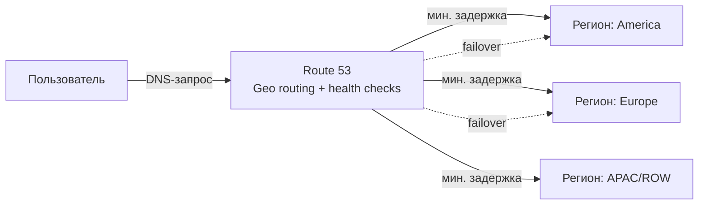
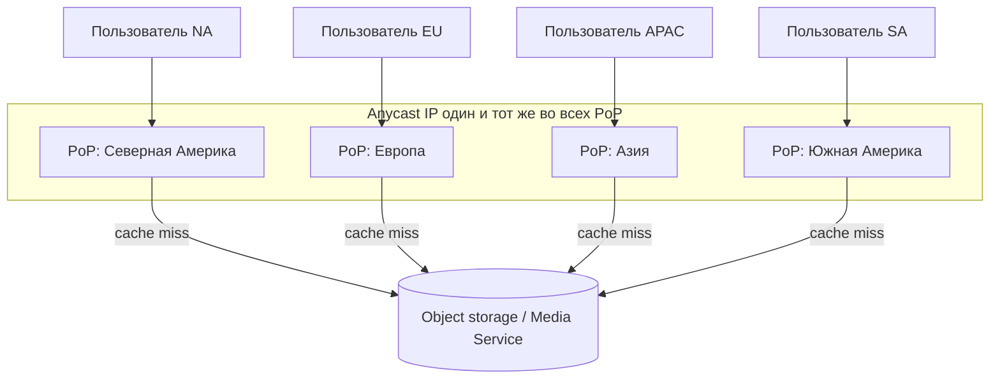
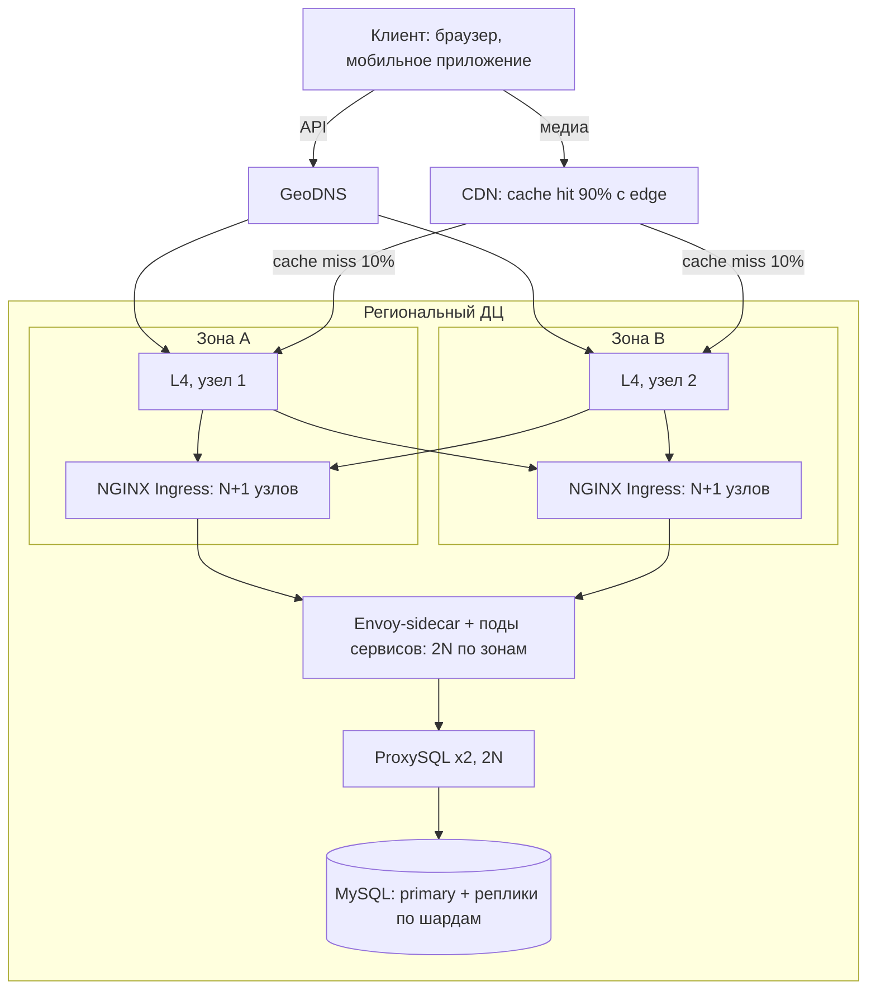

# Высоконагруженная платформа визуального поиска и сохранения идей Pinterest
### Курсовая работа по курсу «Проектирование высоконагруженных систем»

---

## 1. Тема и целевая аудитория

### Тема
Высоконагруженная платформа визуального поиска и сохранения идей (Pinterest). Ближайший аналог — Pinterest.

Pinterest представляет собой визуальную поисковую платформу, которая позволяет пользователям искать, организовывать и сохранять идеи в различных тематических областях. Сервис сочетает в себе функции социальной сети, визуального поиска и системы закладок. Пользователи создают доски, на которых сохраняют пины — изображения, видео или ссылки на внешние ресурсы.

### Целевая аудитория
Основная аудитория сервиса состоит из следующих групп:
- **Пользователи** — люди, которые ищут вдохновение, сохраняют идеи, создают доски и планируют различные активности;
- **Бизнес-пользователи и бренды** — компании, которые публикуют контент, продвигают продукты и взаимодействуют с аудиторией через рекламные инструменты.

По итогам IV квартала 2025 года глобальная MAU платформы достигла 619 млн (+12% г/г) [[1]](https://www.sec.gov/Archives/edgar/data/1506293/000150629326000019/q4-25xpressrelease.htm), по итогам II квартала 2026 года — 640 млн MAU (+11% г/г) [[4]](https://www.sec.gov/Archives/edgar/data/0001506293/000150629326000102/q2-26xpressrelease.htm).

География — глобальная. Q4'25: США и Канада — 105 млн MAU, Европа — 158 млн MAU, остальной мир — 356 млн MAU [[1]](https://www.sec.gov/Archives/edgar/data/1506293/000150629326000019/q4-25xpressrelease.htm), [[6]](https://sproutsocial.com/insights/pinterest-statistics/).

Портрет аудитории:
- Поколение зумеров стало крупнейшим поколенческим сегментом в 2025 году [[8]](https://www.sec.gov/Archives/edgar/data/1506293/000150629325000195/q2-25xpressrelease.htm);
- Основная выручка и монетизация — США и Канада [[1]](https://www.sec.gov/Archives/edgar/data/1506293/000150629326000019/q4-25xpressrelease.htm).

### Функционал MVP
1. Регистрация и авторизация пользователей;
2. Создание, редактирование и удаление пинов;
3. Создание и управление досками;
4. Сохранение пина на доску;
5. Визуальный и текстовый поиск;
6. Просмотр ленты рекомендаций;
7. Лайк пинов.

### Ключевые продуктовые решения
- Визуальная поисковая платформа, а не социальная сеть;
- Контент организован по доскам и пинам;
- Персонализация на основе сохранений и поведения;
- Визуальный поиск по загруженному изображению;
- Мобильный приоритет.

---

## 2. Расчёт нагрузки

### 2.1 Динамика аудитории [[1]](https://www.sec.gov/Archives/edgar/data/1506293/000150629326000019/q4-25xpressrelease.htm), [[2]](https://www.fool.com/earnings/call-transcripts/2026/02/12/pinterest-pins-q4-2025-earnings-call-transcript/Pinterest), [[3]](https://www.sec.gov/Archives/edgar/data/1506293/000150629326000060/finalars030826.htm), [[4]](https://www.sec.gov/Archives/edgar/data/0001506293/000150629326000102/q2-26xpressrelease.htm), [[5]](https://www.sec.gov/Archives/edgar/data/0001506293/000150629326000066/q1-26xpressrelease.htm):

| Квартал | MAU, млн | Рост г/г |
|---|---|---|
| Q4'24 | 553 | +11% |
| Q1'25 | 570 | +10% |
| Q2'25 | 578 | +11% |
| Q3'25 | 600 | +12% |
| Q4'25 | 619 | +12% |
| Q1'26 | 631 | +11% |
| Q2'26 | 640 | +11% |

Среднеквартальный темп роста ≈ 2,5% за квартал = 11% годовых. Прогноз на 2 года: 640 × 1,11² ≈ **789 млн MAU**, запас 20–25%.

**Дневная аудитория (DAU).** WAU/MAU = 62% [[3]](https://www.sec.gov/Archives/edgar/data/1506293/000150629326000060/finalars030826.htm) → WAU = 397 млн. DAU/MAU = 25% (допущение на основе мобильной аналитики [[9]](https://www.blog.udonis.co/mobile-marketing/mobile-apps/pinterest)) → **DAU = 160 млн**.

### 2.2 Продуктовые метрики

| Метрика | Значение |
|---|---|
| MAU | 640 млн |
| WAU | 397 млн |
| DAU | 160 млн |
| Всего пинов | 300 млрд |
| Пинов на пользователя | 468,75 шт. |
| Изображения (96%) | 450 шт. — 0,225 Гб |
| Видео (4%) | 18,75 шт. — 0,469 Гб |
| Итого объём на пользователя | 0,69 Гб |
| Досок на платформе | 6 млрд |
| Поисков в месяц | 80 млрд |
| Поисков на DAU в день | 17 |
| Сохранений в неделю | 1,5 млрд |
| Сохранений на DAU в день | 1,3 |
| Лайков на DAU в день | 10–20 |
| Создание пина на DAU в день | 0,05–0,1 |
| Просмотров пина на DAU в день | 200 |
| Внешних кликов в месяц | 1,7 млрд |

### 2.3 Технические метрики

#### Размер хранения [[11]](https://aws.amazon.com/solutions/case-studies/pinterest-proserve)

| Тип данных | Кол-во | Средний размер | Общий объём |
|---|---|---|---|
| Изображения (96%) | 288 млрд | 500 Кб | **144 ПБ** |
| Видео (4%) | 12 млрд | 25 Мб | **300 ПБ** |
| **Итого** | 300 млрд | — | **444 ПБ** |

#### Сетевой трафик

160 млн × 200 × 150 Кб = **4,8 ПБ/сутки**. Пик: 444 Гбит/с средний → **1150–1200 Гбит/с** вечерний пик.

#### RPS

| Тип запроса | Средний RPS | Пиковый RPS |
|---|---:|---:|
| Поиск | 30 900 | 93 000 |
| Лента | 18 500 | 55 000 |
| Показ пина | 370 000 | 1 100 000 |
| Сохранение | 2 500 | 7 500 |
| Лайк | 27 800 | 83 000 |
| Создание пина | 140 | 420 |
| Создание доски | 14 | 42 |
| Аутентификация | 2 200 | 6 600 |

---

## 3. Глобальная балансировка нагрузки

### 3.1 Функциональное разбиение по доменам

| Домен | Зона ответственности | Профиль |
|---|---|---|
| Identity/Auth | регистрация, сессии | низкий RPS |
| Pin Service | CRUD пинов | средний RPS |
| Board Service | CRUD досок | очень низкий RPS |
| Media/Storage | хранение, транскодирование | огромный объём |
| Search & Visual Search | поиск, ML-инференс | высокий RPS + CPU |
| Feed/Recommendation | лента | самый высокий RPS |
| Interaction/Graph | лайки, сохранения | средний RPS |
| Ads/Monetization | реклама | вне MVP |

### 3.2 Обоснование расположения ДЦ

Pinterest на AWS с 2010 года, долгосрочное соглашение с 2017, расширено до $4 млрд до 2031 [[12]](ttps://w.media/pinterest-and-aws-sign-us-4-billion-dollar-cloud-service-deal-for-ai-expansion/), [[13]](https://www.sec.gov/Archives/edgar/data/1506293/000150629320000013/pins-20191231.htm). Мульти-CDN: Akamai, CloudFront, Fastly, Cloudflare [[14]](https://www.netify.ai/resources/applications/pinterest).

Модель размещения:
- **Compute + горячее хранилище + БД** — три региона (NA 17%, EU 25,5%, ROW 57,5%);
- **Холодное хранилище** — централизовано в 1–2 макрорегионах;
- **CDN PoP (anycast)** — везде.

### 3.3 Распределение запросов по типам между ДЦ

| Тип запроса | Всего | US&Canada | Европа | ROW |
|---|---:|---:|---:|---:|
| Поиск | 30 900 | 5 253 | 7 880 | 17 768 |
| Показ пина | 370 000 | 62 900 | 94 350 | 212 750 |
| Лента | 18 500 | 3 145 | 4 718 | 10 638 |
| Сохранение | 2 500 | 425 | 638 | 1 438 |
| Лайк | 27 800 | 4 726 | 7 089 | 15 985 |
| Создание | 140 | 24 | 36 | 81 |

### 3.4 Схема DNS-балансировки

### 3.5 Схема Anycast-балансировки

### 3.6 Механизм регулировки трафика между ДЦ

1. Weighted routing (Route 53/Global Accelerator);
2. Health-check + circuit breaker;
3. Локальность данных с асинхронной кросс-региональной репликацией.

---

## 4. Локальная балансировка нагрузки

### 4.1. Схема балансировки нагрузки и механизмы резервирования

#### 4.1.1. Уровни балансировки внутри ДЦ

Внутри ДЦ трафик проходит четыре уровня балансировки. ДЦ делится на две зоны доступности (A и B) — группы стоек с независимым питанием и сетью, они служат доменами отказа.

Выбранные решения:
- **Медиа** (96% пинов - изображения) почти целиком обслуживает CDN;
- **Envoy-sidecar** нужен, потому что HTTP/2 держит одно соединение;
- **СУБД:** MySQL с шардированием [[10]](https://medium.com/pinterest-engineering/sharding-pinterest-how-we-scaled-our-mysql-fleet-3f341e96ca6f);
- **L4** в AWS - управляемый NLB, моделируется как пара независимых узлов;

#### 4.1.2. Алгоритмы балансировки на каждом уровне

| Участок | Алгоритм | Причина выбора | Резервирование |
| --- | --- | --- | --- |
| Маршрутизаторы - L4 | ECMP по хешу потока | равномерно, поток не рвётся [[17]](https://research.google/pubs/pub44824/) | оба L4 активны, при отказе — перераспределение |
| NGINX | consistent hashing + DSR | соединение на своём узле | health-check исключает недоступный |
| сервис | random two least_conn [[18]](https://nginx.org/en/docs/http/ngx_http_upstream_module.html) | учитывает активные соединения | readiness-проба, graceful drain |
| Envoy - реплика | least request | HTTP/2 - одно соединение, балансируем запросы | outlier detection, повтор идемпотентных |
| ProxySQL - MySQL | read в реплику, write в primary | у шарда один primary | при отказе primary - реплика повышается |

#### 4.1.3. Формулы резервирования

| Формула | Что означает | От чего защищает |
| --- | --- | --- |
| **N+1** | N узлов под пик + 1 запасной | Отказ **одного** узла |
| **N*2** | Два независимых комплекта, каждый держит весь пик (active-active) | Отказ **целой зоны** |
| **2(N+1)** | В каждой из двух зон по N+1 узлов; каждая зона в одиночку держит весь пик | Комбинация: отказ узла **и** зоны |

**Применение по уровням:**
- **L4** - N×2;
- **L7** - 2(N+1);
- **Envoy** - реплики сервиса 2N по зонам;
- **ProxySQL** - N*2;

---

### 4.2. Расчёт количества балансировщиков

#### 4.2.1. Ограничители и опорные характеристики узла

Расчёт ведётся по двум ограничителям:
1. **SSL Termination** - количество новых TLS-соединений в секунду;
2. **Пропускная способность сети** - исходящий трафик ДЦ в Гбит/с;

Базовый узел - NGINX Ingress Controller на 16 CPU, из теста [[15]](https://blog.nginx.org/blog/testing-performance-nginx-ingress-controller-kubernetes):

| Показатель (16 CPU) | Измерено | Предел с запасом 0,7 |
| --- | ---: | ---: |
| HTTPS RPS, ответ 1 КБ | 341 232 | 238 862 |
| SSL TPS (HT выкл) | 54 877 | **38 414** |
| Пропускная способность | 8,80 Гбит/с | **6,16 Гбит/с** |

**Поправка на размер ответа:** 238 862 * 0,556 = **132 800 RPS на узел**.

**Сравнение источников:** тест 2017 [[16]](https://blog.nginx.org/blog/testing-the-performance-of-nginx-and-nginx-plus-web-servers) даёт 6 676 TLS/с - в 8,2 раза меньше, чем 54 877 в тесте 2019. Используем более свежий, старый - как пессимистичная проверка.

#### 4.2.2. Нагрузка на балансировщики одного ДЦ

- **API-запросы:** 93 000 + 55 000 + 7 500 + 83 000 + 420 + 42 + 6 600 = **245 562 RPS**;
- **Промахи кэша CDN:** 1 100 000 * 10% = **110 000 RPS**.

Исходящий трафик ДЦ:

| Класс | Расчёт | Гбит/с |
| --- | --- | ---: |
| Промахи кэша | 1200 * 10% | 120,00 |
| Поиск | 30 900 * 7 КБ * 8 * 3 | 5,19 |
| Лента | 18 500 * 20 КБ * 8 * 3 | 8,88 |
| Прочий API | 32 654 * 1 КБ * 8 * 3 | 0,78 |
| **Итого** | | **134,85** |

| Регион | Доля | API RPS | Промахи | Трафик, Гбит/с |
| --- | ---: | ---: | ---: | ---: |
| US&Canada | 17% | 41 746 | 18 700 | 22,93 |
| Европа | 25,5% | 62 618 | 28 050 | 34,39 |
| ROW | 57,5% | 141 198 | 63 250 | 77,54 |
| **Всего** | 100% | 245 562 | 110 000 | 134,85 |

#### 4.2.3. Расчёт по ограничителям SSL Termination и сети

- N_RPS = ⌈ API_RPS / 132 800 ⌉

- N_TLS = ⌈ новых TLS-соединений / 38 414 ⌉

- N_net = ⌈ исходящий трафик ДЦ / 6,16 ⌉

- N = max(N_RPS, N_TLS, N_net)

- L7 = 2 * (N + 1)

- L4 = 2

| ДЦ | N_RPS | N_TLS штатный | N_TLS худший | N_net | **N** | N+1 | **2(N+1)** |
| --- | ---: | ---: | ---: | ---: | ---: | ---: | ---: |
| US&Canada | 1 | 1 | 2 | 4 | **4** | 5 | **10** |
| Европа | 1 | 1 | 2 | 6 | **6** | 7 | **14** |
| ROW | 2 | 1 | 4 | 13 | **13** | 14 | **28** |
| **Всего** | 4 | 3 | 8 | 23 | **23** | 26 | **52** |

#### 4.2.4. Проверка отказоустойчивости и запас на рост

| Состояние | US&Canada | Европа | ROW |
| --- | ---: | ---: | ---: |
| Штатно | 26% | 28% | 31% |
| Отказ зоны | 52% | 56% | 63% |
| Отказ зоны + узла | 65% | 65% | 68% |

Во всех состояниях загрузка <70%, так как формула 2(N+1) выдерживает потерю зоны и ещё одного узла

**Итог:**

| Компонент | US&Canada | Европа | ROW | Итого |
| --- | ---: | ---: | ---: | ---: |
| L4 (N*2) | 2 | 2 | 2 | **6** |
| NGINX рабочих N | 4 | 6 | 13 | 23 |
| NGINX с 2(N+1) | 10 | 14 | 28 | **52** |

---

## Список источников

[[1]](https://www.sec.gov/Archives/edgar/data/1506293/000150629326000019/q4-25xpressrelease.htm) Pinterest, Inc. *Pinterest Announces Fourth Quarter and Full Year 2025 Results*

[[2]](https://www.fool.com/earnings/call-transcripts/2026/02/12/pinterest-pins-q4-2025-earnings-call-transcript/Pinterest) Pinterest, Inc. Q4 2025 Earnings Call Transcript, 12.02.2026

[[3]](https://www.sec.gov/Archives/edgar/data/1506293/000150629326000060/finalars030826.htm) Pinterest, Inc. Form 10-K / ARS за 2025 финансовый год

[[4]](https://www.sec.gov/Archives/edgar/data/0001506293/000150629326000102/q2-26xpressrelease.htm) Pinterest, Inc. *Q2 2026 Results* — 640 млн MAU, +11% г/г

[[5]](https://www.sec.gov/Archives/edgar/data/0001506293/000150629326000066/q1-26xpressrelease.htm) Pinterest, Inc. *Q1 2026 Results* — 631 млн MAU

[[6]](https://sproutsocial.com/insights/pinterest-statistics/) Sprout Social. *29 Essential Pinterest statistics for marketers in 2026*

[[7]](https://medium.com/pinterest-engineering) Pinterest Engineering Blog — «300 billion ideas and counting»

[[8]](https://www.sec.gov/Archives/edgar/data/1506293/000150629325000195/q2-25xpressrelease.htm) Pinterest, Inc. Q2 2025 Earnings press release

[[9]](https://www.blog.udonis.co/mobile-marketing/mobile-apps/pinterest) Udonis Blog. *Pinterest Statistics [2026]*

[[10]](https://medium.com/pinterest-engineering/sharding-pinterest-how-we-scaled-our-mysql-fleet-3f341e96ca6f) Pinterest Engineering Blog. *Sharding Pinterest: How we scaled our MySQL fleet*, 2017

[[11]](https://aws.amazon.com/solutions/case-studies/pinterest-proserve) AWS. *How Pinterest Engaged with AWS ProServe*

[[12]](ttps://w.media/pinterest-and-aws-sign-us-4-billion-dollar-cloud-service-deal-for-ai-expansion/) W.Media. *Pinterest and AWS sign US$4 billion deal*, 08.06.2026

[[13]](https://www.sec.gov/Archives/edgar/data/1506293/000150629320000013/pins-20191231.htm) Pinterest, Inc. Form 10-K за 2019 финансовый год

[[14]](https://www.netify.ai/resources/applications/pinterest) Netify.ai. Технический профиль инфраструктуры Pinterest

[[15]](https://blog.nginx.org/blog/testing-performance-nginx-ingress-controller-kubernetes) NGINX Community Blog. *Testing the Performance of NGINX Ingress Controller for Kubernetes*, 11.04.2019

[[16]](https://blog.nginx.org/blog/testing-the-performance-of-nginx-and-nginx-plus-web-servers) NGINX Community Blog. *Testing the Performance of NGINX and NGINX Plus Web Servers*, 24.08.2017

[[17]](https://research.google/pubs/pub44824/) Eisenbud D. E. et al. *Maglev: A Fast and Reliable Software Network Load Balancer*. NSDI 16, 2016

[[18]](https://nginx.org/en/docs/http/ngx_http_upstream_module.html) NGINX. *Module ngx_http_upstream_module*

[[19]](https://www.verdict.co.uk/?p=401753) Verdict. Материал о соглашении Pinterest и AWS на 4 млрд USD