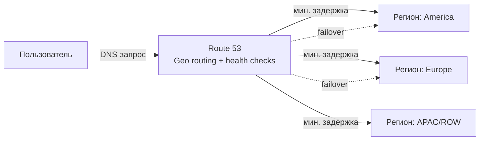
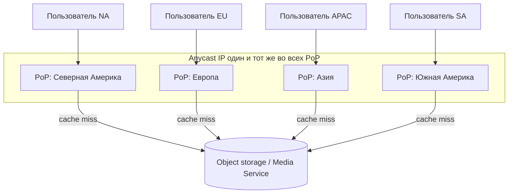
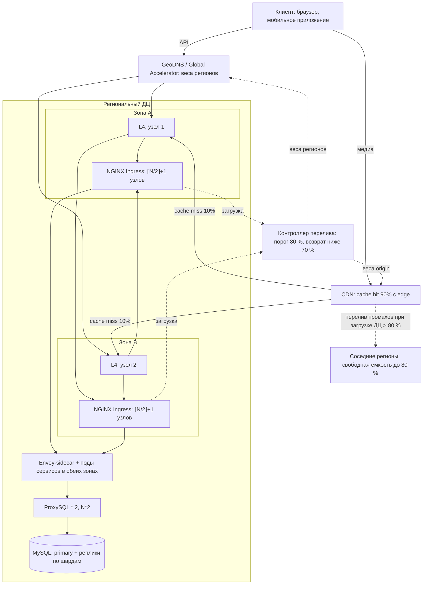
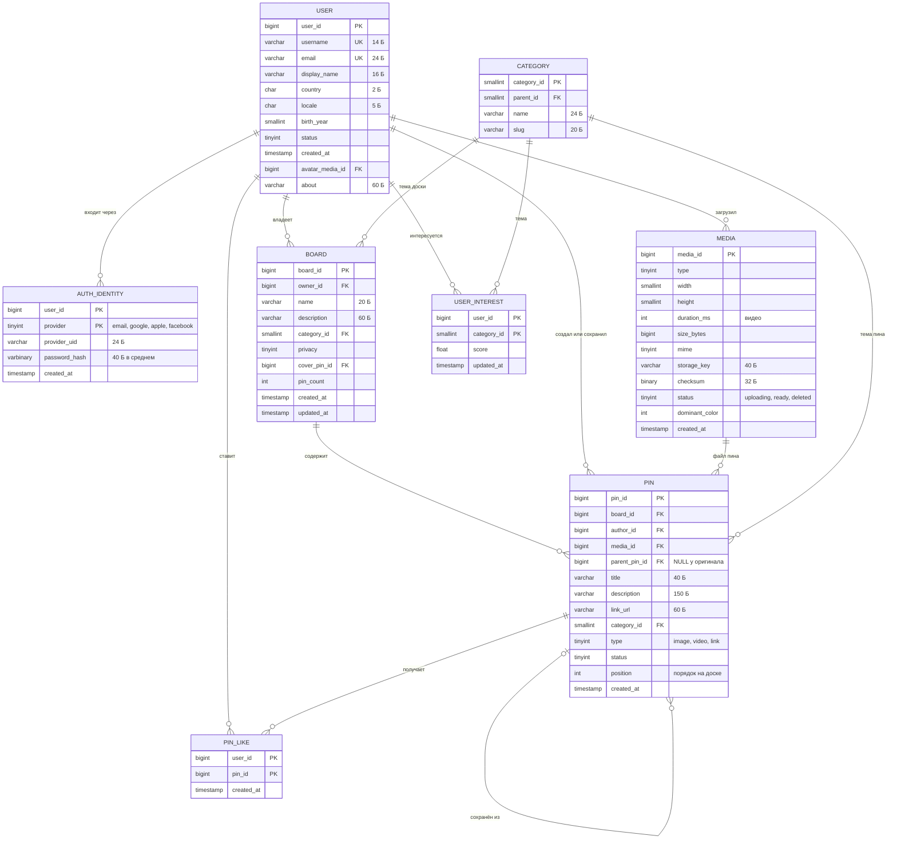
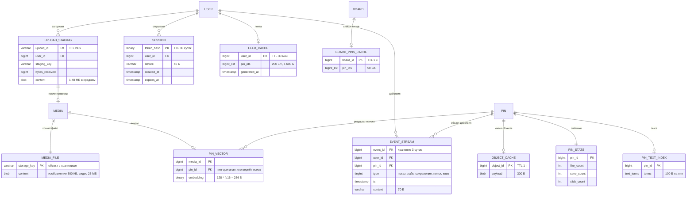
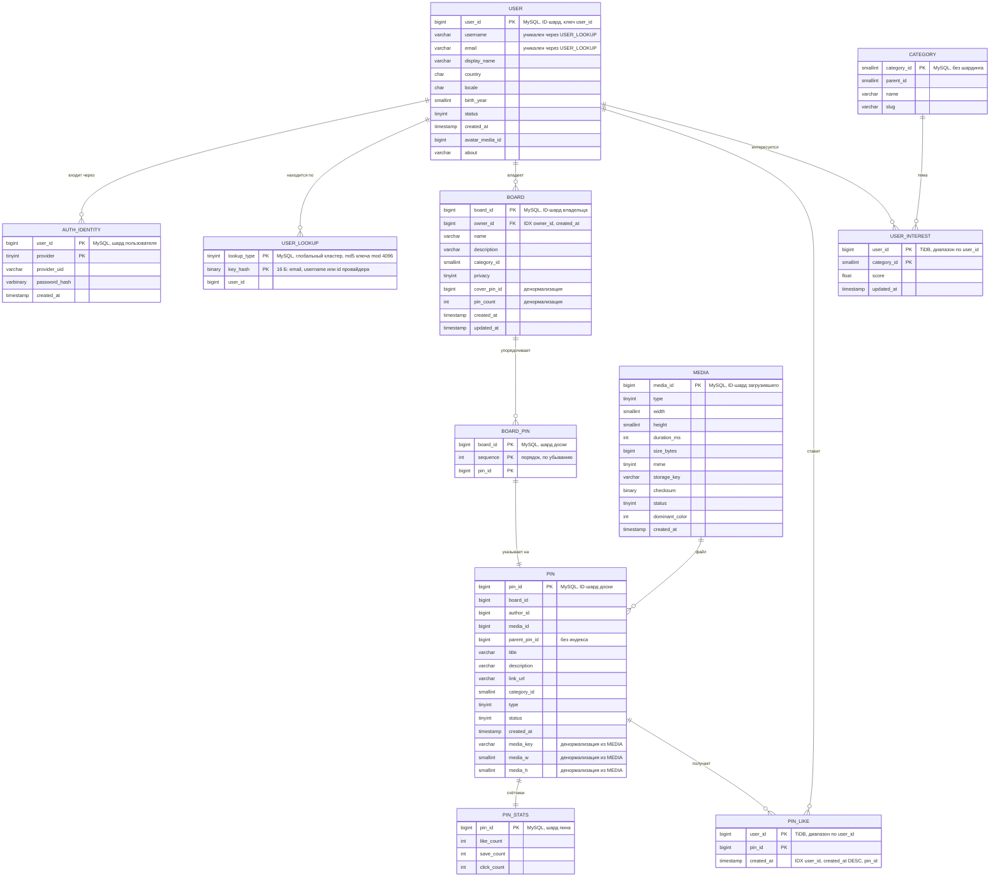
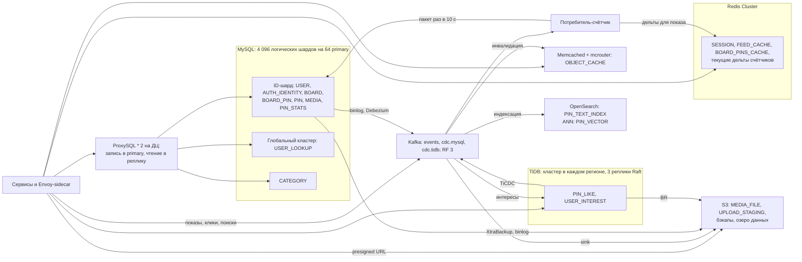

# Высоконагруженная платформа визуального поиска и сохранения идей Pinterest
### Курсовая работа по курсу «Проектирование высоконагруженных систем»

---

## 1. Тема и целевая аудитория

### Тема
Высоконагруженная платформа визуального поиска и сохранения идей (Pinterest). Ближайший аналог - Pinterest.

Pinterest представляет собой визуальную поисковую платформу, которая позволяет пользователям искать, организовывать и сохранять идеи в различных тематических областях. Сервис сочетает в себе функции социальной сети, визуального поиска и системы закладок. Пользователи создают доски, на которых сохраняют пины - изображения, видео или ссылки на внешние ресурсы.

### Целевая аудитория
Основная аудитория сервиса состоит из следующих групп:
- **Пользователи** - люди, которые ищут вдохновение, сохраняют идеи, создают доски и планируют различные активности;
- **Бизнес-пользователи и бренды** - компании, которые публикуют контент, продвигают продукты и взаимодействуют с аудиторией через рекламные инструменты.

По итогам IV квартала 2025 года глобальная MAU платформы достигла 619 млн (+12% г/г) [[1]](https://www.sec.gov/Archives/edgar/data/1506293/000150629326000019/q4-25xpressrelease.htm), по итогам II квартала 2026 года - 640 млн MAU (+11% г/г) [[4]](https://www.sec.gov/Archives/edgar/data/0001506293/000150629326000102/q2-26xpressrelease.htm).

География - глобальная. Q4'25: США и Канада - 105 млн MAU, Европа - 158 млн MAU, остальной мир - 356 млн MAU [[1]](https://www.sec.gov/Archives/edgar/data/1506293/000150629326000019/q4-25xpressrelease.htm), [[6]](https://sproutsocial.com/insights/pinterest-statistics/).

Портрет аудитории:
- Поколение зумеров стало крупнейшим поколенческим сегментом в 2025 году [[8]](https://www.sec.gov/Archives/edgar/data/1506293/000150629325000195/q2-25xpressrelease.htm);
- Основная выручка и монетизация - США и Канада [[1]](https://www.sec.gov/Archives/edgar/data/1506293/000150629326000019/q4-25xpressrelease.htm).

### Функционал MVP
1. Регистрация и авторизация пользователей;
2. Создание, редактирование и удаление пинов;
3. Создание и управление досками;
4. Сохранение пина на доску;
5. Визуальный и текстовый поиск;
6. Просмотр ленты рекомендаций;
7. Лайк пинов.

### Ключевые продуктовые решения
- Визуальная поисковая платформа, а не социальная сеть;
- Контент организован по доскам и пинам;
- Персонализация на основе сохранений и поведения;
- Визуальный поиск по загруженному изображению;
- Мобильный приоритет.

---

## 2. Расчёт нагрузки

### 2.1 Динамика аудитории [[1]](https://www.sec.gov/Archives/edgar/data/1506293/000150629326000019/q4-25xpressrelease.htm), [[2]](https://www.fool.com/earnings/call-transcripts/2026/02/12/pinterest-pins-q4-2025-earnings-call-transcript/), [[3]](https://www.sec.gov/Archives/edgar/data/1506293/000150629326000060/finalars030826.htm), [[4]](https://www.sec.gov/Archives/edgar/data/0001506293/000150629326000102/q2-26xpressrelease.htm), [[5]](https://www.sec.gov/Archives/edgar/data/0001506293/000150629326000066/q1-26xpressrelease.htm):

| Квартал | MAU, млн | Рост г/г |
|---|---|---|
| Q4'24 | 553 | +11% |
| Q1'25 | 570 | +10% |
| Q2'25 | 578 | +11% |
| Q3'25 | 600 | +12% |
| Q4'25 | 619 | +12% |
| Q1'26 | 631 | +11% |
| Q2'26 | 640 | +11% |

Среднеквартальный темп роста ≈ 2,5% за квартал = 11% годовых. Прогноз на 2 года: 640 * 1,11² ≈ **789 млн MAU**, запас 20-25%.

**Дневная аудитория (DAU).** WAU/MAU = 62% [[3]](https://www.sec.gov/Archives/edgar/data/1506293/000150629326000060/finalars030826.htm) → WAU = 397 млн. DAU/MAU = 25% (по данным мобильной аналитики [[9]](https://www.blog.udonis.co/mobile-marketing/mobile-apps/pinterest)) → **DAU = 160 млн**.

### 2.2 Продуктовые метрики

| Метрика | Значение |
|---|---|
| MAU | 640 млн |
| WAU | 397 млн |
| DAU | 160 млн |
| Всего пинов | 300 млрд |
| Пинов на пользователя | 468,75 шт. |
| Изображения (96%) | 450 шт. - 0,225 Гб |
| Видео (4%) | 18,75 шт. - 0,469 Гб |
| Итого объём на пользователя | 0,69 Гб |
| Досок на платформе | 6 млрд |
| Поисков в месяц | 80 млрд |
| Поисков на DAU в день | 17 |
| Сохранений в неделю | 1,5 млрд |
| Сохранений на DAU в день | 1,3 |
| Лайков на DAU в день | 10-20 |
| Создание пина на DAU в день | 0,05-0,1 |
| Просмотров пина на DAU в день | 200 |
| Внешних кликов в месяц | 1,7 млрд |

### 2.3 Технические метрики

#### Размер хранения [[11]](https://aws.amazon.com/solutions/case-studies/pinterest-proserve)

| Тип данных | Кол-во | Средний размер | Общий объём |
|---|---|---|---|
| Изображения (96%) | 288 млрд | 500 Кб | **144 ПБ** |
| Видео (4%) | 12 млрд | 25 Мб | **300 ПБ** |
| **Итого** | 300 млрд | - | **444 ПБ** |

#### Сетевой трафик

160 млн * 200 * 150 Кб = **4,8 ПБ/сутки**. Пик: 444 Гбит/с средний → **1150-1200 Гбит/с** вечерний пик.

#### RPS

| Тип запроса | Средний RPS | Пиковый RPS |
|---|---:|---:|
| Поиск | 30 900 | 93 000 |
| Лента | 18 500 | 55 000 |
| Показ пина | 370 000 | 1 100 000 |
| Сохранение | 2 500 | 7 500 |
| Лайк | 27 800 | 83 000 |
| Создание пина | 140 | 420 |
| Создание доски | 14 | 42 |
| Аутентификация | 2 200 | 6 600 |

---

## 3. Глобальная балансировка нагрузки

### 3.1 Функциональное разбиение по доменам

| Домен | Зона ответственности | Профиль |
|---|---|---|
| Identity/Auth | регистрация, сессии | низкий RPS |
| Pin Service | CRUD пинов | средний RPS |
| Board Service | CRUD досок | очень низкий RPS |
| Media/Storage | хранение, транскодирование | огромный объём |
| Search & Visual Search | поиск, ML-инференс | высокий RPS + CPU |
| Feed/Recommendation | лента | самый высокий RPS |
| Interaction/Graph | лайки, сохранения | средний RPS |
| Ads/Monetization | реклама | вне MVP |

### 3.2 Обоснование расположения ДЦ

Pinterest на AWS с 2010 года, долгосрочное соглашение с 2017, расширено до $4 млрд до 2031 [[12]](https://w.media/pinterest-and-aws-sign-us-4-billion-dollar-cloud-service-deal-for-ai-expansion/), [[13]](https://www.sec.gov/Archives/edgar/data/1506293/000150629320000013/pins-20191231.htm). Мульти-CDN: Akamai, CloudFront, Fastly, Cloudflare [[14]](https://www.netify.ai/resources/applications/pinterest).

Модель размещения:
- **Compute + горячее хранилище + БД** - три региона (NA 17%, EU 25,5%, ROW 57,5%);
- **Холодное хранилище** - централизовано в 1-2 макрорегионах;
- **CDN PoP (anycast)** - везде.

### 3.3 Распределение запросов по типам между ДЦ

| Тип запроса | Всего | US&Canada | Европа | ROW |
|---|---:|---:|---:|---:|
| Поиск | 30 900 | 5 253 | 7 880 | 17 768 |
| Показ пина | 370 000 | 62 900 | 94 350 | 212 750 |
| Лента | 18 500 | 3 145 | 4 718 | 10 638 |
| Сохранение | 2 500 | 425 | 638 | 1 438 |
| Лайк | 27 800 | 4 726 | 7 089 | 15 985 |
| Создание | 140 | 24 | 36 | 81 |

### 3.4 Схема DNS-балансировки



### 3.5 Схема Anycast-балансировки



### 3.6 Механизм регулировки трафика между ДЦ

1. Weighted routing (Route 53/Global Accelerator) с переливом по порогу: при загрузке ДЦ от 80 % избыток уходит в регионы со свободной ёмкостью, возврат ниже 70 % (п. 4.1.3, 4.2.4);
2. Health-check + circuit breaker;
3. Локальность данных с асинхронной кросс-региональной репликацией.

---

## 4. Локальная балансировка нагрузки

### 4.1. Схема балансировки нагрузки и механизмы резервирования

#### 4.1.1. Уровни балансировки внутри ДЦ

Внутри ДЦ трафик проходит четыре уровня балансировки. ДЦ делится на две зоны доступности (A и B) - группы стоек с независимым питанием и сетью, они служат доменами отказа.

Резервирование построено по модели **перелива нагрузки (spillover)**: зона не держит запас на всю нагрузку соседней зоны. Каждая зона рассчитана на свою половину нагрузки ДЦ и один запасной узел. Когда загрузка зоны или ДЦ достигает порога **80 %**, избыток начинает распределяться в другую зону или в соседние регионы, у которых есть свободная ёмкость.



Выбранные решения:
- **Медиа** (96% пинов - изображения) почти целиком обслуживает CDN;
- **Envoy-sidecar** нужен, потому что HTTP/2 держит одно соединение;
- **СУБД:** MySQL с шардированием [[10]](https://medium.com/pinterest-engineering/sharding-pinterest-how-we-scaled-our-mysql-fleet-3f341e96ca6f);
- **L4** в AWS - управляемый NLB, моделируется как пара независимых узлов;
- **Перелив между регионами** выполняется для промахов CDN: это медиатрафик без состояния (120 из 134,85 Гбит/с), соседний регион отдаёт файл из S3 так же, как домашний. API остаётся в домашнем регионе, где лежат данные пользователя.

#### 4.1.2. Алгоритмы балансировки на каждом уровне

| Участок | Алгоритм | Причина выбора | Резервирование |
| --- | --- | --- | --- |
| Маршрутизаторы - L4 | ECMP по хешу потока | равномерно, поток не рвётся [[17]](https://research.google/pubs/pub44824/) | оба L4 активны, при отказе - перераспределение |
| NGINX | consistent hashing + DSR | соединение на своём узле | health-check исключает недоступный; запасной узел в каждой зоне |
| сервис | random two least_conn [[18]](https://nginx.org/en/docs/http/ngx_http_upstream_module.html) | учитывает активные соединения | readiness-проба, graceful drain |
| Envoy - реплика | least request + zone-aware routing | HTTP/2 - одно соединение, балансируем запросы; запрос остаётся в своей зоне | outlier detection, повтор идемпотентных; при падении доступной ёмкости зоны ниже 80 % (overprovisioning factor 1,25) избыток уходит во вторую зону [[33]](https://www.envoyproxy.io/docs/envoy/latest/intro/arch_overview/upstream/load_balancing/priority) |
| ProxySQL - MySQL | read в реплику, write в primary | у шарда один primary | при отказе primary - реплика повышается |
| ДЦ - соседние регионы | перелив по порогу: веса регионов в Global Accelerator (traffic dial) [[34]](https://docs.aws.amazon.com/global-accelerator/latest/dg/about-endpoint-groups-traffic-dial.html) и веса origin для CDN в Route 53 [[35]](https://docs.aws.amazon.com/Route53/latest/DeveloperGuide/routing-policy-weighted.html) | при загрузке ДЦ от 80 % избыток уходит в регионы со свободной ёмкостью пропорционально их запасу | регион с отказом зоны не перегружается; возврат трафика при загрузке ниже 70 % |

#### 4.1.3. Формулы резервирования

| Формула | Что означает | От чего защищает |
| --- | --- | --- |
| **N+1** | N узлов под пик + 1 запасной | Отказ **одного** узла |
| **N*2** | Два независимых комплекта, каждый держит весь пик (active-active) | Отказ **целой зоны** |
| **2 * (⌈N/2⌉ + 1) + перелив** | В каждой из двух зон половина рабочих узлов и 1 запасной; при отказе зоны оставшаяся работает до порога 80 %, избыток переливается в соседние регионы | Отказ **узла** - запасным узлом зоны; отказ **зоны** - общим запасом всех регионов |

**Применение по уровням:**
- **L4** - N*2 (N = 1, управляемый NLB);
- **L7 (NGINX)** - 2 * (⌈N/2⌉ + 1) + перелив;
- **Envoy** - поды поровну в двух зонах, zone-aware routing с переливом во вторую зону; HPA добавляет поды при загрузке CPU выше 80 %;
- **ProxySQL** - N*2: N = 1, путь к локальной БД нельзя перелить в другой регион, а удвоение стоит один узел.

**Порог и гистерезис перелива:**
- **рабочая точка - 70 %** производительности узла: по ней считается число рабочих узлов N;
- **порог перелива - 80 %**: выше него избыток уходит во вторую зону (Envoy) или в соседние регионы (веса Global Accelerator и origin CDN);
- **возврат - ниже 70 %**: разница 10 п.п. не даёт трафику «качаться» между регионами;
- **предел - 100 %** измеренной производительности: запас 20 % между порогом и пределом покрывает время реакции контроллера (десятки секунд).

**Почему перелив, а не 2(N+1).** В схеме 2(N+1) каждая зона держит весь пик ДЦ: в штатном режиме половина узлов простаивает, и при этом заранее неизвестно, сколько нагрузки придёт при отказе. При переливе резерв общий для всех регионов: регионы пикуют в разное время (часовые пояса), а одновременно отказывает не больше одной зоны. Свободной ёмкости трёх регионов до порога 80 % хватает, чтобы принять избыток одной зоны (проверка в п. 4.2.4). Узлов NGINX требуется 30 вместо 52.

---

### 4.2. Расчёт количества балансировщиков

#### 4.2.1. Ограничители и опорные характеристики узла

Расчёт ведётся по двум ограничителям:
1. **SSL Termination** - количество новых TLS-соединений в секунду;
2. **Пропускная способность сети** - исходящий трафик ДЦ в Гбит/с;


Базовый узел - NGINX Ingress Controller на 16 CPU, из теста [[15]](https://blog.nginx.org/blog/testing-performance-nginx-ingress-controller-kubernetes):

| Показатель (16 CPU) | Измерено | Рабочая точка 0,7 | Порог перелива 0,8 |
| --- | ---: | ---: | ---: |
| HTTPS RPS, ответ 1 КБ | 341 232 | 238 862 | 272 986 |
| SSL TPS (HT выкл) | 54 877 | **38 414** | 43 902 |
| Пропускная способность | 8,80 Гбит/с | **6,16 Гбит/с** | **7,04 Гбит/с** |

**Поправка на размер ответа:** 238 862 * 0,556 = **132 800 RPS на узел** (на пороге перелива 272 986 * 0,556 = 151 780 RPS).

**Сравнение источников:** тест 2017 [[16]](https://blog.nginx.org/blog/testing-the-performance-of-nginx-and-nginx-plus-web-servers) даёт 6 676 TLS/с - в 8,2 раза меньше, чем 54 877 в тесте 2019. Используем более свежий, старый - как пессимистичная проверка.

#### 4.2.2. Нагрузка на балансировщики одного ДЦ

- **API-запросы:** 93 000 + 55 000 + 7 500 + 83 000 + 420 + 42 + 6 600 = **245 562 RPS**;
- **Промахи кэша CDN:** 1 100 000 * 10% = **110 000 RPS**.

Исходящий трафик ДЦ:

| Класс | Расчёт | Гбит/с |
| --- | --- | ---: |
| Промахи кэша | 1200 * 10% | 120,00 |
| Поиск | 30 900 * 7 КБ * 8 * 3 | 5,19 |
| Лента | 18 500 * 20 КБ * 8 * 3 | 8,88 |
| Прочий API | 32 654 * 1 КБ * 8 * 3 | 0,78 |
| **Итого** | | **134,85** |

| Регион | Доля | API RPS | Промахи | Трафик, Гбит/с |
| --- | ---: | ---: | ---: | ---: |
| US&Canada | 17% | 41 746 | 18 700 | 22,93 |
| Европа | 25,5% | 62 618 | 28 050 | 34,39 |
| ROW | 57,5% | 141 198 | 63 250 | 77,54 |
| **Всего** | 100% | 245 562 | 110 000 | 134,85 |

#### 4.2.3. Расчёт по ограничителям SSL Termination и сети

- N_RPS = ⌈ API_RPS / 132 800 ⌉

- N_TLS = ⌈ новых TLS-соединений / 38 414 ⌉

- N_net = ⌈ исходящий трафик ДЦ / 6,16 ⌉

- N = max(N_RPS, N_TLS, N_net) - рабочих узлов ДЦ на рабочей точке 0,7

- n_zone = ⌈ N / 2 ⌉ + 1 - узлов в зоне: половина рабочих + запасной

- L7 = 2 * n_zone

- L4 = 2

| ДЦ | N_RPS | N_TLS штатный | N_TLS худший | N_net | **N** | ⌈N/2⌉+1 | **2 * (⌈N/2⌉+1)** |
| --- | ---: | ---: | ---: | ---: | ---: | ---: | ---: |
| US&Canada | 1 | 1 | 2 | 4 | **4** | 3 | **6** |
| Европа | 1 | 1 | 2 | 6 | **6** | 4 | **8** |
| ROW | 2 | 1 | 4 | 13 | **13** | 8 | **16** |
| **Всего** | 4 | 3 | 8 | 23 | **23** | 15 | **30** |


#### 4.2.4. Проверка отказоустойчивости и перелив нагрузки

Определяющий ограничитель - сеть, поэтому проверка ведётся в Гбит/с. Ёмкость на пороге = число узлов * 7,04 Гбит/с, загрузка - в процентах от измеренной производительности узла 8,80 Гбит/с.

| Показатель | US&Canada | Европа | ROW |
| --- | ---: | ---: | ---: |
| Трафик ДЦ, Гбит/с | 22,93 | 34,39 | 77,54 |
| Узлов NGINX | 6 | 8 | 16 |
| Ёмкость на пороге 80 %, Гбит/с | 42,24 | 56,32 | 112,64 |
| Свободно до порога, Гбит/с | 19,31 | 21,93 | 35,10 |

| Состояние | US&Canada | Европа | ROW |
| --- | ---: | ---: | ---: |
| Штатно | 43% | 49% | 55% |
| Отказ узла | 65% | 65% | 63% |
| Отказ зоны | 80%, перелив 1,81 Гбит/с | 80%, перелив 6,23 Гбит/с | 80%, перелив 21,22 Гбит/с |
| Отказ зоны + узла | 80%, перелив 8,85 Гбит/с | 80%, перелив 13,27 Гбит/с | 80%, перелив 28,26 Гбит/с |

«Отказ узла» - загрузка зоны, в которой отказал узел: её половина трафика ложится на оставшиеся узлы зоны, перелив не нужен. При отказе зоны оставшаяся зона работает на пороге 80 %, избыток уходит в соседние регионы пропорционально их свободной ёмкости.

```text
Отказ зоны ROW:
  оставшаяся зона:  8 * 7,04 = 56,32 Гбит/с на пороге
  перелив:          77,54 - 56,32 = 21,22 Гбит/с
  приёмники:        US&Canada 19,31 + Европа 21,93 = 41,24 Гбит/с свободно
  в US&Canada:      21,22 * 19,31 / 41,24 = 9,94  -> (22,93 + 9,94) / 52,8 = 62%
  в Европу:         21,22 * 21,93 / 41,24 = 11,28 -> (34,39 + 11,28) / 70,4 = 65%

Худший случай - отказ зоны и узла в ROW:
  оставшаяся зона:  7 * 7,04 = 49,28 Гбит/с
  перелив:          77,54 - 49,28 = 28,26 Гбит/с
  в US&Canada:      28,26 * 19,31 / 41,24 = 13,23 -> (22,93 + 13,23) / 52,8 = 68%
  в Европу:         28,26 * 21,93 / 41,24 = 15,03 -> (34,39 + 15,03) / 70,4 = 70%
```

Во всех состояниях узлы не превышают порог 80 %, регионы-приёмники остаются не выше 70 %, то есть ниже собственного порога перелива. Перелив состоит из промахов CDN: в ROW их 69 Гбит/с, в Европе 30,6, в US&Canada 20,4 - больше максимального перелива каждого региона (28,26 / 13,27 / 8,85), поэтому API всегда обслуживается в домашнем регионе. Переливаемый файл проходит межрегиональный путь (+100-150 мс) только при первом запросе к edge CDN, дальше он отдаётся из кеша. Одновременный отказ зон в двух регионах не рассматривается: это независимые события.

**Итог:**

| Компонент | US&Canada | Европа | ROW | Итого |
| --- | ---: | ---: | ---: | ---: |
| L4 (N*2) | 2 | 2 | 2 | **6** |
| NGINX рабочих N | 4 | 6 | 13 | 23 |
| NGINX 2 * (⌈N/2⌉+1) | 6 | 8 | 16 | **30** |

По сравнению со схемой 2(N+1) (52 узла) перелив требует на 22 узла (42 %) меньше при той же устойчивости к отказу узла и зоны.

---

## 5. Логическая схема БД


### 5.1 Логическая схема: основные данные

Объекты (пользователи, доски, пины, медиафайлы) создаются одновременно на многих узлах в трёх регионах. Поэтому единый глобальный автоинкремент не используется: общий счётчик - это точка синхронизации между регионами и единая точка отказа, а независимые счётчики на разных узлах без дополнительной информации дают пересекающиеся значения.

Для `user_id`, `board_id`, `pin_id`, `media_id` используется 64-битный идентификатор (`8 Б`), который:

- выдаётся на том узле, где создаётся объект, без обращения к центральной службе;
- уникален во всей системе;
- в два раза короче бинарного UUID (`16 Б`). Только в `PIN_LIKE` (2,63 трлн строк по два идентификатора) это экономит `2,63 трлн * 2 * 8 Б ≈ 42 ТБ`.



### 5.2 Логическая схема: файлы, кеши, буферы и производные данные




### 5.3 Потоки данных

Создание пина:

```text
клиент --(файл)--> UPLOAD_STAGING              загрузка напрямую в хранилище, минуя сервисы
                       ▼ проверка, превью, вектор
           MEDIA (status: uploading → ready) + MEDIA_FILE
                       ▼
           PIN (+ position на доске)            одна атомарная операция
                       ▼ событие изменения
           PIN_TEXT_INDEX, PIN_VECTOR,          асинхронно, секунды
           BOARD.pin_count
```

Сохранение чужого пина:

```text
PIN оригинала --> новый PIN: board_id      = доска сохраняющего
                             parent_pin_id = оригинал
                             media_id      = тот же файл
              --> событие save --> PIN_STATS.save_count оригинала, USER_INTEREST
```

Лайк:

```text
PIN_LIKE (user_id, pin_id)     источник истины; повторный лайк ничего не меняет
      ▼ событие like - только если строка действительно добавлена
EVENT_STREAM --> PIN_STATS.like_count   пакетом, с отставанием до минуты
             --> USER_INTEREST.score
```

Лента:

```text
USER_INTEREST + признаки из EVENT_STREAM --> ранжирование --> FEED_CACHE (200 pin_id, TTL 30 мин)
FEED_CACHE --> OBJECT_CACHE (пин, автор, доска) --> при промахе: PIN / USER / BOARD
```

Поиск:

```text
текст    --> PIN_TEXT_INDEX --> pin_id --> OBJECT_CACHE
картинка --> вектор (ML-модель) --> PIN_VECTOR: ближайшие соседи --> pin_id --> OBJECT_CACHE
```

Вход:

```text
email / username / id провайдера --> USER --> AUTH_IDENTITY (проверка пароля) --> SESSION (TTL 30 суток)
каждый API-запрос --> SESSION (проверка токена)
```

### 5.4 Описание сущностей

| Сущность | Вид | Назначение |
| --- | --- | --- |
| `USER` | основные | учётная запись пользователя |
| `AUTH_IDENTITY` | основные | способы входа: пароль или внешний провайдер (Google, Apple, Facebook) |
| `BOARD` | основные | доска пользователя |
| `PIN` | основные | пин: оригинал или сохранённая копия |
| `MEDIA` | основные | метаданные медиафайла: тип, размеры, ключ в хранилище |
| `PIN_LIKE` | основные | лайк пользователя на пине |
| `USER_INTEREST` | основные | веса интересов пользователя по темам |
| `CATEGORY` | справочник | дерево тематик |
| `MEDIA_FILE` | файлы | сам файл изображения или видео |
| `UPLOAD_STAGING` | файлы, буфер | загруженный, но ещё не проверенный файл |
| `SESSION` | временное состояние | сессия авторизованного клиента |
| `FEED_CACHE` | кеш | готовая ранжированная лента пользователя |
| `BOARD_PINS_CACHE` | кеш | первая страница пинов доски |
| `OBJECT_CACHE` | кеш | сериализованные пины, доски, пользователи |
| `EVENT_STREAM` | буфер | поток действий пользователей для счётчиков, интересов и обучения моделей |
| `PIN_STATS` | производные | счётчики лайков, сохранений, кликов |
| `PIN_TEXT_INDEX` | производные | текстовый поисковый индекс |
| `PIN_VECTOR` | производные | вектор изображения для визуального поиска |

### 5.5 Размеры данных

Объём = число строк * размер строки.

| Сущность | Вид | Строк | Строка, Б | Объём |
| --- | --- | --- | --- | --- |
| USER | основные | 640 млн - принято равным MAU | 144 | 92 ГБ |
| AUTH_IDENTITY | основные | 768 млн = 640 млн * 1,2 | 77 | 59 ГБ |
| BOARD | основные | 6 млрд - оценка из п. 2.2 | 119 | 714 ГБ |
| PIN | основные | 300 млрд [[7]](https://medium.com/pinterest-engineering) | 302 | 90,6 ТБ |
| MEDIA | основные | 300 млрд - верхняя оценка, как в п. 2.3: у каждого пина свой файл | 107 | 32,1 ТБ |
| PIN_LIKE | основные | 2,63 трлн = 2,4 млрд лайков в сутки * 365 * 3 года | 20 | 52,6 ТБ |
| USER_INTEREST | основные | 12,8 млрд = 640 млн * 20 тем | 18 | 230 ГБ |
| CATEGORY | справочник | около 10 000 | 48 | < 1 МБ |
| MEDIA_FILE | файлы | 288 млрд + 12 млрд | 500 КБ / 25 МБ | **444 ПБ** (п. 2.3) |
| UPLOAD_STAGING | файлы, TTL 24 ч | 12,1 млн = 140/с * 86 400 с | 1,48 МБ | 17,9 ТБ |
| SESSION | состояние, TTL 30 суток | 768 млн = 640 млн * 1,2 | 96 | 74 ГБ |
| FEED_CACHE | кеш, TTL 30 мин | 16 млн = 10 % DAU в пике | 1 640 | 26 ГБ |
| BOARD_PINS_CACHE | кеш, TTL 1 ч | 120 млн = 2 % досок | 500 | 60 ГБ |
| OBJECT_CACHE | кеш, TTL 1 ч | 3 млрд = 1 % пинов | 300 | 0,9 ТБ |
| EVENT_STREAM | буфер, 3 суток | 117 млрд = 450 700/с * 86 400 с * 3 | 100 | 11,7 ТБ |
| PIN_STATS | производные | 300 млрд | 20 | 6,0 ТБ |
| PIN_TEXT_INDEX | производные | 300 млрд | 100 | 30 ТБ |
| PIN_VECTOR | производные | 300 млрд - верхняя оценка | 272 | 81,6 ТБ |
| **Итого** | | | | **≈ 307 ТБ** |


### 5.6 Нагрузка на чтение и запись

Пиковый QPS = средний * 3

**QPS (средний / пиковый)**

| Сущность | Чтение | Запись | Расчёт |
| --- | --- | --- | --- |
| USER | 22 550 / 67 650 | 10 / 30 | автор на карточке пина 18 500 + профили 1 850 + вход 2 200; регистрации около 4 |
| AUTH_IDENTITY | 2 200 / 6 600 | 5 / 15 | вход |
| BOARD | 8 050 / 24 150 | 14 / 42 | открытия досок 5 550 (3 на DAU в день) + диалог «сохранить» 2 500 |
| PIN, по id | 370 000 / 1 100 000 | 2 650 / 7 950 | метаданные каждого показа; сохранения 2 500 + создания 140 + правки 10 |
| PIN, список доски | 5 550 / 16 650 | - | открытие доски |
| MEDIA | 370 000 / 1 100 000 | 140 / 420 | чтение при каждом показе (без денормализации) |
| PIN_LIKE | 18 500 / 55 500 | 27 800 / 83 000 | «лайкнут ли» при открытии пина (5 % показов) |
| USER_INTEREST | 32 750 / 98 250 | 30 300 / 90 900 | чтение: поиск 30 900 + лента 1 850; запись до объединения |
| CATEGORY | - | < 1 | копия в памяти сервисов |
| PIN_STATS | 18 500 / 55 500 | 31 000 / 93 000 | запись: лайки + сохранения + клики до объединения |
| SESSION | 82 050 / 245 560 | 2 200 / 6 600 | чтение на каждом API-запросе (сумма API из п. 4.2.2) |
| FEED_CACHE | 18 500 / 55 500 | 1 850 / 5 550 | пересчёт в 10 % загрузок ленты |
| BOARD_PINS_CACHE | 5 550 / 16 650 | 2 650 / 7 950 | запись при каждом сохранении |
| OBJECT_CACHE | 400 600 / 1 191 800 | 22 700 / 68 100 | чтения PIN + USER + BOARD; заполнение при 5 % промахов + инвалидация при записи |
| EVENT_STREAM | 1 352 000 / 4 056 000 | 450 700 / 1 352 000 | чтение - 3 группы потребителей |
| MEDIA_FILE | 37 000 / 110 000 | 140 / 420 | чтение - промахи CDN, 10 % (п. 4.2.2) |
| UPLOAD_STAGING | 140 / 420 | 140 / 420 | загрузка и обработка |
| PIN_TEXT_INDEX | 24 700 / 74 100 | 2 640 / 7 920 | 80 % поисков текстовые; индексация новых и сохранённых пинов |
| PIN_VECTOR | 6 200 / 18 500 | 140 / 420 | 20 % поисков по картинке; векторы только у новых файлов |

Профиль нагрузки: чтение преобладает над записью, поэтому основной инструмент масштабирования - кеши и реплики. Исключения с тяжёлой записью: `PIN_LIKE`, `USER_INTEREST`, `PIN_STATS` и `EVENT_STREAM`, для них выбраны отдельные хранилища и пакетная запись.

### 5.7 Консистентность и распределение нагрузки по ключам

Используются три уровня консистентности:

- **строгая** - после подтверждения записи её видят все: уникальность email и username, пароли, отзыв сессии;
- **read-your-writes** - автор сразу видит свои изменения, остальные - через секунды: доски и пины;
- **в конечном счёте** - данные догоняют источник с задержкой от секунд до минут: счётчики, интересы, кеши, поисковые индексы;

Почти все запросы адресованы одному пользователю (его доски, пины, лайки, сессия) или одному пину по id. Перекос создают: вирусные пины (миллионы показов), пользователи с тысячами досок и счётчики популярных пинов. По времени: вечерний пик в каждом регионе по местному времени, часовые пояса сглаживают глобальную кривую; ROW даёт 57,5 % нагрузки.

| Сущность | Консистентность | Распределение нагрузки по ключам |
| --- | --- | --- |
| USER | строгая: username и email уникальны глобально | user_id, равномерно; вход по email и username - отдельный равномерный ключ (хеш) |
| AUTH_IDENTITY | строгая: смена пароля атомарна, сессии отзываются сразу | user_id; вход 6 600/с в пике |
| BOARD | автору - read-your-writes (созданная доска видна сразу), остальным - в конечном счёте, секунды | owner_id; доски и пины пользователя лежат вместе; перекос у пользователей с тысячами досок |
| PIN | создание атомарно с привязкой к доске; автору - read-your-writes; остальным - секунды; правка - чтение-изменение-запись в транзакции | шард доски; сохранение вирусного пина пишет в шард сохраняющего, а не автора - запись распределена; чтение вирусного пина - горячий ключ, его снимают CDN и кеш |
| MEDIA | неизменяема после записи; статусы uploading → ready строго по порядку | media_id; читают все, вирусный файл отдаёт CDN |
| PIN_LIKE | идемпотентна: повторный лайк не меняет состояние; своё состояние пользователь видит сразу, счётчик - в конечном счёте | user_id; запись 27 800/с равномерна; чтение по паре (user_id, pin_id) |
| USER_INTEREST | в конечном счёте, отставание в минуты не влияет на корректность | user_id; записи объединяются по времени |
| CATEGORY | в конечном счёте, обновление за минуты | мала, копия в памяти сервисов |
| PIN_STATS | в конечном счёте, отставание до минуты; инкременты не теряются (события перечитываются из потока), при сбое возможен редкий повторный учёт | pin_id; вирусный пин - горячий ключ, тысячи инкрементов в секунду на одной строке |
| SESSION | строгая внутри региона, отзыв виден сразу; между регионами не реплицируется | token_hash, равномерно; чтение на каждом API-запросе |
| FEED_CACHE | в конечном счёте: лента старше TTL 30 мин не отдаётся | user_id, равномерно |
| BOARD_PINS_CACHE | инвалидация при записи; владелец видит свои изменения сразу | board_id; горячие доски популярных пользователей |
| OBJECT_CACHE | cache-aside; устаревание до TTL допустимо, при изменении объекта ключ удаляется | pin_id; распределение Парето: 1 % пинов даёт 95 % чтений |
| EVENT_STREAM | доставка не реже одного раза; порядок - только внутри пользователя | ключ партиции user_id, равномерно |
| MEDIA_FILE, UPLOAD_STAGING | объект неизменяем; после записи чтение сразу актуально | ключ с хеш-префиксом, равномерно |
| PIN_TEXT_INDEX, PIN_VECTOR | в конечном счёте: пин появляется в поиске через секунды-минуты | хеш pin_id и media_id, равномерно |

---

## 6. Физическая схема БД

В проекте используются шесть классов хранения под разные профили нагрузки: 

- OLTP-ядро на шардированном MySQL;

- распределённая SQL-БД TiDB для тяжёлых узких таблиц;

- in-memory Redis и Memcached для кешей и сессий;

- поток событий Kafka;

- объектное хранилище S3 для файлов;

- поисковые индексы OpenSearch и ANN для текстового и визуального поиска;

### 6.1. Физическая схема



Карта хранилищ, включая кеши, потоки и файлы:



### 6.2. Таблица с описанием таблиц

| Таблица | СУБД | Назначение | Шардирование | Резервирование |
| --- | --- | --- | --- | --- |
| `USER` | MySQL (InnoDB) | учётная запись | ID-шард по `user_id`: 4 096 логических шардов, карта «шард → хост» в ZooKeeper [[10]](https://medium.com/pinterest-engineering/sharding-pinterest-how-we-scaled-our-mysql-fleet-3f341e96ca6f) | primary + полусинхронная реплика в другой зоне [[31]](https://dev.mysql.com/doc/refman/8.0/en/replication-semisync.html) + асинхронная в другом регионе |
| `AUTH_IDENTITY` | MySQL | способы входа | ID-шард по `user_id` | как выше |
| `BOARD` | MySQL | доска пользователя | ID-шард владельца | как выше |
| `BOARD_PIN` | MySQL | упорядоченный список пинов доски | ID-шард доски | как выше |
| `PIN` | MySQL | пин: оригинал или копия | ID-шард доски | как выше |
| `MEDIA` | MySQL | метаданные медиафайла | ID-шард загрузившего | как выше |
| `PIN_STATS` | MySQL | счётчики пина | ID-шард пина | как выше |
| `USER_LOOKUP` | MySQL, глобальный кластер | уникальность email и username, вход по неидентификатору | mod-шард: `md5(ключ) mod 4096` [[10]](https://medium.com/pinterest-engineering/sharding-pinterest-how-we-scaled-our-mysql-fleet-3f341e96ca6f); 4 primary-хоста по 1 024 шарда | полусинхронная реплика в другой зоне + асинхронные реплики в Европе и ROW |
| `CATEGORY` | MySQL, без шардинга | справочник тематик | нет, 0,5 МБ | primary + реплика |
| `PIN_LIKE` | TiDB | лайки пользователей | автоматическое по диапазонам ключа (регионы TiKV); ключ начинается с `user_id` | 3 реплики Raft в трёх зонах региона; кластер в каждом регионе |
| `USER_INTEREST` | TiDB | веса интересов по темам | автоматическое по диапазонам; ключ начинается с `user_id` | как `PIN_LIKE` |
| `SESSION` | Redis Cluster | сессии авторизованного клиента | 16 384 слота хеша [[23]](https://redis.io/docs/latest/operate/oss_and_stack/reference/cluster-spec/); 4 шарда | реплика каждого шарда в другой зоне; потеря = повторный вход |
| `FEED_CACHE` | Redis Cluster | готовая лента | 2 шарда | реплика; потеря пересчитывается |
| `BOARD_PINS_CACHE` | Redis Cluster | первая страница доски | 2 шарда | реплика; инвалидация при записи |
| Дельты `PIN_STATS` | Redis Cluster | свежая часть счётчиков | 2 шарда | реплика; при потере теряется только отображение секунд |
| `OBJECT_CACHE` | Memcached + mcrouter [[29]](https://github.com/facebook/mcrouter) | сериализованные объекты | consistent hashing; 22 узла на регион | без реплик; потеря узла - 4,5 % промахов |
| `EVENT_STREAM` | Kafka [[24]](https://kafka.apache.org/documentation/) | поток действий и CDC | партиции по ключу `user_id` или `id` объекта | RF 3, `min.insync.replicas = 2`, 9 брокеров в трёх зонах региона |
| `MEDIA_FILE`, `UPLOAD_STAGING` | S3 [[32]](https://docs.aws.amazon.com/AmazonS3/latest/userguide/Welcome.html) | файлы изображений и видео, staging загрузок | ключ с хеш-префиксом | три зоны; оригиналы реплицируются в другой регион; staging - без реплик, TTL 24 ч |
| `PIN_TEXT_INDEX` | OpenSearch | полнотекстовый поиск | 600 первичных шардов по 50 ГБ, хеш `pin_id` | 1 реплика; полный индекс в каждом регионе |
| `PIN_VECTOR` | ANN-индекс IVF-PQ (FAISS [[30]](https://github.com/facebookresearch/faiss)) + исходные векторы в S3 | визуальный поиск | хеш `media_id`, 30 шардов по ≈ 240 ГБ | 2 реплики в каждом регионе |

**Размер MySQL.** Данные и индексы: PIN 102,6 ТБ + MEDIA 32,1 ТБ + BOARD_PIN 6,0 ТБ + PIN_STATS 6,0 ТБ + BOARD с индексом 0,83 ТБ + USER, AUTH_IDENTITY 0,15 ТБ = **147,7 ТБ**. С запасом на служебные данные InnoDB (×1,2) - 177 ТБ; на один логический шард 43 ГБ, на хост 2,8 ТБ при лимите 4 ТБ. Каждый шард хранится в трёх копиях - всего 192 хоста. Рост ёмкости - как в [[10]](https://medium.com/pinterest-engineering/sharding-pinterest-how-we-scaled-our-mysql-fleet-3f341e96ca6f): обновить диски хостов, открыть новые диапазоны шардов (из 16 бит доступно до 65 536) или перенести часть шардов на новую пару хостов, изменив карту в ZooKeeper.

**Размер TiDB.** `PIN_LIKE` 52,6 ТБ + индекс 52,6 ТБ + `USER_INTEREST` 0,23 ТБ ≈ **105,4 ТБ**, с тремя репликами - 316 ТБ. Узлов TiKV: 14 / 20 / 46 по регионам = 80; ≈ 3,95 ТБ на узел.

**Число узлов хранилищ:**

| Кластер | Состав | Всего |
| --- | --- | ---: |
| MySQL основной | 64 primary + 64 полусинхронные + 64 асинхронные реплики | 192 |
| MySQL USER_LOOKUP | 4 primary + 4 полусинхронные + 4 + 4 региональные асинхронные реплики | 16 |
| MySQL CATEGORY | primary + реплика | 2 |
| TiDB | TiKV 14 / 20 / 46 + PD по 3 в регионе | 89 |
| Memcached | 22 узла на регион | 66 |
| Kafka | 9 брокеров на регион | 27 |
| Redis Cluster | 10 мастеров + 10 реплик на регион | 60 |

### 6.3. Идентификаторы и маршрутизация по шардам

Идентификатор объекта - 64 бита, в которые зашит номер логического шарда [[10]](https://medium.com/pinterest-engineering/sharding-pinterest-how-we-scaled-our-mysql-fleet-3f341e96ca6f):

| Биты | Поле | Размер | Назначение |
| --- | --- | --- | --- |
| 63-62 | резерв | 2 бита | на будущее |
| 61-46 | `shard_id` | 16 бит | номер логического шарда, до 65 536 |
| 45-36 | `type` | 10 бит | тип объекта: пользователь, доска, пин, медиа |
| 35-0 | `local_id` | 36 бит | автоинкремент таблицы внутри шарда, до 68,7 млрд |

```text
id       = (shard_id << 46) | (type << 36) | local_id
shard_id = (id >> 46) & 0xFFFF
```

Правила размещения новых объектов:

| Объект | Шард |
| --- | --- |
| пользователь | случайный шард из диапазона своего региона |
| доска | шард владельца |
| пин | шард доски, в том числе сохранённая копия - шард доски сохраняющего |
| медиа | шард загрузившего |

Так все данные одного пользователя (профиль, доски, пины, порядок пинов, счётчики его пинов) лежат на одном шарде: создание пина и обновление доски выполняются одной локальной транзакцией без распределённых.

| Регион | Диапазон `shard_id` | Primary-хостов | Шардов |
| --- | --- | ---: | ---: |
| US&Canada | 0 – 703 | 11 | 704 |
| Европа | 704 – 1 727 | 16 | 1 024 |
| ROW | 1 728 – 4 095 | 37 | 2 368 |
| **Всего** | | **64** | **4 096** |

Каждый хост - ровно 64 шарда, доли регионов 17,2 / 25 / 57,8 % - близко к долям аудитории 17 / 25,5 / 57,5 %. Пользователь живёт в шардах своего региона: его данные лежат рядом с его сервисами.

Маршрут запроса:

```text
pin_id --> shard_id = (pin_id >> 46) & 0xFFFF --> база db_{shard_id}
       --> правило ProxySQL: schema → hostgroup (primary + реплика хоста) --> MySQL
```

### 6.4. Индексы

| Таблица | Индекс | Какой запрос обслуживает | Цена |
| --- | --- | --- | --- |
| `USER` | PK (`user_id`) | профиль, автор на карточке | кластерный, данные в нём же |
| `AUTH_IDENTITY` | PK (`user_id`, `provider`) | способы входа пользователя | кластерный |
| `USER_LOOKUP` | PK (`lookup_type`, `key_hash`) | вход по email, username, id провайдера → `user_id`; уникальность | кластерный |
| `BOARD` | PK (`board_id`); **IDX (`owner_id`, `created_at`)** | список досок пользователя | +120 ГБ |
| `BOARD_PIN` | **PK (`board_id`, `sequence DESC`, `pin_id`)** | страница доски: пины по порядку, листание по ключу, без `OFFSET` | кластерный |
| `PIN` | PK (`pin_id`) | метаданные по id | кластерный |
| `MEDIA` | PK (`media_id`) | файл по id | кластерный |
| `PIN_STATS` | PK (`pin_id`) | счётчики пина | кластерный |
| `PIN_LIKE` (TiDB) | PK (`user_id`, `pin_id`); **IDX (`user_id`, `created_at DESC`, `pin_id`)** | «лайкнул ли» и список лайков по времени | +52,6 ТБ |
| `USER_INTEREST` (TiDB) | PK (`user_id`, `category_id`) | все интересы пользователя одним диапазоном | кластерный |

В InnoDB первичный ключ - кластерный: строки физически упорядочены по нему, поэтому чтение по PK - один проход по B+-дереву, а вторичный индекс хранит значение PK и требует второго поиска. Отсюда выбор ключей: `BOARD_PIN` упорядочен так, как страница доски читается, а `PIN_LIKE` начинается с `user_id`, чтобы все лайки пользователя лежали рядом.

Индексы, которые **сознательно не создаются**:
- `PIN (parent_pin_id)` - 300 млрд × 16 Б = 4,8 ТБ; запрос «кто сохранил этот пин» в MVP не нужен;
- `PIN (author_id)` - вкладка «Создано» вне MVP, пины пользователя доступны через его доски;
- `PIN (media_id)` - визуальный поиск получает `pin_id` прямо из ANN-индекса;
- `MEDIA (checksum)` уникальный - 12 ТБ, и уникальность невозможна между шардами;
- `PIN (category_id)` - выбор по теме выполняет поисковый индекс.

### 6.5. Денормализация

| Что | Где | Зачем | Цена |
| --- | --- | --- | --- |
| `media_key`, ширина, высота | в `PIN` из `MEDIA` | чтение `MEDIA` при каждом показе (370 000/с, 1,1 млн в пике) исчезает из пути ленты | +44 Б на пин = 13,2 ТБ (+14,6 % к PIN); аномалий нет - медиафайл неизменяем |
| Упорядоченный список пинов | `BOARD_PIN` отдельно от `PIN` (вместо `PIN.position`) | страница доски читает 20-байтные строки и затем объекты по id (прикладной JOIN); порядок хранится в ключе | 6,0 ТБ; запись пина - две строки в одной транзакции |
| Счётчики | `PIN_STATS` отдельно от `PIN` + пакетная запись | строка `PIN` в 342 Б не перезаписывается и не блокируется при тысячах инкрементов в секунду; пакет раз в 10 с снижает запись с 93 000 до 9 300 в секунду в пике | 6,0 ТБ; счётчик отстаёт до 10–60 с |
| `pin_count`, `cover_pin_id` | в `BOARD` | заголовок доски без подсчёта пинов | обновляются асинхронно, расхождение временное |
| Лайки в двух порядках | `PIN_LIKE`: ключ и вторичный индекс | проверка «лайкнул ли» по паре и список по времени | +52,6 ТБ |
| `pin_id` оригинала | в `PIN_VECTOR` | визуальный поиск возвращает пин без индекса `PIN (media_id)` | +8 Б на вектор |
| Поиск шарда по неидентификатору | `USER_LOOKUP` | email, username и id провайдера не содержат номера шарда | 42,5 ГБ |

Не денормализуются изменяемые поля: имя автора и название доски **не копируются** в `PIN`. Ссылки хранятся по неизменяемым id, имена подставляет сервис при сборке ответа из кеша [[10]](https://medium.com/pinterest-engineering/sharding-pinterest-how-we-scaled-our-mysql-fleet-3f341e96ca6f): иначе смена username потребовала бы обновить миллиарды строк.

**Как работают счётчики.** Лайки приходят в Kafka из TiCDC, сохранения - из Debezium, клики - от приложения. Потребитель-счётчик:
1. читает события пачкой и суммирует их по `pin_id` в памяти за окно 10 с;
2. сразу прибавляет суммы в Redis (`HINCRBY pinstats:{pin_id}`) - это «свежая» часть счётчика для показа;
3. в конце окна одним `UPDATE` на шард прибавляет суммы в `PIN_STATS` (MySQL);
4. вычитает перенесённые суммы из Redis;
5. только после этого фиксирует смещение в Kafka.

Показываемое значение = `PIN_STATS` + дельта из Redis. Если потребитель упал до шага 5, события будут прочитаны повторно - возможен редкий двойной учёт (доставка не реже одного раза), но инкременты не теряются. Если пропал Redis, теряется только отображение последних секунд: источник - MySQL и Kafka.

### 6.6. Клиентские библиотеки и интеграции

Сервисы написаны на JVM; для других языков есть эквиваленты.

| Компонент | Библиотека или интеграция | Роль |
| --- | --- | --- |
| MySQL | MySQL Connector/J + HikariCP; своя библиотека шардов: вычисляет `shard_id = (id >> 46) & 0xFFFF` и имя базы `db_{shard_id}` | маршрутизация; к физическому хосту запрос ведёт ProxySQL по имени базы |
| ProxySQL | правила запросов: schema → hostgroup; запись и `SELECT ... FOR UPDATE` - в primary, остальное чтение в реплику [[22]](https://proxysql.com/documentation/) | разделение чтения и записи, пул соединений |
| ZooKeeper | Apache Curator | хранение карты «шард → хост», синхронизация её в ProxySQL |
| TiDB | тот же MySQL-драйвер (протокол совместим); L4-балансировщик перед `tidb-server` | SQL-доступ к `PIN_LIKE` и `USER_INTEREST` |
| Redis | Lettuce (поддержка Redis Cluster, асинхронный) | сессии, лента, списки, дельты счётчиков |
| Memcached | клиент → mcrouter [[29]](https://github.com/facebook/mcrouter) | consistent hashing, пулы |
| Kafka | Apache Kafka Java client: `acks=all`, `enable.idempotence=true`, пакетная отправка | события; группы потребителей: счётчики, интересы, признаки ранжирования, индексатор, инвалидация, sink |
| S3 | AWS SDK: multipart upload, presigned URL | клиент загружает файл напрямую в S3, минуя сервисы |
| Поиск | клиент OpenSearch; gRPC к ANN-сервису | текстовый и визуальный поиск |
| CDC | Debezium [[25]](https://debezium.io/documentation/) (binlog MySQL → Kafka), TiCDC (TiDB → Kafka) | индексы, инвалидация кешей, счётчики |
| Аналитика | ежесуточные снимки MySQL и TiDB в S3 | озеро данных для обучения моделей; выгрузка снимка в объектное хранилище была требованием Pinterest при выборе хранилища [[19]](https://medium.com/pinterest-engineering/tidb-adoption-at-pinterest-1130ab787a10), дампы MySQL в S3 - в [[10]](https://medium.com/pinterest-engineering/sharding-pinterest-how-we-scaled-our-mysql-fleet-3f341e96ca6f) |

### 6.7. Балансировка запросов и мультиплексирование подключений

Нагрузка на СУБД после кешей (пик). Кеши снимают: Memcached - 95 % чтений `PIN`, `USER`, `BOARD`; Redis - 90 % чтений списка доски и интересов; пакетная запись - 90 % записи `PIN_STATS`.

| Таблица | Чтение | Запись |
| --- | --- | --- |
| `PIN` | 55 000 | 7 950 |
| `BOARD_PIN` | 1 665 | 7 950 |
| `USER` | 3 382 | 30 |
| `BOARD` | 1 208 | 42 |
| `AUTH_IDENTITY` | 6 600 | 15 |
| `USER_LOOKUP` | 6 600 | 30 |
| `MEDIA` | 0 (денормализация) | 420 |
| `PIN_STATS` | 2 775 | 9 300 |
| **Итого MySQL** | **77 230** | **25 737** |
| `PIN_LIKE` (TiDB) | 55 500 | 83 000 строк |
| `USER_INTEREST` (TiDB) | 9 825 | 18 180 |
| **Итого TiDB** | **65 325** | **101 180** |

**MySQL.** Весь трафик к MySQL идёт через ProxySQL (два узла на ДЦ, схема N×2 из раздела 4). ProxySQL выбирает группу хостов по имени базы `db_{shard_id}` и по типу запроса:
- запись и чтение с блокировкой - в primary шарда;
- обычное чтение - в полусинхронную реплику, если её отставание меньше `max_replication_lag` (1 с), иначе в primary;
- чтение автором своих только что изменённых объектов (read-your-writes) сервис помечает, и оно идёт в primary.

На один хост в пике: `25 737 / 64 ≈ 402` записи/с на primary и `77 230 / 64 ≈ 1 207` чтений/с на реплику. Региональный ДЦ ROW получает 57,5 % от 103 000 QPS ≈ **59 200 QPS** (44 400 чтений + 14 800 записей); один узел ProxySQL должен выдержать это в одиночку: принято требование ≥ 60 000 QPS на узел, подтверждается нагрузочным тестом.

| Параметр | Значение |
| --- | --- |
| Подов сервисов | 492 = 245 562 / 500 RPS на под |
| Пул подов | 4 соединения на каждый из 64 хостов |
| Без прокси | на каждом хосте 492 × 4 = **1 968** соединений |
| Нагрузка на хост | 103 000 / 64 = 1 609 QPS |
| Одновременных запросов (закон Литтла L = λ × W, W = 2 мс) | 1 609 × 0,002 ≈ 3,2 |
| С ProxySQL | пул 32 соединения на хост (запас в 10 раз) → в **61** раз меньше |

Мультиплексирование: ProxySQL держит небольшой пул постоянных соединений к MySQL и отдаёт соединение клиентскому запросу только на время выполнения запроса, а не на всё время жизни клиентского соединения. Каждое соединение MySQL - это поток и буферы на сервере, поэтому 1 968 простаивающих соединений тратят память, которая нужна под кеш страниц InnoDB.

**TiDB.** Подключения принимают серверы `tidb-server` без состояния за L4-балансировщиком; распределение по данным выполняет сам кластер (PD).
**Redis Cluster.** Клиент знает слот ключа (`CRC16(key) mod 16384`) и обращается сразу к нужному шарду; чтение - с master, чтобы не получить устаревшую сессию.
**Memcached.** mcrouter раскладывает ключи по узлам consistent hashing: при добавлении узла переезжает только `1/N` ключей.
**Kafka.** Продюсер выбирает партицию по ключу, события одного пользователя идут по порядку; группа потребителей делит партиции между экземплярами.

### 6.8. Схема резервного копирования

| Хранилище | Метод | Частота и хранение | RPO | RTO |
| --- | --- | --- | --- | --- |
| MySQL (основной и `USER_LOOKUP`) | полный физический снимок реплики (Percona XtraBackup [[28]](https://docs.percona.com/percona-xtrabackup/)) в S3 + непрерывная выгрузка binlog в S3 для восстановления на момент времени | снимок раз в сутки, 14 суток; месячные снимки 12 месяцев; binlog 14 суток | до 5 минут (binlog) | отказ хоста: полусинхронная реплика становится primary автоматически (Orchestrator [[27]](https://github.com/openark/orchestrator)), около минуты; потеря всех копий: восстановление хоста 2,8 ТБ ≈ 37 мин передачи по 10 Гбит/с + проигрывание binlog, 1,5–2 ч |
| TiDB | BR [[26]](https://docs.pingcap.com/tidb/stable/backup-and-restore-overview): полный снимок + журнал изменений в S3 | снимок раз в неделю, журнал непрерывно, 14 суток | до 5 минут | потеря зоны: ноль, 3 реплики Raft; потеря региона: часы-сутки (оценка), лайки и интересы вторичны |
| Redis: сессии | реплика в другой зоне; RDB-снимок раз в час для быстрого прогрева | снимок 24 часа | потеря сессий = повторный вход | минуты |
| Redis: ленты, списки, дельты счётчиков | не копируются: пересчитываются из источника (MySQL, Kafka) | - | - | минуты (прогрев) |
| Memcached | не копируется | - | - | прогрев кеша |
| Kafka | RF = 3, `acks=all`; sink в S3 для озера данных | хранение 3 суток в Kafka, в озере - бессрочно | 0 | минуты (перевыбор лидера) |
| S3: `MEDIA_FILE` | версионирование + репликация оригиналов в другой регион; долговечность 99 % | бессрочно | минуты (репликация) | переключение чтения на бакет-реплику |
| S3: `UPLOAD_STAGING` | не копируется, правило удаления через 24 ч | 24 часа | - | загрузку повторяет клиент |
| OpenSearch, ANN | производные: снимок в S3 раз в сутки; при потере - пересборка из MySQL и S3 через CDC | 7 суток | не применимо | часы (пересборка) |

Принцип 3-2-1 для критичных данных (MySQL, оригиналы файлов): три копии (primary, реплика, снимок), два типа носителей (диск хоста и S3), одна копия в другом регионе. Бакет с резервными копиями защищён Object Lock: снимок нельзя удалить ни ошибкой, ни атакой до окончания срока хранения. Восстановление проверяется раз в месяц на тестовом хосте: бэкап без проверки восстановления не считается бэкапом. В [[10]](https://medium.com/pinterest-engineering/sharding-pinterest-how-we-scaled-our-mysql-fleet-3f341e96ca6f) реплика также служила для резервного копирования и выгрузки в S3, но повышение реплики выполняли вручную скриптами; здесь выбрано автоматическое - это проектное решение.

---

## Список источников

[[1]](https://www.sec.gov/Archives/edgar/data/1506293/000150629326000019/q4-25xpressrelease.htm) Pinterest, Inc. *Pinterest Announces Fourth Quarter and Full Year 2025 Results*

[[2]](https://www.fool.com/earnings/call-transcripts/2026/02/12/pinterest-pins-q4-2025-earnings-call-transcript/) Pinterest, Inc. Q4 2025 Earnings Call Transcript, 12.02.2026

[[3]](https://www.sec.gov/Archives/edgar/data/1506293/000150629326000060/finalars030826.htm) Pinterest, Inc. Form 10-K / ARS за 2025 финансовый год

[[4]](https://www.sec.gov/Archives/edgar/data/0001506293/000150629326000102/q2-26xpressrelease.htm) Pinterest, Inc. *Q2 2026 Results* - 640 млн MAU, +11% г/г

[[5]](https://www.sec.gov/Archives/edgar/data/0001506293/000150629326000066/q1-26xpressrelease.htm) Pinterest, Inc. *Q1 2026 Results* - 631 млн MAU

[[6]](https://sproutsocial.com/insights/pinterest-statistics/) Sprout Social. *29 Essential Pinterest statistics for marketers in 2026*

[[7]](https://medium.com/pinterest-engineering) Pinterest Engineering Blog - «300 billion ideas and counting»

[[8]](https://www.sec.gov/Archives/edgar/data/1506293/000150629325000195/q2-25xpressrelease.htm) Pinterest, Inc. Q2 2025 Earnings press release

[[9]](https://www.blog.udonis.co/mobile-marketing/mobile-apps/pinterest) Udonis Blog. *Pinterest Statistics [2026]*

[[10]](https://medium.com/pinterest-engineering/sharding-pinterest-how-we-scaled-our-mysql-fleet-3f341e96ca6f) Pinterest Engineering Blog. *Sharding Pinterest: How we scaled our MySQL fleet*, 17.08.2015

[[11]](https://aws.amazon.com/solutions/case-studies/pinterest-proserve) AWS. *How Pinterest Engaged with AWS ProServe*

[[12]](https://w.media/pinterest-and-aws-sign-us-4-billion-dollar-cloud-service-deal-for-ai-expansion/) W.Media. *Pinterest and AWS sign US$4 billion deal*, 08.06.2026

[[13]](https://www.sec.gov/Archives/edgar/data/1506293/000150629320000013/pins-20191231.htm) Pinterest, Inc. Form 10-K за 2019 финансовый год

[[14]](https://www.netify.ai/resources/applications/pinterest) Netify.ai. Технический профиль инфраструктуры Pinterest

[[15]](https://blog.nginx.org/blog/testing-performance-nginx-ingress-controller-kubernetes) NGINX Community Blog. *Testing the Performance of NGINX Ingress Controller for Kubernetes*, 11.04.2019

[[16]](https://blog.nginx.org/blog/testing-the-performance-of-nginx-and-nginx-plus-web-servers) NGINX Community Blog. *Testing the Performance of NGINX and NGINX Plus Web Servers*, 24.08.2017

[[17]](https://research.google/pubs/pub44824/) Eisenbud D. E. et al. *Maglev: A Fast and Reliable Software Network Load Balancer*. NSDI 16, 2016

[[18]](https://nginx.org/en/docs/http/ngx_http_upstream_module.html) NGINX. *Module ngx_http_upstream_module*

[[19]](https://medium.com/pinterest-engineering/tidb-adoption-at-pinterest-1130ab787a10) Pinterest Engineering Blog. *TiDB Adoption at Pinterest*, 19.07.2024. HBase - основа хранилищ Pinterest с 2013 года, выбор TiDB как замены, требования к выгрузке снимков в S3, TTL и CDC

[[20]](https://medium.com/pinterest-engineering/online-data-migration-from-hbase-to-tidb-with-zero-downtime-43f0fb474b84) Wagh A. G. *Online Data Migration from HBase to TiDB with Zero Downtime*. Pinterest Engineering Blog. HBase обслуживает Zen (граф), UMS (wide column), Ixia (вторичные индексы); Unified Storage Service на TiDB

[[21]](https://www.verdict.co.uk/?p=401753) Verdict. Материал о соглашении Pinterest и AWS на 4 млрд USD

[[22]](https://proxysql.com/documentation/) ProxySQL. *Documentation*: query rules, hostgroups, connection multiplexing

[[23]](https://redis.io/docs/latest/operate/oss_and_stack/reference/cluster-spec/) Redis. *Redis Cluster Specification*: 16 384 hash slots

[[24]](https://kafka.apache.org/documentation/) Apache Kafka. *Documentation*: replication, acks, min.insync.replicas, idempotent producer

[[25]](https://debezium.io/documentation/) Debezium. *Documentation*: CDC for MySQL binlog

[[26]](https://docs.pingcap.com/tidb/stable/backup-and-restore-overview) PingCAP. *TiDB Backup & Restore Overview* (BR, log backup, PITR)

[[27]](https://github.com/openark/orchestrator) Orchestrator. *MySQL replication topology manager and failover*

[[28]](https://docs.percona.com/percona-xtrabackup/) Percona. *Percona XtraBackup Documentation*

[[29]](https://github.com/facebook/mcrouter) Meta. *mcrouter: Memcached protocol router*

[[30]](https://github.com/facebookresearch/faiss) Meta AI. *FAISS: library for efficient similarity search* (IVF, PQ)

[[31]](https://dev.mysql.com/doc/refman/8.0/en/replication-semisync.html) Oracle. *MySQL Reference Manual: Semisynchronous Replication*

[[32]](https://docs.aws.amazon.com/AmazonS3/latest/userguide/Welcome.html) AWS. *Amazon S3 User Guide*: presigned URL, multipart upload, request rate per prefix, Intelligent-Tiering, replication, Object Lock

[[33]](https://www.envoyproxy.io/docs/envoy/latest/intro/arch_overview/upstream/load_balancing/priority) Envoy. *Priority levels*: overprovisioning factor, перелив трафика между уровнями приоритета

[[34]](https://docs.aws.amazon.com/global-accelerator/latest/dg/about-endpoint-groups-traffic-dial.html) AWS. *Global Accelerator: traffic dials* - регулирование доли трафика на регион

[[35]](https://docs.aws.amazon.com/Route53/latest/DeveloperGuide/routing-policy-weighted.html) AWS. *Route 53: weighted routing*
