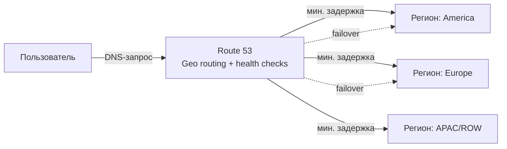
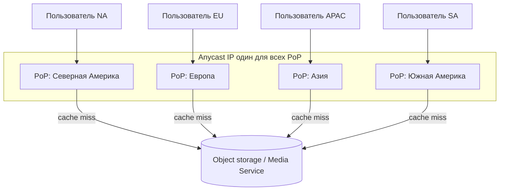
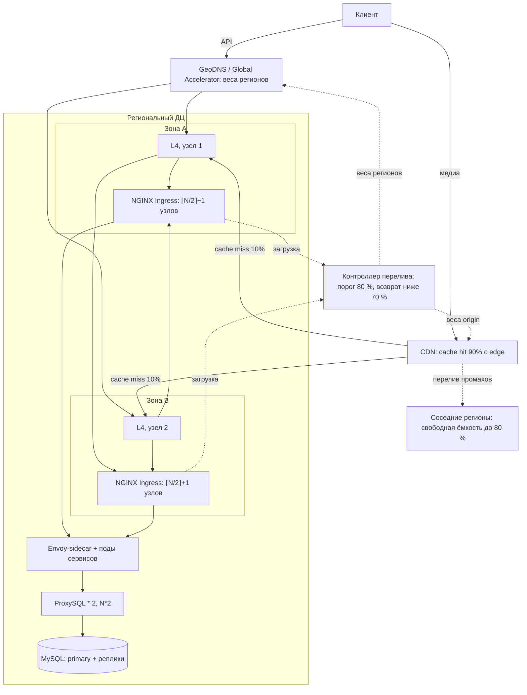
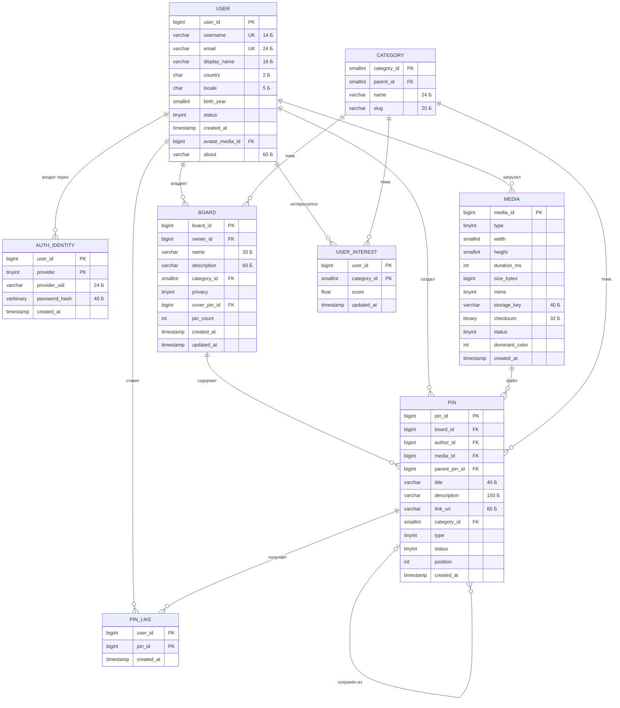
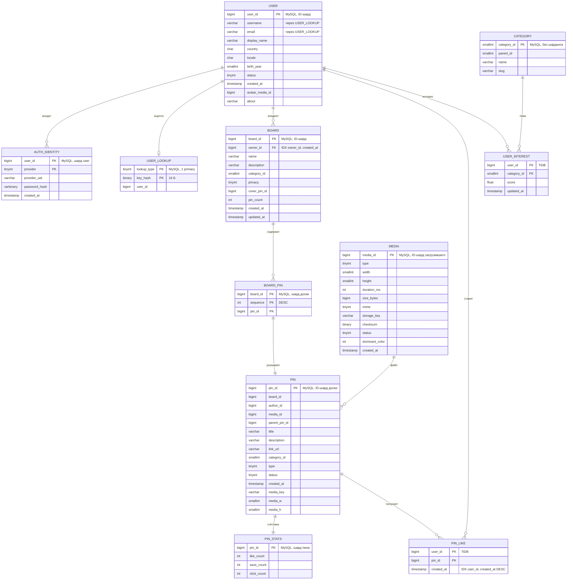
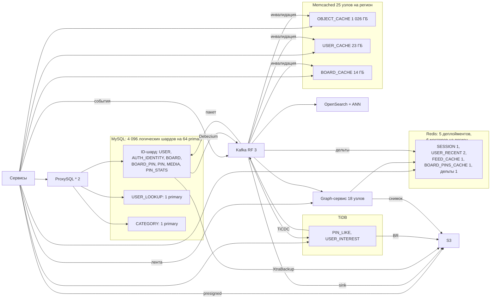

# Высоконагруженная платформа визуального поиска и сохранения идей Pinterest
### Курсовая работа по курсу «Проектирование высоконагруженных систем»

---

## 1. Тема и целевая аудитория

### Тема
Высоконагруженная платформа визуального поиска и сохранения идей (Pinterest). Ближайший аналог — Pinterest.

Pinterest представляет собой визуальную поисковую платформу, которая позволяет пользователям искать, организовывать и сохранять идеи в различных тематических областях. Сервис сочетает в себе функции социальной сети, визуального поиска и системы закладок. Пользователи создают доски, на которых сохраняют пины — изображения, видео или ссылки на внешние ресурсы.

### Целевая аудитория
- **Пользователи** — люди, которые ищут вдохновение, сохраняют идеи, создают доски;
- **Бизнес-пользователи и бренды** — компании, которые публикуют контент и продвигают продукты.

По итогам IV квартала 2025 года глобальная MAU достигла 619 млн (+12% г/г) [[1]](https://www.sec.gov/Archives/edgar/data/1506293/000150629326000019/q4-25xpressrelease.htm), по итогам II квартала 2026 — 640 млн MAU (+11% г/г) [[4]](https://www.sec.gov/Archives/edgar/data/0001506293/000150629326000102/q2-26xpressrelease.htm).

География — глобальная. Q4'25: США и Канада — 105 млн MAU, Европа — 158 млн MAU, остальной мир — 356 млн MAU [[1]](https://www.sec.gov/Archives/edgar/data/1506293/000150629326000019/q4-25xpressrelease.htm), [[6]](https://sproutsocial.com/insights/pinterest-statistics/).

Портрет аудитории: поколение зумеров стало крупнейшим сегментом в 2025 [[8]](https://www.sec.gov/Archives/edgar/data/1506293/000150629325000195/q2-25xpressrelease.htm); основная монетизация — США и Канада [[1]](https://www.sec.gov/Archives/edgar/data/1506293/000150629326000019/q4-25xpressrelease.htm).

### Функционал MVP
1. Регистрация и авторизация;
2. Создание, редактирование и удаление пинов;
3. Создание и управление досками;
4. Сохранение пина на доску;
5. Визуальный и текстовый поиск;
6. Просмотр ленты рекомендаций;
7. Лайк пинов.

### Ключевые продуктовые решения
- Визуальная поисковая платформа, а не социальная сеть;
- Контент по доскам и пинам;
- Персонализация на основе сохранений;
- Визуальный поиск по картинке;
- Мобильный приоритет.

---

## 2. Расчёт нагрузки

### 2.1 Динамика аудитории [[1]](https://www.sec.gov/Archives/edgar/data/1506293/000150629326000019/q4-25xpressrelease.htm), [[2]](https://www.fool.com/earnings/call-transcripts/2026/02/12/pinterest-pins-q4-2025-earnings-call-transcript/), [[3]](https://www.sec.gov/Archives/edgar/data/1506293/000150629326000060/finalars030826.htm), [[4]](https://www.sec.gov/Archives/edgar/data/0001506293/000150629326000102/q2-26xpressrelease.htm), [[5]](https://www.sec.gov/Archives/edgar/data/0001506293/000150629326000066/q1-26xpressrelease.htm):

| Квартал | MAU, млн | Рост г/г |
|---|---|---|
| Q4'24 | 553 | +11% |
| Q1'25 | 570 | +10% |
| Q2'25 | 578 | +11% |
| Q3'25 | 600 | +12% |
| Q4'25 | 619 | +12% |
| Q1'26 | 631 | +11% |
| Q2'26 | 640 | +11% |

Темп роста ≈ 2,5%/квартал = 11% годовых. Прогноз на 2 года: 640 × 1,11² ≈ **789 млн MAU**, запас 20–25%.

**DAU.** WAU/MAU = 62% [[3]](https://www.sec.gov/Archives/edgar/data/1506293/000150629326000060/finalars030826.htm) → WAU = 397 млн. DAU/MAU = 25% [[9]](https://www.blog.udonis.co/mobile-marketing/mobile-apps/pinterest) → **DAU = 160 млн**.

### 2.2 Продуктовые метрики

| Метрика | Значение |
|---|---|
| MAU | 640 млн |
| WAU | 397 млн |
| DAU | 160 млн |
| Всего пинов | 300 млрд |
| Пинов на пользователя | 468,75 шт. |
| Изображения (96%) | 450 шт. — 0,225 Гб |
| Видео (4%) | 18,75 шт. — 0,469 Гб |
| Объём на пользователя | 0,69 Гб |
| Досок на платформе | 6 млрд |
| Поисков в месяц | 80 млрд |
| Поисков на DAU | 17 |
| Сохранений в неделю | 1,5 млрд |
| Сохранений на DAU | 1,3 |
| Лайков на DAU | 10–20 |
| Создание пина на DAU | 0,05–0,1 |
| Просмотров пина на DAU | 200 |
| Внешних кликов в месяц | 1,7 млрд |

### 2.3 Технические метрики

#### Хранение [[11]](https://aws.amazon.com/solutions/case-studies/pinterest-proserve)

| Тип | Кол-во | Размер | Объём |
|---|---|---|---|
| Изображения (96%) | 288 млрд | 500 Кб | **144 ПБ** |
| Видео (4%) | 12 млрд | 25 Мб | **300 ПБ** |
| **Итого** | 300 млрд | — | **444 ПБ** |

#### Сетевой трафик

160 млн × 200 × 150 Кб = **4,8 ПБ/сутки**. Пик: 444 Гбит/с средний → **1150–1200 Гбит/с**.

#### RPS

| Тип запроса | Средний RPS | Пиковый RPS |
|---|---:|---:|
| Поиск | 30 900 | 93 000 |
| Лента | 18 500 | 55 000 |
| Показ пина | 370 000 | 1 100 000 |
| Сохранение | 2 500 | 7 500 |
| Лайк | 27 800 | 83 000 |
| Создание пина | 140 | 420 |
| Создание доски | 14 | 42 |
| Аутентификация | 2 200 | 6 600 |

---

## 3. Глобальная балансировка нагрузки

### 3.1 Домены

| Домен | Профиль |
|---|---|
| Identity/Auth | низкий RPS |
| Pin Service | средний RPS |
| Board Service | очень низкий RPS |
| Media/Storage | огромный объём |
| Search & Visual Search | высокий RPS + CPU |
| Feed/Recommendation | самый высокий RPS |
| Interaction/Graph | средний RPS |
| Ads/Monetization | вне MVP |

### 3.2 Расположение ДЦ

Pinterest на AWS с 2010, долгосрочное соглашение с 2017, расширено до $4 млрд до 2031 [[12]](https://w.media/pinterest-and-aws-sign-us-4-billion-dollar-cloud-service-deal-for-ai-expansion/), [[13]](https://www.sec.gov/Archives/edgar/data/1506293/000150629320000013/pins-20191231.htm). Мульти-CDN: Akamai, CloudFront, Fastly, Cloudflare [[14]](https://www.netify.ai/resources/applications/pinterest).

Три региона: NA 17%, EU 25,5%, ROW 57,5%. Холодное хранилище централизовано. CDN PoP — везде.

### 3.3 Распределение по регионам

| Тип | Всего | US&Canada | Европа | ROW |
|---|---:|---:|---:|---:|
| Поиск | 30 900 | 5 253 | 7 880 | 17 768 |
| Показ пина | 370 000 | 62 900 | 94 350 | 212 750 |
| Лента | 18 500 | 3 145 | 4 718 | 10 638 |
| Сохранение | 2 500 | 425 | 638 | 1 438 |
| Лайк | 27 800 | 4 726 | 7 089 | 15 985 |
| Создание | 140 | 24 | 36 | 81 |

### 3.4 DNS-балансировка



### 3.5 Anycast



### 3.6 Регулировка трафика между ДЦ

1. Weighted routing с переливом по порогу 80 % (возврат ниже 70 %);
2. Health-check + circuit breaker;
3. Асинхронная кросс-региональная репликация.

---

## 4. Локальная балансировка нагрузки

### 4.1. Схема балансировки и механизмы резервирования

#### 4.1.1. Уровни балансировки внутри ДЦ

Внутри ДЦ трафик проходит четыре уровня балансировки. ДЦ делится на две зоны доступности (A и B) — группы стоек с независимым питанием и сетью, они служат доменами отказа.

Резервирование построено по модели **перелива нагрузки (spillover)**: зона не держит запас на всю нагрузку соседней зоны. Каждая зона рассчитана на свою половину нагрузки ДЦ и один запасной узел. Когда загрузка достигает порога **80 %**, избыток распределяется в другую зону или в соседние регионы.



**Выбранные решения:**
- **Медиа** (96% пинов — изображения) почти целиком обслуживает CDN;
- **Envoy-sidecar** — HTTP/2 держит одно соединение;
- **СУБД** — MySQL с шардированием [[10]](https://medium.com/pinterest-engineering/sharding-pinterest-how-we-scaled-our-mysql-fleet-3f341e96ca6f);
- **L4** в AWS — управляемый NLB;
- **Перелив** — для промахов CDN (120 из 134,85 Гбит/с). API остаётся в домашнем регионе.

#### 4.1.2. Алгоритмы

| Участок | Алгоритм | Резервирование |
| --- | --- | --- |
| Маршрутизаторы → L4 | ECMP по хешу потока [[17]](https://research.google/pubs/pub44824/) | оба L4 активны |
| NGINX | consistent hashing + DSR | health-check, запасной узел в зоне |
| сервис | random two least_conn [[18]](https://nginx.org/en/docs/http/ngx_http_upstream_module.html) | readiness, graceful drain |
| Envoy | least request + zone-aware [[33]](https://www.envoyproxy.io/docs/envoy/latest/intro/arch_overview/upstream/load_balancing/priority) | outlier detection |
| ProxySQL | read в реплику, write в primary | failover |
| ДЦ → регионы | weighted routing [[34]](https://docs.aws.amazon.com/global-accelerator/latest/dg/about-endpoint-groups-traffic-dial.html), [[35]](https://docs.aws.amazon.com/Route53/latest/DeveloperGuide/routing-policy-weighted.html) | порог 80 %, возврат 70 % |

#### 4.1.3. Формулы резервирования

| Формула | Защищает от |
| --- | --- |
| **N+1** | Отказ одного узла |
| **N*2** | Отказ целой зоны |
| **2×(⌈N/2⌉+1) + перелив** | Узел + зона одновременно |

**Применение:** L4 — N×2; L7 — 2×(⌈N/2⌉+1); Envoy — 2N; ProxySQL — N×2.

**Пороги:** рабочая точка 70 %, порог перелива 80 %, возврат <70 %, предел 100 %.

### 4.2. Расчёт количества балансировщиков

#### 4.2.1. Характеристики узла

Базовый узел — NGINX Ingress на 16 CPU [[15]](https://blog.nginx.org/blog/testing-performance-nginx-ingress-controller-kubernetes):

| Показатель | Измерено | Рабочая точка 0,7 | Порог 0,8 |
| --- | ---: | ---: | ---: |
| HTTPS RPS, 1 КБ | 341 232 | 238 862 | 272 986 |
| SSL TPS | 54 877 | **38 414** | 43 902 |
| Сеть | 8,80 Гбит/с | **6,16 Гбит/с** | **7,04 Гбит/с** |

Поправка на размер: 238 862 × 0,556 = **132 800 RPS** на узел.

Пессимистичная проверка [[16]](https://blog.nginx.org/blog/testing-the-performance-of-nginx-and-nginx-plus-web-servers): 6 676 TLS/с — в 8,2 раза меньше.

#### 4.2.2. Нагрузка

- **API:** 93 000 + 55 000 + 7 500 + 83 000 + 420 + 42 + 6 600 = **245 562 RPS**;
- **Промахи кэша:** 1 100 000 × 10% = **110 000 RPS**.

| Класс | Гбит/с |
| --- | ---: |
| Промахи кэша | 120,00 |
| Поиск | 5,19 |
| Лента | 8,88 |
| Прочий API | 0,78 |
| **Итого** | **134,85** |

| Регион | API RPS | Промахи | Трафик |
| --- | ---: | ---: | ---: |
| US&Canada | 41 746 | 18 700 | 22,93 |
| Европа | 62 618 | 28 050 | 34,39 |
| ROW | 141 198 | 63 250 | 77,54 |

#### 4.2.3. Расчёт

- N_RPS = ⌈API_RPS / 132 800⌉
- N_TLS = ⌈TLS / 38 414⌉
- N_net = ⌈трафик / 6,16⌉
- N = max
- L7 = 2 × (⌈N/2⌉ + 1)
- L4 = 2

| ДЦ | N_RPS | N_TLS | N_net | **N** | ⌈N/2⌉+1 | **L7** |
| --- | ---: | ---: | ---: | ---: | ---: | ---: |
| US&Canada | 1 | 2 | 4 | **4** | 3 | **6** |
| Европа | 1 | 2 | 6 | **6** | 4 | **8** |
| ROW | 2 | 4 | 13 | **13** | 8 | **16** |
| **Всего** | 4 | 8 | 23 | **23** | 15 | **30** |

#### 4.2.4. Проверка отказоустойчивости

| Состояние | US&Canada | Европа | ROW |
| --- | ---: | ---: | ---: |
| Штатно | 43% | 49% | 55% |
| Отказ узла | 65% | 65% | 63% |
| Отказ зоны | 80% (перелив 1,81) | 80% (перелив 6,23) | 80% (перелив 21,22) |
| Отказ зоны + узла | 80% (перелив 8,85) | 80% (перелив 13,27) | 80% (перелив 28,26) |

**Итог:** 6 L4-узлов, 30 L7-узлов, всего **36 балансировщиков** (против 58 при схеме 2(N+1)).

---

## 5. Логическая схема БД

### 5.1 Основные данные

Объекты создаются в трёх регионах одновременно, глобальный автоинкремент — точка синхронизации и отказа. Используется 64-битный id (8 Б): выдаётся локально, уникален, вдвое короче UUID. Экономия только на `PIN_LIKE`: `2,63 трлн × 2 × 8 Б ≈ 42 ТБ`.



### 5.2 Файлы, кеши, буферы, производные


### 5.3 Потоки данных

Создание пина:
```text
клиент --(файл)--> UPLOAD_STAGING → MEDIA (ready) + MEDIA_FILE
                       ▼
           PIN (+ position)            одна атомарная операция
                       ▼
           PIN_TEXT_INDEX, PIN_VECTOR, BOARD.pin_count   асинхронно
```

Сохранение:
```text
PIN оригинала --> новый PIN: parent_pin_id = оригинал, board_id = доска сохраняющего
              --> save --> PIN_STATS, USER_INTEREST
```

Лайк:
```text
PIN_LIKE (user_id, pin_id) → EVENT_STREAM → PIN_STATS, USER_INTEREST
```

Лента:
```text
USER_RECENT + USER_INTEREST + граф (Pixie) → FEED_CACHE (200 id, 30 мин)
FEED_CACHE → OBJECT_CACHE, USER_CACHE, BOARD_CACHE
```

Поиск:
```text
текст → PIN_TEXT_INDEX → pin_id → OBJECT_CACHE
картинка → вектор → PIN_VECTOR → pin_id → OBJECT_CACHE
```

Вход:
```text
email → USER_LOOKUP → user_id → USER → AUTH_IDENTITY → SESSION
каждый API → SESSION
```

### 5.4 Описание сущностей

| Сущность | Вид | Назначение |
| --- | --- | --- |
| `USER` | основные | аккаунт |
| `AUTH_IDENTITY` | основные | способы входа |
| `BOARD` | основные | доска |
| `PIN` | основные | пин |
| `MEDIA` | основные | метаданные файла |
| `PIN_LIKE` | основные | лайк |
| `USER_INTEREST` | основные | интересы |
| `CATEGORY` | справочник | темы |
| `MEDIA_FILE` | файлы | сам файл |
| `UPLOAD_STAGING` | буфер | непроверенный файл |
| `SESSION` | временное | сессия |
| `FEED_CACHE` | кеш | лента |
| `USER_RECENT` | буфер, кеш | недавние действия |
| `BOARD_PINS_CACHE` | кеш | страница доски |
| `OBJECT_CACHE` | кеш | **пины** 342 Б |
| `USER_CACHE` | кеш | **пользователи** 144 Б |
| `BOARD_CACHE` | кеш | **доски** 119 Б |
| `EVENT_STREAM` | буфер | события |
| `PIN_STATS` | производные | счётчики |
| `PIN_TEXT_INDEX` | производные | текст |
| `PIN_VECTOR` | производные | вектор |
| `PIN_GRAPH` | производные, память | граф |

### 5.5 Размеры

| Сущность | Строк | Б/строка | Объём |
| --- | --- | --- | --- |
| USER | 640 млн | 144 | 92 ГБ |
| AUTH_IDENTITY | 768 млн | 77 | 59 ГБ |
| BOARD | 6 млрд | 119 | 714 ГБ |
| PIN | 300 млрд | 302 | 90,6 ТБ |
| MEDIA | 300 млрд | 107 | 32,1 ТБ |
| PIN_LIKE | 2,63 трлн | 20 | 52,6 ТБ |
| USER_INTEREST | 12,8 млрд | 18 | 230 ГБ |
| CATEGORY | 10 000 | 48 | <1 МБ |
| MEDIA_FILE | 288+12 млрд | 500 КБ/25 МБ | **444 ПБ** |
| UPLOAD_STAGING | 12,1 млн | 1,48 МБ | 17,9 ТБ |
| SESSION | 768 млн | 96 | 74 ГБ |
| FEED_CACHE | 16 млн | 1 640 | 26 ГБ |
| USER_RECENT | 397 млн×20 | 280 | 111 ГБ |
| BOARD_PINS_CACHE | 120 млн | 500 | 60 ГБ |
| OBJECT_CACHE (пины) | 3 млрд | 342 | **1 026 ГБ** |
| USER_CACHE | 160 млн | 144 | **23 ГБ** |
| BOARD_CACHE | 120 млн | 119 | **14 ГБ** |
| EVENT_STREAM | 117 млрд | 100 | 11,7 ТБ |
| PIN_STATS | 300 млрд | 20 | 6,0 ТБ |
| PIN_TEXT_INDEX | 300 млрд | 100 | 30 ТБ |
| PIN_VECTOR | 300 млрд | 272 | 81,6 ТБ |
| PIN_GRAPH | 51+9 млрд | 7,06 Б/ребро | **396 ГБ** |
| **Итого** | | | **≈ 309 ТБ** |

### 5.6 Нагрузка

| Сущность | Чтение (ср/пик) | Запись (ср/пик) |
| --- | --- | --- |
| USER | 22 550 / 67 650 | 10 / 30 |
| AUTH_IDENTITY | 2 200 / 6 600 | 5 / 15 |
| BOARD | 8 050 / 24 150 | 14 / 42 |
| PIN | 370 000 / 1 100 000 | 2 650 / 7 950 |
| MEDIA | 370 000 / 1 100 000 | 140 / 420 |
| PIN_LIKE | 18 500 / 55 500 | 27 800 / 83 000 |
| USER_INTEREST | 32 750 / 98 250 | 30 300 / 90 900 |
| PIN_STATS | 18 500 / 55 500 | 31 000 / 93 000 |
| SESSION | 82 050 / 245 560 | 2 200 / 6 600 |
| FEED_CACHE | 18 500 / 55 500 | 1 850 / 5 550 |
| USER_RECENT | 1 850 / 5 550 | 2 650 / 7 950 |
| BOARD_PINS_CACHE | 5 550 / 16 650 | 2 650 / 7 950 |
| OBJECT_CACHE | **370 000 / 1 100 000** | 2 650 / 7 950 |
| USER_CACHE | **22 550 / 67 650** | 10 / 30 |
| BOARD_CACHE | **8 050 / 24 150** | 14 / 42 |
| EVENT_STREAM | 1 352 000 / 4 056 000 | 450 700 / 1 352 000 |
| MEDIA_FILE | 37 000 / 110 000 | 140 / 420 |
| PIN_TEXT_INDEX | 24 700 / 74 100 | 2 640 / 7 920 |
| PIN_VECTOR | 6 200 / 18 500 | 140 / 420 |
| PIN_GRAPH | 1 850 / 5 550 | 38 млн рёбер/сутки |

### 5.7 Консистентность и распределение

- **строгая** — email, username, пароли, сессии;
- **read-your-writes** — доски, пины;
- **eventual** — счётчики, интересы, кеши, индексы.

| Сущность | Уровень | Ключ |
| --- | --- | --- |
| USER | строгая | user_id; вход — хеш |
| AUTH_IDENTITY | строгая | user_id |
| BOARD | read-your-writes | owner_id |
| PIN | read-your-writes | шард доски; сохранение → шард сохраняющего |
| MEDIA | неизменяем | media_id |
| PIN_LIKE | идемпотентна | user_id |
| USER_INTEREST | eventual | user_id |
| PIN_STATS | eventual | pin_id; вирусный — горячий |
| SESSION | строгая в регионе | token_hash |
| FEED_CACHE | eventual | user_id |
| USER_RECENT | eventual | user_id |
| BOARD_PINS_CACHE | инвалидация | board_id |
| OBJECT_CACHE | cache-aside | pin_id; Парето |
| USER_CACHE | cache-aside | user_id |
| BOARD_CACHE | cache-aside | board_id |
| EVENT_STREAM | at-least-once | user_id |
| PIN_GRAPH | eventual | копия на 18 узлах |

---

## 6. Физическая схема БД

Шесть классов хранения:
- OLTP-ядро — шардированный MySQL;
- TiDB — тяжёлые узкие таблицы;
- Redis + Memcached — кеши (Redis — отдельные деплойменты по типу ключей);
- Kafka — поток событий;
- S3 — файлы;
- OpenSearch / ANN — поиск.

### 6.1 Физическая схема



Карта хранилищ:



### 6.2 Таблица описания

| Таблица | СУБД | Шардирование | Резервирование |
| --- | --- | --- | --- |
| `USER` | MySQL | ID-шард: 4 096 [[10]](https://medium.com/pinterest-engineering/sharding-pinterest-how-we-scaled-our-mysql-fleet-3f341e96ca6f) | primary + sync + async [[31]](https://dev.mysql.com/doc/refman/8.0/en/replication-semisync.html) |
| `AUTH_IDENTITY` | MySQL | ID-шард | как выше |
| `BOARD` | MySQL | ID-шард владельца | как выше |
| `BOARD_PIN` | MySQL | ID-шард доски | как выше |
| `PIN` | MySQL | ID-шард доски | как выше |
| `MEDIA` | MySQL | ID-шард загрузившего | как выше |
| `PIN_STATS` | MySQL | ID-шард пина | как выше |
| `USER_LOOKUP` | MySQL | **без шардинга, 1 primary** | primary + 3 реплики |
| `CATEGORY` | MySQL | **1 primary** | primary + реплика |
| `PIN_LIKE` | TiDB | автоматическое | 3 реплики Raft |
| `USER_INTEREST` | TiDB | автоматическое | как `PIN_LIKE` |
| **`SESSION`** | **Redis, отдельный деплоймент** | **1 мастер + 1 реплика** | реплика |
| **`FEED_CACHE`** | **Redis** | **1 мастер + 1 реплика** | реплика |
| **`USER_RECENT`** | **Redis** | **2 мастера + 2 реплики** | реплика |
| **`BOARD_PINS_CACHE`** | **Redis** | **1 мастер + 1 реплика** | реплика |
| **Дельты `PIN_STATS`** | **Redis** | **1 мастер + 1 реплика** | реплика |
| **`OBJECT_CACHE`** | Memcached [[29]](https://github.com/facebook/mcrouter) | consistent hashing | без реплик |
| **`USER_CACHE`** | Memcached | consistent hashing | без реплик |
| **`BOARD_CACHE`** | Memcached | consistent hashing | без реплик |
| **`PIN_GRAPH`** | Graph-сервис | полная копия на 18 узлах | резерв 2×(⌈N/2⌉+1), снимок в S3 |
| `EVENT_STREAM` | Kafka [[24]](https://kafka.apache.org/documentation/) | партиции по ключу | RF 3 |
| `MEDIA_FILE`, `UPLOAD_STAGING` | S3 [[32]](https://docs.aws.amazon.com/AmazonS3/latest/userguide/Welcome.html) | хеш-префикс | три зоны + реплика |
| `PIN_TEXT_INDEX` | OpenSearch | 600 шардов по 50 ГБ | 1 реплика |
| `PIN_VECTOR` | ANN [[30]](https://github.com/facebookresearch/faiss) | 30 шардов по 240 ГБ | 2 реплики |

#### Правило шардирования

```text
D_горизонт = D_сейчас × 1,2 × G
N = min степень двойки, при которой D_горизонт / N ≤ 100 ГБ
```

`G` для ядра — 1,55 (82,4 млрд новых пинов/год × 2), для USER_LOOKUP — 1,23.

| База | Данные | G | Через 2 года | Шардов |
| --- | ---: | ---: | ---: | ---: |
| Ядро | 177 ТБ | 1,55 | 275 ТБ | **4 096** |
| USER_LOOKUP | 51 ГБ | 1,23 | 63 ГБ | **1** |
| CATEGORY | 0,5 МБ | 1 | 0,5 МБ | **1** |

**Redis:** `max(⌈объём / 64 ГБ⌉, ⌈нагрузка / 80 000⌉, 1)`. Минимум 1 мастер + 1 реплика.

| Деплоймент | Объём | Нагрузка | Шардов |
| --- | ---: | ---: | ---: |
| `SESSION` | 74 ГБ | 82 050 оп/с | **1** |
| `USER_RECENT` | 111 ГБ | 2 650 зап/с | **2** |
| `FEED_CACHE` | 26 ГБ | 18 500 оп/с | **1** |
| `BOARD_PINS_CACHE` | 60 ГБ | 5 550 оп/с | **1** |
| Дельты | малый | 9 300 зап/с | **1** |

**Остальные хранилища:**

| Хранилище | Шардов | Правило |
| --- | ---: | --- |
| TiDB | 80 TiKV | 316 ТБ / 4 ТБ |
| Memcached | 25 узлов/регион | 1 276 ГБ / 51 ГБ |
| OpenSearch | 600 | 30 ТБ / 50 ГБ |
| ANN | 30 | 7,2 ТБ / 240 ГБ |

**Размер MySQL:** 177 ТБ / 4 096 = 43 ГБ/шард, / 64 хоста = 2,8 ТБ/хост, × 3 копии = **192 хоста**.

**Размер TiDB:** 105,4 ТБ × 3 = 316 ТБ / 80 = 3,95 ТБ/узел.

**Число узлов:**

| Кластер | Всего |
| --- | ---: |
| MySQL основной | 192 |
| MySQL USER_LOOKUP | 4 |
| MySQL CATEGORY | 2 |
| TiDB | 89 |
| Memcached | 75 |
| Kafka | 27 |
| **Redis (5 деплойментов)** | **36** (6 мастеров + 6 реплик × 3 региона) |
| Graph-сервис | 18 |
| ANN | 180 |

### 6.3 Идентификаторы

64 бита: 2 резерв + 16 `shard_id` + 10 `type` + 36 `local_id`.

```text
id       = (shard_id << 46) | (type << 36) | local_id
shard_id = (id >> 46) & 0xFFFF
```

| Объект | Шард |
| --- | --- |
| пользователь | случайный из своего региона |
| доска | шард владельца |
| пин | шард доски |
| медиа | шард загрузившего |

**Регионы:** US&Canada 704 / 11 хостов, Европа 1 024 / 16, ROW 2 368 / 37, всего **4 096 / 64**.

**Маршрут USER_LOOKUP:**
```text
email --> md5(email) mod 1 = 0 --> 1 primary --> user_id --> shard_id --> MySQL
```

### 6.4 Индексы

| Таблица | Индекс | Запрос | Цена |
| --- | --- | --- | --- |
| `USER` | PK | профиль | кластерный |
| `AUTH_IDENTITY` | PK (user_id, provider) | вход | кластерный |
| `USER_LOOKUP` | PK (lookup_type, key_hash) | вход по email | кластерный |
| `BOARD` | PK + IDX (owner_id, created_at) | список досок | +120 ГБ |
| `BOARD_PIN` | PK (board_id, sequence DESC, pin_id) | страница без OFFSET | кластерный |
| `PIN` | PK | по id | кластерный |
| `MEDIA` | PK | по id | кластерный |
| `PIN_STATS` | PK | счётчики | кластерный |
| `PIN_LIKE` | PK + IDX | «лайкнул ли» + список | +52,6 ТБ |
| `USER_INTEREST` | PK | все интересы | кластерный |

### 6.5 Денормализация

| Что | Зачем | Цена |
| --- | --- | --- |
| `media_key`, размеры в `PIN` | нет чтений MEDIA при показе | +13,2 ТБ |
| `BOARD_PIN` отдельно | нет перезаписи PIN | 6 ТБ |
| `PIN_STATS` + пакет | нет блокировок | 6 ТБ |
| `pin_count` в BOARD | без подсчёта | асинхронно |
| Лайки в двух порядках | быстро и «лайкнул» и список | +52,6 ТБ |
| `pin_id` в `PIN_VECTOR` | нет индекса `PIN (media_id)` | +8 Б |
| `USER_LOOKUP` | email не содержит шарда | 42,5 ГБ |

**Не денормализуются изменяемые:** имя автора и название доски в PIN не копируются.

**Счётчики:** Kafka → потребитель → Redis (`HINCRBY`) → пакетный UPDATE MySQL → offset.

### 6.6 Клиентские библиотеки

| Компонент | Библиотека |
| --- | --- |
| MySQL | Connector/J + HikariCP + своя библиотека шардов |
| ProxySQL | query rules, hostgroups |
| ZooKeeper | Curator |
| TiDB | MySQL-драйвер |
| Redis | Lettuce |
| Memcached | mcrouter |
| **Graph-сервис** | **C++/Rust + CSR + FAISS** |
| Kafka | Java client |
| S3 | AWS SDK |
| Поиск | OpenSearch + gRPC к ANN |
| CDC | Debezium + TiCDC |

### 6.7 Балансировка запросов

| Таблица | Чтение | Запись |
| --- | ---: | ---: |
| `PIN` | **55 000** | 7 950 |
| `BOARD_PIN` | 1 665 | 7 950 |
| `USER` | **3 382** | 30 |
| `BOARD` | **1 208** | 42 |
| `AUTH_IDENTITY` | 6 600 | 15 |
| `USER_LOOKUP` | 6 600 | 30 |
| `MEDIA` | 0 | 420 |
| `PIN_STATS` | 2 775 | 9 300 |
| **MySQL** | **77 230** | **25 737** |
| `PIN_LIKE` (TiDB) | 55 500 | 83 000 |
| `USER_INTEREST` (TiDB) | 9 825 | 18 180 |
| **TiDB** | **65 325** | **101 180** |

На хост: 402 записи/с + 1 207 чтений/с. ROW: ≈ **59 200 QPS**.

**Закон Литтла:** 1 609 QPS × 0,002 с = 3,2 запроса одновременно. С ProxySQL пул 32 — в **61 раз** меньше соединений.

### 6.8 Бэкапы

| Хранилище | Метод | RPO | RTO |
| --- | --- | --- | --- |
| MySQL | XtraBackup [[28]](https://docs.percona.com/percona-xtrabackup/) + binlog | 5 мин | 1 мин / 1,5–2 ч |
| TiDB | BR [[26]](https://docs.pingcap.com/tidb/stable/backup-and-restore-overview) | 5 мин | часы |
| Graph-сервис | снимок в S3 + пересборка | до 1 ч | 317 с + 2–4 ч |
| Redis SESSION | реплика + RDB | потеря = вход | минуты |
| Memcached | не копируется | — | прогрев |
| Kafka | RF 3 + sink в S3 | 0 | минуты |
| S3 MEDIA_FILE | версионирование + CRR | минуты | переключение |
| OpenSearch, ANN | снимок + пересборка | — | часы |

Принцип 3-2-1, Object Lock, проверка восстановления раз в месяц.

---

## 7. Алгоритмы


---

### 7.1. Формирование ленты рекомендаций

#### 7.1.1. Наименование

Алгоритм **Pixie** — случайные блуждания по графу «пин — доска» с перезапуском [[36]](https://arxiv.org/abs/1711.07601).

#### 7.1.2. Блок применения

**Feed/Recommendation Service** - функция «Просмотр ленты рекомендаций» (MVP № 6).

#### 7.1.3. Постановка задачи

Для пользователя нужно отобрать **200 релевантных пинов из 300 млрд** за доли секунды. Перебор невозможен: даже по одной наносекунде на пин это 300 секунд. Нужен метод, время которого **не зависит от общего числа пинов**.

**Требования к результату:**
- 200 пинов за < 100 мс;
- релевантность на уровне реального Pinterest (> 80 % вовлечённости по данным [[36]](https://arxiv.org/abs/1711.07601));
- разнообразие тем — чтобы лента не была однотипной;
- исключение уже показанных и удалённых пинов;

#### 7.1.4. Исходные данные, ограничения, требования

**Исходные данные:**
- 300 млрд пинов, 6 млрд досок;
- у каждого пина есть `board_id` - из этого строится граф;
- 20 последних действий пользователя (сохранения, лайки) за 7 суток;
- `USER_INTEREST` — веса тем пользователя;

**Ограничения:**
- перебор 300 млрд * 1 нс = 300 с - недопустимо;
- данных о графе слишком много для одного сервера;
- лента устаревает, если пересчитывается раз в сутки;
- одновременно с этим - 18 500 открытий ленты в секунду;


#### 7.1.5. Последовательность работы

```text
1. Проверить FEED_CACHE:
     hit (90 %) - отдать - готово.
     miss (10 %) - шаг 2.

2. Взять USER_RECENT:
     20 последних действий за 7 суток.
     Вес: сохранение 1,0, лайк 0,5, просмотр 0,1.
     Вес умножается на полураспад 3 суток.

3. Обход графа Pixie:
     для каждого пина пользователя:
       запустить N случайных обходов,
       N = вес * 10 000 (максимум 100 000),
       шаг: пин - случайная доска → случайный пин,
       перезапуск с вероятностью 0,15 (вернуться в стартовый),
       останов раньше, если набрано достаточно кандидатов.

4. Добавить вес кандидатам:
     чем из большего числа стартовых пинов дошли,
     тем больше вес,
     формула: (сумма корня посещений)^2.

5. Оставить 1 000 лучших, отфильтровать:
     удалённые,
     уже показанные за последние 7 суток,
     заблокированные.

6. Оценить лёгкой моделью:
     тема совпадает с USER_INTEREST - +,
     популярность высокая - +,
     разнообразие тем по алгоритму MMR - 200 пинов.

7. Записать в FEED_CACHE на 30 мин.
   Отдать первую страницу 20 пинов.

8. Старт:
     взять 5 главных тем из USER_INTEREST,
     популярные пины этих тем из OpenSearch за 7 суток,
     если интересов нет - темы региона и языка.
```

#### 7.1.6. Структуры данных

**Граф в памяти:**
```text
offsets: массив длины |nodes|+1, где offsets[i] - начало соседей узла i в edges
edges:   массив соседей, для узла i - edges[offsets[i] : offsets[i+1]]
```

**Атрибуты узла прямо в графе:**
| Поле | Размер | Зачем |
| --- | ---: | --- |
| `topic` | 2 Б | фильтр по теме, MMR |
| `status` | 1 Б | удалён / заблокирован |
| `popularity_bucket` | 1 Б | корзина 0–255 для ранжирования |

**Зачем атрибуты в графе:** первая версия алгоритма читала метаданные каждого из 2 000 кандидатов из `OBJECT_CACHE`:
```text
2 000 кандидатов × 1 850 пересчётов/с = 3,7 млн чтений/с
```

**`USER_RECENT` - Redis, 2 мастера + 2 реплики:**
- 397 млн пользователей WAU * 20 действий * 280 Б = **111 ГБ**;
- структура: ключ `recent:{user_id}`, значение — список из 20 записей `(pin_id, action, ts, weight)`;
- TTL 7 суток;


#### 7.1.7. Обоснование выбора и параметров

**Почему Pixie (4 причины из [[36]](https://arxiv.org/abs/1711.07601)):**
1. Время обхода не зависит от размера графа — только от числа шагов.
2. Граф целиком в памяти сервера, обход не ходит по сети.
3. Граф строится из существующих строк `PIN` с `board_id` — новых данных собирать не нужно.
4. Метод проверен в продакшене Pinterest: системы на Pixie дают более 80 % вовлечённости.

**Расчёт размера графа:**
```text
рёбер: 300 млрд пинов × 17 % = 51 млрд
       (17 из 100 млрд после чистки в [36]: удалены дубликаты, неактивные доски)
байт на ребро: 120 ГБ / 17 млрд = 7,06 Б (данные [36])
рёбра: 51 млрд * 7,06 Б = 360 ГБ
узлов: 51 млрд / (17/3) = 9 млрд
атрибуты: 9 млрд * 4 Б = 36 ГБ
итого: 396 ГБ
через 2 года: * 1,55 = 613 ГБ
```

#### 7.1.9. Влияние на схему и нагрузку

**Новые сущности:**
- **`PIN_GRAPH`** — граф в памяти, 396 ГБ на узел, 18 копий (полная копия на каждом);
- **`USER_RECENT`** — Redis, 2 мастера + 2 реплики на регион, 111 ГБ.

**Новый сервис:**  18 узлов (4 / 6 / 8 по регионам).

**Нагрузка:**
- пересчётов ленты: **1 850/с средний, 5 550/с пиковый** (10 % открытий);
- внешняя нагрузка: **2 чтения на пересчёт** (`USER_RECENT`, `USER_INTEREST`);
- обновление графа: 38 млн рёбер/сутки из Kafka (новые сохранения).

---

### 7.2. Визуальный поиск по картинке

#### 7.2.1. Наименование

Приближённый поиск ближайших соседей **IVF-PQ** (библиотека FAISS) [[30]](https://github.com/facebookresearch/faiss), [[39]](https://arxiv.org/abs/1702.08734).

#### 7.2.2. Блок применения

**Search & Visual Search Service** - функция «Визуальный поиск по загруженному изображению» (MVP № 5).

#### 7.2.3. Постановка задачи

Пользователь загружает картинку; нейросеть превращает её в **вектор из 128 чисел** (эмбеддинг). Нужно найти **ближайшие векторы** среди 300 млрд. Похожесть = близость векторов.

**Точный перебор:**
```text
300 млрд * 128 операций = 7,7 * 10^13 операций
на одном ядре - 25 минут
память на точное хранение: 300 млрд * 256 Б = 79,2 ТБ
```

**Требования к результату:**
- < 100 мс на запрос;
- recall@10 > 0,8;
- память укладывается в разумный объём серверов;

#### 7.2.4. Исходные данные, ограничения, требования

**Исходные данные:**
- 300 млрд пинов, у каждого - эмбеддинг 128 чисел (fp16, 256 Б);
- **верхняя оценка:** как и 300 млрд файлов - у каждого пина свой файл, но репины делят файл, так что уникальных файлов меньше. Если уникальных 10 %, то векторов 30 млрд.

**Ограничения:**
- точный перебор: 25 минут, 79,2 ТБ памяти;
- 6 200 / 18 500 QPS визуального поиска в пике;
- нельзя делать запрос через регион - задержка;

**Допущения:**
- 25 нс на код на ядро (проверяется замером на FAISS);
- recall@10 > 0,8 - целевое значение, подбирается через nprobe;

#### 7.2.5. Последовательность работы

```text
1. Пользователь загружает картинку.
2. ML-модель превращает её в вектор 128 чисел (fp16).
3. Брокер региона находит 32 ближайших центроида (nprobe = 32).
4. Рассылает вектор во все 30 шардов ANN-сервиса:
     шардирование по хешу media_id,
     каждый шард хранит 1/30 каждого кластера.
5. Каждый шард:
     смотрит свои 1/30 кодов в 32 ближайших кластерах,
     считает приближённые расстояния по таблицам,
     возвращает 200 лучших pin_id.
6. Брокер сливает 30 списков по расстоянию, оставляет 200.
7. По pin_id объекты достаются из OBJECT_CACHE (кеш пинов).
8. Отдаём пользователю.
```

#### 7.2.6. Структуры данных

**inverted file:**
- 4 194 304 кластера (nlist = 2^22);
- у каждого кластера — центроид 128 * fp16 = 256 Б;
- квантизатор: 4 194 304 * 256 Б = **2,1 ГБ на шард**;
- для запроса - ищем 32 ближайших центроида;
- 32 * 71 526 = **2,29 млн кодов** вместо 300 млрд.

**product quantization:**
- вектор 128 чисел делится на 16 частей по 8 чисел;
- каждая часть заменяется номером ближайшего центроида из 256 (1 байт);
- вектор сжимается с 256 Б до **16 Б**;
- расстояние до запроса считается по таблицам: для каждой части запроса заранее считается расстояние до всех 256 центров (16 * 256 = 4 096 значений), а расстояние до сжатого вектора — сумма 16 значений из таблиц.

**Запись:**
```text
16 Б код + 8 Б pin_id = 24 Б на вектор
300 млрд * 24 Б = 7,2 ТБ
7,2 ТБ / 30 шардов = 240 ГБ на шард
```

#### 7.2.7. Обоснование выбора и параметров

**Расчёт памяти:**
```text
300 млрд * 24 Б = 7,2 ТБ; / 30 шардов = 240 ГБ на шард
против 79,2 ТБ без сжатия - в 11 раз меньше
```

**Стоимость и выбор nprobe:**

| nprobe | Кодов на запрос | CPU на запрос | Ядер в пике | Ядер в среднем |
| ---: | ---: | ---: | ---: | ---: |
| 16 | 1,14 млн | 29 мс | 529 | 177 |
| **32** | **2,29 млн** | **57 мс** | **1 059** | **355** |
| 64 | 4,58 млн | 114 мс | 2 117 | 710 |

Стартовое значение nprobe = 32. Финальное подбирается так, чтобы recall@10 был ≥ 0,8.

**По регионам ядер:**
- US&Canada: 6 200 * 57 мс / 1000 = 353 ядра в пике;
- Европа: 18 500 * 0,255 × 57 / 1000 = 269;
- ROW: 18 500 * 0,575 * 57 / 1000 = 607;

Итого 1 059 в пике


**Слабое место:** 300 млрд векторов - верхняя оценка. Если уникальных файлов 10 %:
- векторов 30 млрд;
- памяти 0,72 ТБ;
- шардов 3 вместо 30;

Архитектура (IVF-PQ, брокер, шарды) не меняется, меняется только число шардов.


---

### 7.3. Кеширование объектов

#### 7.3.1. Наименование

**Cache-aside** с защитой от трёх проблем:
- лавины промахов (stampede);
- устаревших данных (stale set);
- горячих ключей (hot key) через L1-кеш;

#### 7.3.2. Блок применения

Чтение метаданных:
- пинов (`PIN`) - 370 000 / 1 100 000 чтений/с;
- пользователей (`USER`) - 22 550 / 67 650;
- досок (`BOARD`) - 8 050 / 24 150;

Всего 400 600 чтений/с в пике

#### 7.3.3. Постановка задачи

Метаданные пина читаются 1,1 млн раз в секунду в пике. Без кеша на каждый из 64 хостов MySQL пришлось бы:
```text
1 100 000 / 64 = 17 200 чтений/с на хост
```

**Требования:**
- обосновать 95 % hit rate;
- защититься от трёх проблем кеша;
- устаревание < 5 с (пользователь не должен видеть старые данные дольше);

#### 7.3.4. Исходные данные, ограничения, требования

**Три кеша:**

| Ключ | Значение | Размер | Hit rate |
| --- | --- | ---: | ---: |
| `pin:{id}` | пин | 342 Б | 95 % |
| `user:{id}` | пользователь | 144 Б | 95 % |
| `board:{id}` | доска | 119 Б | 95 % |

**Размер:** 1 026 + 23 + 14 = 1 063 ГБ, × 1,2 = **1 276 ГБ** - **25 узлов Memcached по 64 ГБ** на регион.

**Ограничения:**
- 370 000 чтений/с пинов;
- устаревание < 5 с;
- потеря кеша не должна ронять систему;


#### 7.3.5. Последовательность работы

```text
1. Читать L1 (память пода, TTL 2 с, 10 000 горячих ключей).
     hit - отдать.

2. При промахе L1 - читать Memcached.
     hit - положить в L1 - отдать.

3. При промахе Memcached - взять замок add lock:{ключ} TTL 10 с:
     успешен - читать MySQL - записать в Memcached → снять замок;
     не успешен - ждать 20 мс, повторить шаг 2;

4. При изменении объекта:
     удалить ключ сразу после коммита,
     удалить ещё раз через 1–2 с из журнала MySQL (двойное удаление).
```

#### 7.3.6. Обоснование 

Если упорядочить пины по популярности, `k`-й получает долю обращений `1/k^s`. Кеш на 1 % пинов (3 млрд из 300 млрд) хранит самые популярные.

**Формула:**
```text
hit = H_s(C) / H_s(N),  H_s(n) = Σ 1/k^s по k от 1 до n
```

| Показатель `s` | Hit rate | Чтений `PIN` в MySQL в пике | На хост из 64 |
| ---: | ---: | ---: | ---: |
| 0,9 | 60,4 % | 435 000 | 6 800 |
| 1,0 | 82,9 % | 188 000 | 2 900 |
| 1,05 | 90,9 % | 100 000 | 1 560 |
| **1,1** | **95,8 %** | **46 000** | **720** |
| 1,2 | 99,3 % | 7 600 | 120 |


**Расчёт лавины (stampede):**
```text
ключ с 50 000 чтений/с,
время заполнения 5 мс:
50 000 × 0,005 = 250 одновременных чтений MySQL
с замком — одно
```

**Расчёт hot key:**
```text
283 пода в ROW / 2 с (TTL L1) = 141 запрос/с на ключ до Memcached
```

#### 7.3.7. Влияние на схему и нагрузку

- **`OBJECT_CACHE`** разбит на **три пространства имён**: пины (1 026 ГБ), пользователи (23 ГБ), доски (14 ГБ);
- **25 узлов Memcached** на регион (75 всего), было 22 до разбивки;
- MySQL получает **77 230 чтений + 25 737 записей** в пике вместо миллионов;
- доля попаданий **95,8 %** обосновывает нагрузку;
- **детализация по нагрузке после кешей:** `PIN` 55 000 / `USER` 3 382 / `BOARD` 1 208;

**Что было бы при 83 % (s = 1,0):**
- `PIN` - 188 000 чтений/с (в 3,4 раза больше);
- суммарный ProxySQL ROW - 135 000 QPS вместо 59 200;
- пришлось бы усилить ProxySQL или добавить ещё кеш.


---

## Список источников

[[1]](https://www.sec.gov/Archives/edgar/data/1506293/000150629326000019/q4-25xpressrelease.htm) Pinterest Q4 2025 Results
[[2]](https://www.fool.com/earnings/call-transcripts/2026/02/12/pinterest-pins-q4-2025-earnings-call-transcript/) Pinterest Q4 2025 Earnings Call
[[3]](https://www.sec.gov/Archives/edgar/data/1506293/000150629326000060/finalars030826.htm) Pinterest Form 10-K 2025
[[4]](https://www.sec.gov/Archives/edgar/data/0001506293/000150629326000102/q2-26xpressrelease.htm) Pinterest Q2 2026 Results
[[5]](https://www.sec.gov/Archives/edgar/data/0001506293/000150629326000066/q1-26xpressrelease.htm) Pinterest Q1 2026 Results
[[6]](https://sproutsocial.com/insights/pinterest-statistics/) Sprout Social 2026
[[7]](https://medium.com/pinterest-engineering) Pinterest Engineering Blog — «300 billion ideas»
[[8]](https://www.sec.gov/Archives/edgar/data/1506293/000150629325000195/q2-25xpressrelease.htm) Pinterest Q2 2025 press release
[[9]](https://www.blog.udonis.co/mobile-marketing/mobile-apps/pinterest) Udonis Blog
[[10]](https://medium.com/pinterest-engineering/sharding-pinterest-how-we-scaled-our-mysql-fleet-3f341e96ca6f) *Sharding Pinterest*, 2015
[[11]](https://aws.amazon.com/solutions/case-studies/pinterest-proserve) AWS case study Pinterest
[[12]](https://w.media/pinterest-and-aws-sign-us-4-billion-dollar-cloud-service-deal-for-ai-expansion/) W.Media — $4B deal
[[13]](https://www.sec.gov/Archives/edgar/data/1506293/000150629320000013/pins-20191231.htm) Pinterest 2019 10-K
[[14]](https://www.netify.ai/resources/applications/pinterest) Netify.ai
[[15]](https://blog.nginx.org/blog/testing-performance-nginx-ingress-controller-kubernetes) NGINX Ingress 2019
[[16]](https://blog.nginx.org/blog/testing-the-performance-of-nginx-and-nginx-plus-web-servers) NGINX 2017
[[17]](https://research.google/pubs/pub44824/) Maglev NSDI 2016
[[18]](https://nginx.org/en/docs/http/ngx_http_upstream_module.html) NGINX upstream
[[19]](https://medium.com/pinterest-engineering/tidb-adoption-at-pinterest-1130ab787a10) Pinterest TiDB 2024
[[20]](https://medium.com/pinterest-engineering/online-data-migration-from-hbase-to-tidb-with-zero-downtime-43f0fb474b84) Pinterest HBase → TiDB
[[21]](https://www.verdict.co.uk/?p=401753) Verdict — Pinterest & AWS
[[22]](https://proxysql.com/documentation/) ProxySQL docs
[[23]](https://redis.io/docs/latest/operate/oss_and_stack/reference/cluster-spec/) Redis Cluster spec
[[24]](https://kafka.apache.org/documentation/) Apache Kafka docs
[[25]](https://debezium.io/documentation/) Debezium docs
[[26]](https://docs.pingcap.com/tidb/stable/backup-and-restore-overview) TiDB BR
[[27]](https://github.com/openark/orchestrator) Orchestrator
[[28]](https://docs.percona.com/percona-xtrabackup/) Percona XtraBackup
[[29]](https://github.com/facebook/mcrouter) mcrouter
[[30]](https://github.com/facebookresearch/faiss) FAISS
[[31]](https://dev.mysql.com/doc/refman/8.0/en/replication-semisync.html) MySQL semisync
[[32]](https://docs.aws.amazon.com/AmazonS3/latest/userguide/Welcome.html) Amazon S3 Guide
[[33]](https://www.envoyproxy.io/docs/envoy/latest/intro/arch_overview/upstream/load_balancing/priority) Envoy priority
[[34]](https://docs.aws.amazon.com/global-accelerator/latest/dg/about-endpoint-groups-traffic-dial.html) Global Accelerator traffic dials
[[35]](https://docs.aws.amazon.com/Route53/latest/DeveloperGuide/routing-policy-weighted.html) Route 53 weighted
[[36]](https://arxiv.org/abs/1711.07601) Eksombatchai et al. *Pixie*, WWW 2018
[[37]](https://arxiv.org/abs/1806.01973) Ying et al. *PinSage*, KDD 2018
[[38]](https://arxiv.org/abs/1505.07647) Jing et al. *Visual Search at Pinterest*, KDD 2015
[[39]](https://arxiv.org/abs/1702.08734) Johnson, Douze, Jégou. *FAISS*, 2017
[[40]](https://www.usenix.org/conference/nsdi13/technical-sessions/presentation/nishtala) Nishtala et al. *Scaling Memcache*, NSDI 2013