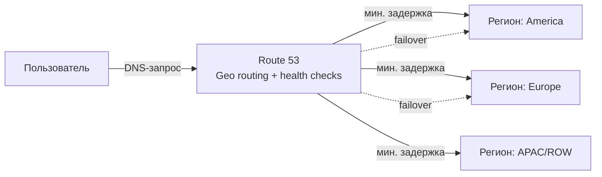
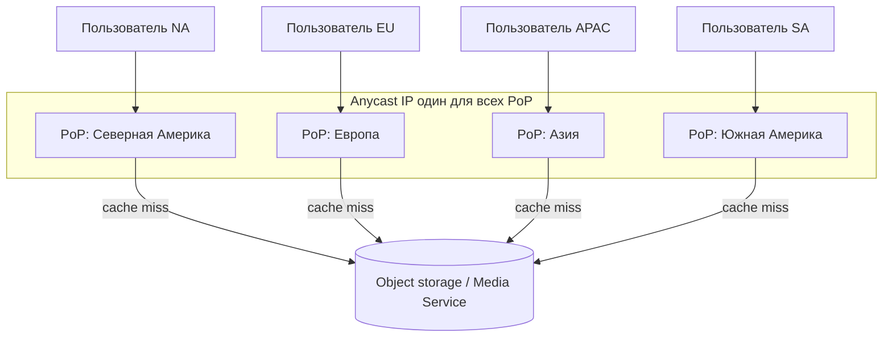
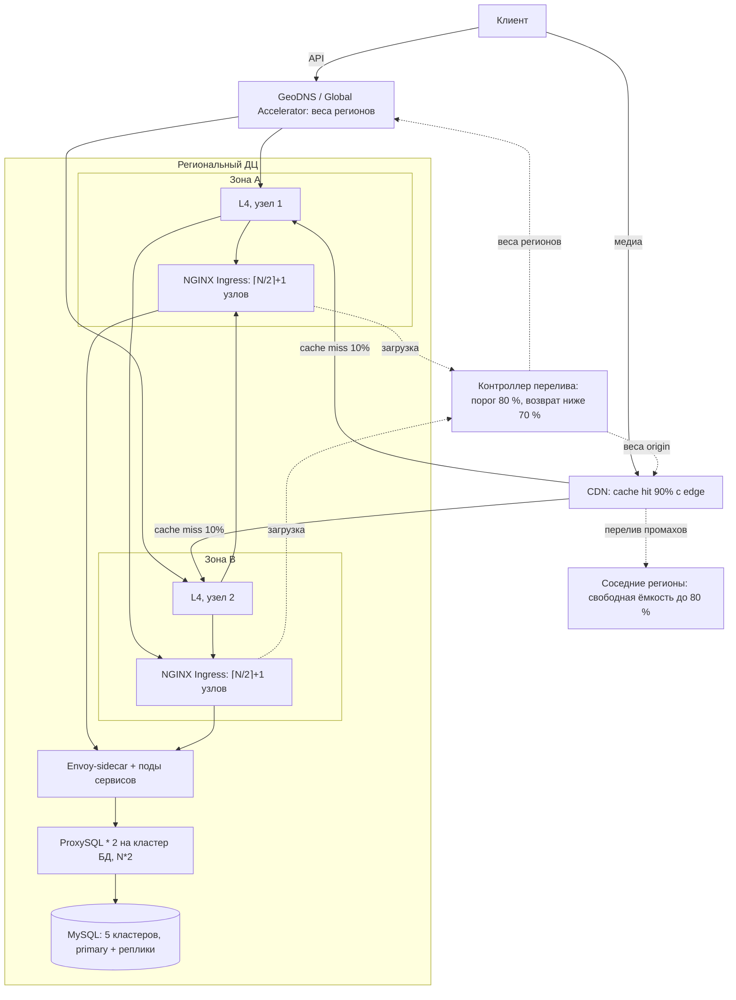
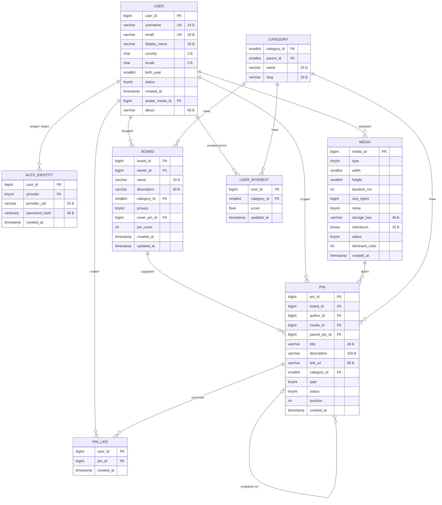
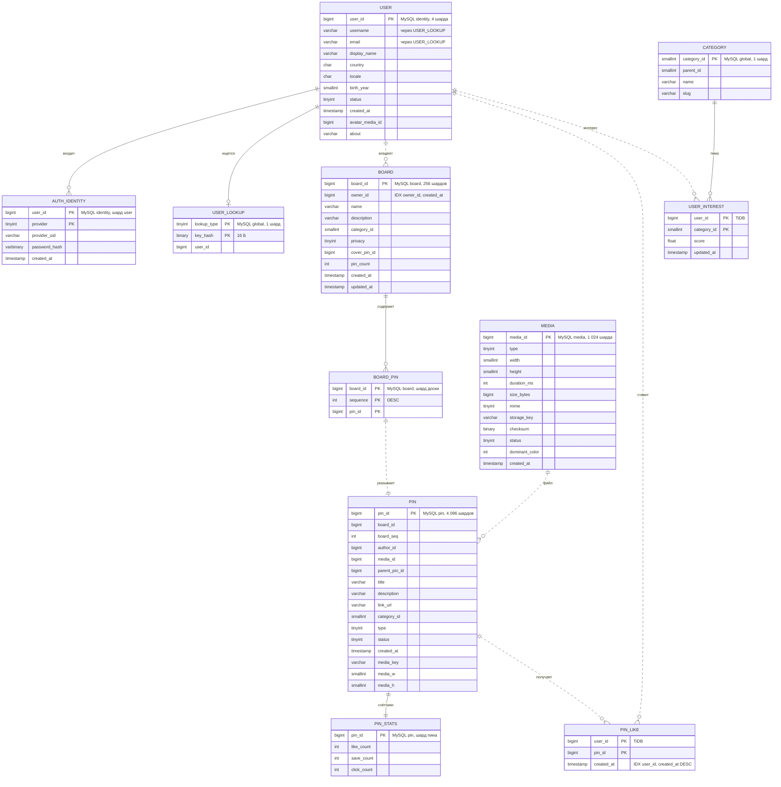
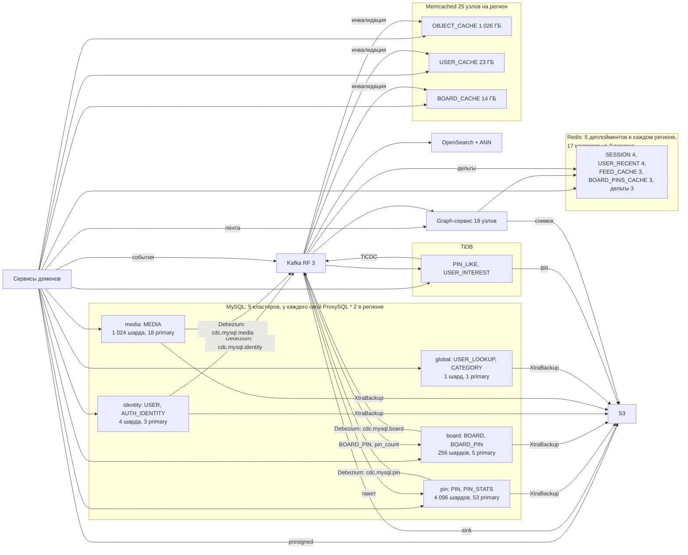
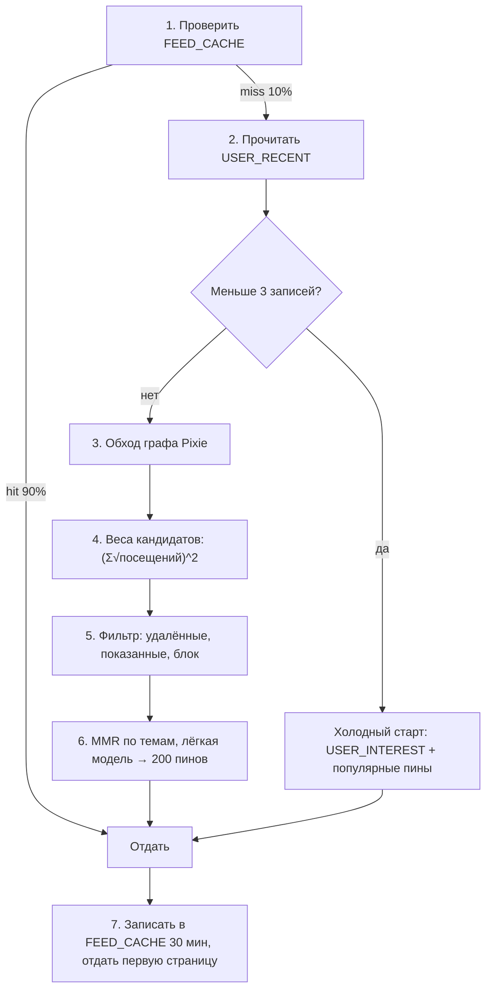
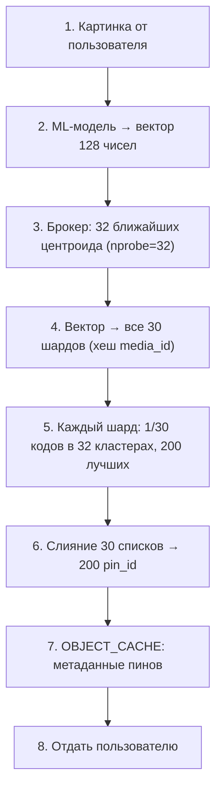
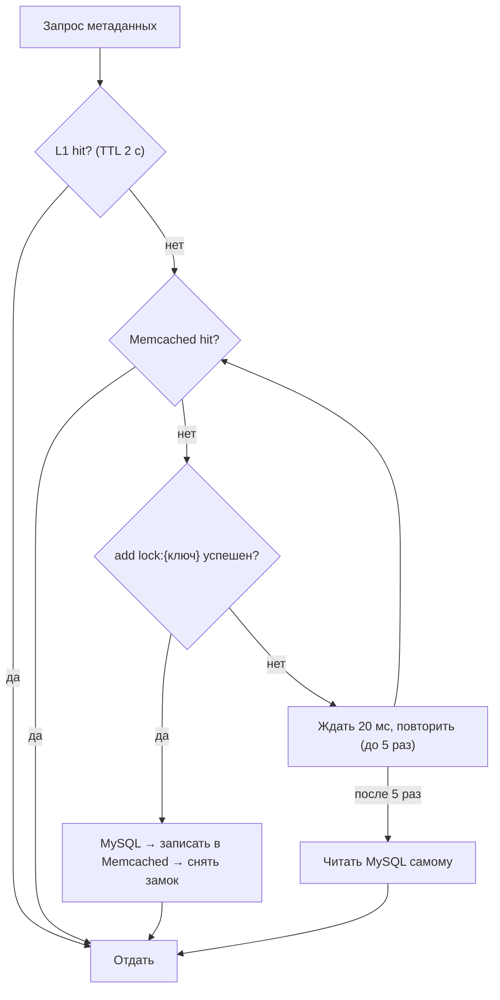

# Высоконагруженная платформа визуального поиска и сохранения идей Pinterest
### Курсовая работа по курсу «Проектирование высоконагруженных систем»

---

## 1. Тема и целевая аудитория

### Тема
Высоконагруженная платформа визуального поиска и сохранения идей (Pinterest). Ближайший аналог - Pinterest.

Pinterest представляет собой визуальную поисковую платформу, которая позволяет пользователям искать, организовывать и сохранять идеи в различных тематических областях. Сервис сочетает в себе функции социальной сети, визуального поиска и системы закладок. Пользователи создают доски, на которых сохраняют пины - изображения, видео или ссылки на внешние ресурсы.

### Целевая аудитория
- **Пользователи** - люди, которые ищут вдохновение, сохраняют идеи, создают доски;
- **Бизнес-пользователи и бренды** - компании, которые публикуют контент и продвигают продукты.

По итогам IV квартала 2025 года глобальная MAU достигла 619 млн (+12% г/г) [[1]](https://www.sec.gov/Archives/edgar/data/1506293/000150629326000019/q4-25xpressrelease.htm), по итогам II квартала 2026 - 640 млн MAU (+11% г/г) [[4]](https://www.sec.gov/Archives/edgar/data/0001506293/000150629326000102/q2-26xpressrelease.htm).

География - глобальная. Q4'25: США и Канада - 105 млн MAU, Европа - 158 млн MAU, остальной мир - 356 млн MAU [[1]](https://www.sec.gov/Archives/edgar/data/1506293/000150629326000019/q4-25xpressrelease.htm), [[6]](https://sproutsocial.com/insights/pinterest-statistics/).

Портрет аудитории: поколение зумеров стало крупнейшим сегментом в 2025 [[8]](https://www.sec.gov/Archives/edgar/data/1506293/000150629325000195/q2-25xpressrelease.htm); основная монетизация - США и Канада [[1]](https://www.sec.gov/Archives/edgar/data/1506293/000150629326000019/q4-25xpressrelease.htm).

### Функционал MVP
1. Регистрация и авторизация;
2. Создание, редактирование и удаление пинов;
3. Создание и управление досками;
4. Сохранение пина на доску;
5. Визуальный и текстовый поиск;
6. Просмотр ленты рекомендаций;
7. Лайк пинов.

### Ключевые продуктовые решения
- Визуальная поисковая платформа, а не социальная сеть;
- Контент по доскам и пинам;
- Персонализация на основе сохранений;
- Визуальный поиск по картинке;
- Мобильный приоритет.

---

## 2. Расчёт нагрузки

### 2.1 Динамика аудитории [[1]](https://www.sec.gov/Archives/edgar/data/1506293/000150629326000019/q4-25xpressrelease.htm), [[2]](https://www.fool.com/earnings/call-transcripts/2026/02/12/pinterest-pins-q4-2025-earnings-call-transcript/), [[3]](https://www.sec.gov/Archives/edgar/data/1506293/000150629326000060/finalars030826.htm), [[4]](https://www.sec.gov/Archives/edgar/data/0001506293/000150629326000102/q2-26xpressrelease.htm), [[5]](https://www.sec.gov/Archives/edgar/data/0001506293/000150629326000066/q1-26xpressrelease.htm):

| Квартал | MAU, млн | Рост г/г |
|---|---|---|
| Q4'24 | 553 | +11% |
| Q1'25 | 570 | +10% |
| Q2'25 | 578 | +11% |
| Q3'25 | 600 | +12% |
| Q4'25 | 619 | +12% |
| Q1'26 | 631 | +11% |
| Q2'26 | 640 | +11% |

Темп роста ≈ 2,5%/квартал = 11% годовых. Прогноз на 2 года: 640 × 1,11² ≈ **789 млн MAU**, запас 20-25%.

**DAU.** WAU/MAU = 62% [[3]](https://www.sec.gov/Archives/edgar/data/1506293/000150629326000060/finalars030826.htm) → WAU = 397 млн. DAU/MAU = 25% [[9]](https://www.blog.udonis.co/mobile-marketing/mobile-apps/pinterest) → **DAU = 160 млн**.

### 2.2 Продуктовые метрики

| Метрика | Значение |
|---|---|
| MAU | 640 млн |
| WAU | 397 млн |
| DAU | 160 млн |
| Всего пинов | 300 млрд |
| Пинов на пользователя | 468,75 шт. |
| Изображения (96%) | 450 шт. - 0,225 Гб |
| Видео (4%) | 18,75 шт. - 0,469 Гб |
| Объём на пользователя | 0,69 Гб |
| Досок на платформе | 6 млрд |
| Поисков в месяц | 80 млрд |
| Поисков на DAU | 17 |
| Сохранений в неделю | 1,5 млрд |
| Сохранений на DAU | 1,3 |
| Лайков на DAU | 10-20 |
| Создание пина на DAU | 0,05-0,1 |
| Просмотров пина на DAU | 200 |
| Внешних кликов в месяц | 1,7 млрд |

### 2.3 Технические метрики

#### Хранение [[11]](https://aws.amazon.com/solutions/case-studies/pinterest-proserve)

| Тип | Кол-во | Размер | Объём |
|---|---|---|---|
| Изображения (96%) | 288 млрд | 500 Кб | **144 ПБ** |
| Видео (4%) | 12 млрд | 25 Мб | **300 ПБ** |
| **Итого** | 300 млрд | - | **444 ПБ** |

#### Сетевой трафик

160 млн × 200 × 150 Кб = **4,8 ПБ/сутки**. Пик: 444 Гбит/с средний → **1150-1200 Гбит/с**.

#### RPS

| Тип запроса | Средний RPS | Пиковый RPS |
|---|---:|---:|
| Поиск | 30 900 | 93 000 |
| Лента | 18 500 | 55 000 |
| Показ пина | 370 000 | 1 100 000 |
| Сохранение | 2 500 | 7 500 |
| Лайк | 27 800 | 83 000 |
| Создание пина | 140 | 420 |
| Создание доски | 14 | 42 |
| Аутентификация | 2 200 | 6 600 |

Визуальные поиски: 20% от поисков = 6 200 / 18 500 (допущение).

---

## 3. Глобальная балансировка нагрузки

### 3.1 Домены

| Домен | Профиль | Хранилище (п. 6) |
|---|---|---|
| Identity/Auth | регистрация, сессии; низкий RPS | MySQL `identity`, `global`; Redis `SESSION` |
| Pin Service | CRUD пинов; средний RPS | MySQL `pin` |
| Board Service | CRUD досок; очень низкий RPS | MySQL `board` |
| Media/Storage | хранение, транскодирование; огромный объём | MySQL `media`, S3 |
| Search & Visual Search (включая сервис вывода эмбеддингов и ANN-брокер) | поиск, ML-инференс; высокий RPS + CPU | OpenSearch, ANN |
| Feed/Recommendation (включая Graph-сервис с `PIN_GRAPH`) | лента, Pixie; самый высокий RPS | Redis, Graph-сервис |
| Interaction/Graph | лайки, сохранения; средний RPS | TiDB, Kafka |
| Ads/Monetization | реклама; вне MVP | - |

### 3.2 Расположение ДЦ

Pinterest на AWS с 2010, долгосрочное соглашение с 2017, расширено до $4 млрд до 2031 [[12]](https://w.media/pinterest-and-aws-sign-us-4-billion-dollar-cloud-service-deal-for-ai-expansion/), [[13]](https://www.sec.gov/Archives/edgar/data/1506293/000150629320000013/pins-20191231.htm). Мульти-CDN: Akamai, CloudFront, Fastly, Cloudflare [[14]](https://www.netify.ai/resources/applications/pinterest).

Три региона: NA 17%, EU 25,5%, ROW 57,5%. Холодное хранилище централизовано. CDN PoP - везде.

### 3.3 Распределение по регионам

| Тип | Всего | US&Canada | Европа | ROW |
|---|---:|---:|---:|---:|
| Поиск | 30 900 | 5 253 | 7 880 | 17 768 |
| Показ пина | 370 000 | 62 900 | 94 350 | 212 750 |
| Лента | 18 500 | 3 145 | 4 718 | 10 638 |
| Сохранение | 2 500 | 425 | 638 | 1 438 |
| Лайк | 27 800 | 4 726 | 7 089 | 15 985 |
| Создание | 140 | 24 | 36 | 81 |

### 3.4 DNS-балансировка



### 3.5 Anycast



### 3.6 Регулировка трафика между ДЦ

1. Weighted routing с переливом по порогу 80 % (возврат ниже 70 %);
2. Health-check + circuit breaker;
3. Асинхронная кросс-региональная репликация.

---

## 4. Локальная балансировка нагрузки

### 4.1. Схема балансировки и механизмы резервирования

#### 4.1.1. Уровни балансировки внутри ДЦ

Внутри ДЦ трафик проходит четыре уровня балансировки. ДЦ делится на две зоны доступности (A и B) - группы стоек с независимым питанием и сетью, они служат доменами отказа.

Резервирование построено по модели **перелива нагрузки (spillover)**: зона не держит запас на всю нагрузку соседней зоны. Каждая зона рассчитана на свою половину нагрузки ДЦ и один запасной узел. Когда загрузка достигает порога **80 %**, избыток распределяется в другую зону или в соседние регионы.



**Выбранные решения:**
- **Медиа** (96% пинов - изображения) почти целиком обслуживает CDN;
- **Envoy-sidecar** - HTTP/2 держит одно соединение;
- **СУБД** - MySQL: 5 кластеров по доменам, шардирование внутри кластера [[10]](https://medium.com/pinterest-engineering/sharding-pinterest-how-we-scaled-our-mysql-fleet-3f341e96ca6f);
- **L4** в AWS - управляемый NLB;
- **Перелив** - для промахов CDN (120 из 134,85 Гбит/с). API остаётся в домашнем регионе.

#### 4.1.2. Алгоритмы

| Участок | Алгоритм | Резервирование |
| --- | --- | --- |
| Маршрутизаторы → L4 | ECMP по хешу потока [[17]](https://research.google/pubs/pub44824/) | оба L4 активны |
| NGINX | consistent hashing + DSR | health-check, запасной узел в зоне |
| сервис | random two least_conn [[18]](https://nginx.org/en/docs/http/ngx_http_upstream_module.html) | readiness, graceful drain |
| Envoy | least request + zone-aware [[33]](https://www.envoyproxy.io/docs/envoy/latest/intro/arch_overview/upstream/load_balancing/priority) | outlier detection |
| ProxySQL (пара на кластер БД) | read в реплику, write в primary | failover |
| ДЦ → регионы | weighted routing [[34]](https://docs.aws.amazon.com/global-accelerator/latest/dg/about-endpoint-groups-traffic-dial.html), [[35]](https://docs.aws.amazon.com/Route53/latest/DeveloperGuide/routing-policy-weighted.html) | порог 80 %, возврат 70 % |

#### 4.1.3. Формулы резервирования

| Формула | Защищает от |
| --- | --- |
| **N+1** | Отказ одного узла |
| **N*2** | Отказ целой зоны |
| **2×(⌈N/2⌉+1) + перелив** | Узел + зона одновременно |

**Применение:** L4 - N×2; L7 - 2×(⌈N/2⌉+1); Envoy - 2N; ProxySQL - N×2.

**Пороги:** рабочая точка 70 %, порог перелива 80 %, возврат <70 %, предел 100 %.

### 4.2. Расчёт количества балансировщиков

#### 4.2.1. Характеристики узла

Базовый узел - NGINX Ingress на 16 CPU [[15]](https://blog.nginx.org/blog/testing-performance-nginx-ingress-controller-kubernetes):

| Показатель | Измерено | Рабочая точка 0,7 | Порог 0,8 |
| --- | ---: | ---: | ---: |
| HTTPS RPS, 1 КБ | 341 232 | 238 862 | 272 986 |
| SSL TPS | 54 877 | **38 414** | 43 902 |
| Сеть | 8,80 Гбит/с | **6,16 Гбит/с** | **7,04 Гбит/с** |

Поправка на размер: 238 862 × 0,556 = **132 800 RPS** на узел.

Пессимистичная проверка [[16]](https://blog.nginx.org/blog/testing-the-performance-of-nginx-and-nginx-plus-web-servers): 6 676 TLS/с - в 8,2 раза меньше.

#### 4.2.2. Нагрузка

- **API:** 93 000 + 55 000 + 7 500 + 83 000 + 420 + 42 + 6 600 = **245 562 RPS**;
- **Промахи кэша:** 1 100 000 × 10% = **110 000 RPS**.

| Класс | Гбит/с |
| --- | ---: |
| Промахи кэша | 120,00 |
| Поиск | 5,19 |
| Лента | 8,88 |
| Прочий API | 0,78 |
| **Итого** | **134,85** |

| Регион | API RPS | Промахи | Трафик |
| --- | ---: | ---: | ---: |
| US&Canada | 41 746 | 18 700 | 22,93 |
| Европа | 62 618 | 28 050 | 34,39 |
| ROW | 141 198 | 63 250 | 77,54 |

#### 4.2.3. Расчёт

- N_RPS = ⌈API_RPS / 132 800⌉
- N_TLS = ⌈TLS / 38 414⌉
- N_net = ⌈трафик / 6,16⌉
- N = max
- L7 = 2 × (⌈N/2⌉ + 1)
- L4 = 2

| ДЦ | N_RPS | N_TLS | N_net | **N** | ⌈N/2⌉+1 | **L7** |
| --- | ---: | ---: | ---: | ---: | ---: | ---: |
| US&Canada | 1 | 2 | 4 | **4** | 3 | **6** |
| Европа | 1 | 2 | 6 | **6** | 4 | **8** |
| ROW | 2 | 4 | 13 | **13** | 8 | **16** |
| **Всего** | 4 | 8 | 23 | **23** | 15 | **30** |

#### 4.2.4. Проверка отказоустойчивости

| Состояние | US&Canada | Европа | ROW |
| --- | ---: | ---: | ---: |
| Штатно | 43% | 49% | 55% |
| Отказ узла | 65% | 65% | 63% |
| Отказ зоны | 80% (перелив 1,81) | 80% (перелив 6,23) | 80% (перелив 21,22) |
| Отказ зоны + узла | 80% (перелив 8,85) | 80% (перелив 13,27) | 80% (перелив 28,26) |

**Итог:** 6 L4-узлов, 30 L7-узлов, всего **36 балансировщиков** (против 58 при схеме 2(N+1)).

---

## 5. Логическая схема БД

### 5.1 Основные данные

Объекты создаются в трёх регионах одновременно, глобальный автоинкремент - точка синхронизации и отказа. Используется 64-битный id (8 Б): выдаётся локально, уникален, вдвое короче UUID. Экономия только на `PIN_LIKE`: `2,63 трлн × 2 × 8 Б ≈ 42 ТБ`.



### 5.2 Файлы, кеши, буферы, производные

```mermaid
erDiagram
    MEDIA ||--|| MEDIA_FILE : "хранит файл"
    USER ||--o{ UPLOAD_STAGING : "загружает"
    UPLOAD_STAGING ||--o| MEDIA : "после проверки"
    USER ||--o{ SESSION : "открывает"
    USER ||--o| FEED_CACHE : "лента"
    USER ||--o{ USER_RECENT : "недавние"
    PIN ||--o{ USER_RECENT : "объект"
    BOARD ||--o| BOARD_PINS_CACHE : "список"
    PIN ||--o| OBJECT_CACHE : "копия"
    USER ||--o| USER_CACHE : "копия"
    BOARD ||--o| BOARD_CACHE : "копия"
    PIN ||--|| PIN_STATS : "счётчики"
    PIN ||--o| PIN_TEXT_INDEX : "текст"
    MEDIA ||--o| PIN_VECTOR : "вектор"
    PIN ||--o{ PIN_VECTOR : "результат"
    PIN ||--o| PIN_GRAPH : "узел"
    BOARD ||--o| PIN_GRAPH : "узел"
    USER ||--o{ EVENT_STREAM : "действия"
    PIN ||--o{ EVENT_STREAM : "объект"

    MEDIA_FILE {
        varchar storage_key PK
        blob content
    }
    UPLOAD_STAGING {
        varchar upload_id PK "TTL 24 ч"
        bigint user_id FK
        varchar staging_key
        bigint bytes_received
        blob content
    }
    SESSION {
        binary token_hash PK "TTL 30 суток"
        bigint user_id FK
        varchar device
        timestamp created_at
        timestamp expires_at
    }
    FEED_CACHE {
        bigint user_id PK "TTL 30 мин"
        bigint_list pin_ids "200 шт."
        timestamp generated_at
    }
    USER_RECENT {
        bigint user_id PK "TTL 7 суток"
        bigint pin_id
        tinyint action
        timestamp ts
    }
    BOARD_PINS_CACHE {
        bigint board_id PK "TTL 1 ч"
        bigint_list pin_ids "50 шт."
    }
    OBJECT_CACHE {
        bigint pin_id PK "TTL 1 ч"
        blob payload "342 Б"
    }
    USER_CACHE {
        bigint user_id PK "TTL 1 ч"
        blob payload "144 Б"
    }
    BOARD_CACHE {
        bigint board_id PK "TTL 1 ч"
        blob payload "119 Б"
    }
    PIN_STATS {
        bigint pin_id PK
        int like_count
        int save_count
        int click_count
    }
    EVENT_STREAM {
        bigint event_id PK "3 суток"
        bigint user_id FK
        bigint pin_id FK
        tinyint type
        timestamp ts
        varchar context
    }
    PIN_TEXT_INDEX {
        bigint pin_id PK
        text_terms terms
    }
    PIN_VECTOR {
        bigint media_id PK
        bigint pin_id FK
        binary embedding "128×fp16=256 Б"
    }
    PIN_GRAPH {
        bigint node_id PK
        tinyint node_type
        bigint_list edges
        smallint topic
        tinyint status
        tinyint popularity_bucket
    }
```



### 5.3 Потоки данных

Создание пина (три кластера MySQL, общей транзакции нет - сага, п. 9.2):
```text
клиент --(файл)--> UPLOAD_STAGING
Media Service --> [media]  MEDIA (ready) + MEDIA_FILE
Pin Service   --> [pin]    PIN (board_id, board_seq) + PIN_STATS                   транзакция 1
Pin Service   --> [board]  BOARD_PIN (board_id, sequence = created_at, pin_id)     транзакция 2
                           не прошла - применит потребитель cdc.mysql.pin; ключ тот же, повтор безопасен
                  асинхронно: PIN_TEXT_INDEX, PIN_VECTOR, BOARD.pin_count
```

Сохранение:
```text
PIN оригинала --> [pin]   новый PIN: parent_pin_id = оригинал, board_id = доска сохраняющего
              --> [board] BOARD_PIN доски сохраняющего (как при создании)
              --> save --> PIN_STATS, USER_INTEREST, USER_RECENT
```

Лайк:
```text
PIN_LIKE (user_id, pin_id) → EVENT_STREAM → PIN_STATS, USER_INTEREST, USER_RECENT
```

Лента:
```text
USER_RECENT + USER_INTEREST + граф (Pixie) → FEED_CACHE (200 id, 30 мин)
FEED_CACHE → OBJECT_CACHE, USER_CACHE, BOARD_CACHE
```

Поиск:
```text
текст → PIN_TEXT_INDEX → pin_id → OBJECT_CACHE
картинка → вектор → PIN_VECTOR → pin_id → OBJECT_CACHE
```

Вход:
```text
email → USER_LOOKUP [global] → user_id → USER, AUTH_IDENTITY [identity] → SESSION
каждый API → SESSION
```

### 5.4 Описание сущностей

| Сущность | Вид | Назначение |
| --- | --- | --- |
| `USER` | основные | аккаунт |
| `AUTH_IDENTITY` | основные | способы входа |
| `BOARD` | основные | доска |
| `PIN` | основные | пин |
| `MEDIA` | основные | метаданные файла |
| `PIN_LIKE` | основные | лайк |
| `USER_INTEREST` | основные | интересы |
| `CATEGORY` | справочник | темы |
| `MEDIA_FILE` | файлы | сам файл |
| `UPLOAD_STAGING` | буфер | непроверенный файл |
| `SESSION` | временное | сессия |
| `FEED_CACHE` | кеш | лента |
| `USER_RECENT` | буфер, кеш | недавние действия |
| `BOARD_PINS_CACHE` | кеш | страница доски |
| `OBJECT_CACHE` | кеш | **пины** 342 Б |
| `USER_CACHE` | кеш | **пользователи** 144 Б |
| `BOARD_CACHE` | кеш | **доски** 119 Б |
| `EVENT_STREAM` | буфер | события |
| `PIN_STATS` | производные | счётчики |
| `PIN_TEXT_INDEX` | производные | текст |
| `PIN_VECTOR` | производные | вектор |
| `PIN_GRAPH` | производные, память | граф |

### 5.5 Размеры

| Сущность | Строк | Б/строка | Объём |
| --- | --- | --- | --- |
| USER | 640 млн | 144 | 92 ГБ |
| AUTH_IDENTITY | 768 млн | 77 | 59 ГБ |
| BOARD | 6 млрд | 119 | 714 ГБ |
| PIN | 300 млрд | 302 | 90,6 ТБ |
| MEDIA | 300 млрд | 107 | 32,1 ТБ |
| PIN_LIKE | 2,63 трлн | 20 | 52,6 ТБ |
| USER_INTEREST | 12,8 млрд | 18 | 230 ГБ |
| CATEGORY | 10 000 | 48 | <1 МБ |
| MEDIA_FILE | 288+12 млрд | 500 КБ/25 МБ | **444 ПБ** |
| UPLOAD_STAGING | 12,1 млн | 1,48 МБ | 17,9 ТБ |
| SESSION | 768 млн | 96 | 74 ГБ |
| FEED_CACHE | 16 млн | 1 640 | 26 ГБ |
| USER_RECENT | 397 млн | 280 (20 записей * 13 Б + 20 Б служебных) | 111 ГБ |
| BOARD_PINS_CACHE | 120 млн | 500 | 60 ГБ |
| OBJECT_CACHE (пины) | 3 млрд | 342 | **1 026 ГБ** |
| USER_CACHE | 160 млн | 144 | **23 ГБ** |
| BOARD_CACHE | 120 млн | 119 | **14 ГБ** |
| EVENT_STREAM | 117 млрд | 100 | 11,7 ТБ |
| PIN_STATS | 300 млрд | 20 | 6,0 ТБ |
| PIN_TEXT_INDEX | 300 млрд | 100 | 30 ТБ |
| PIN_VECTOR | 300 млрд | 272 | 81,6 ТБ |
| PIN_GRAPH | 51+9 млрд | 7,06 Б/ребро | **396 ГБ** |
| **Итого** | | | **≈ 309 ТБ** |

### 5.6 Нагрузка

| Сущность | Чтение (ср/пик) | Запись (ср/пик) |
| --- | --- | --- |
| USER | 22 550 / 67 650 | 10 / 30 |
| AUTH_IDENTITY | 2 200 / 6 600 | 5 / 15 |
| BOARD | 8 050 / 24 150 | 14 / 42 |
| PIN | 370 000 / 1 100 000 | 2 650 / 7 950 |
| MEDIA | 370 000 / 1 100 000 | 140 / 420 |
| PIN_LIKE | 18 500 / 55 500 | 27 800 / 83 000 |
| USER_INTEREST | 32 750 / 98 250 | 30 300 / 90 900 |
| PIN_STATS | 18 500 / 55 500 | 31 000 / 93 000 |
| SESSION | 82 050 / 245 560 | 2 200 / 6 600 |
| FEED_CACHE | 18 500 / 55 500 | 1 850 / 5 550 |
| USER_RECENT | 1 850 / 5 550 | 30 300 / 90 900 (сохранения 2 500 + лайки 27 800) |
| BOARD_PINS_CACHE | 5 550 / 16 650 | 2 650 / 7 950 |
| OBJECT_CACHE | **370 000 / 1 100 000** | 2 650 / 7 950 |
| USER_CACHE | **22 550 / 67 650** | 10 / 30 |
| BOARD_CACHE | **8 050 / 24 150** | 14 / 42 |
| EVENT_STREAM | 1 352 000 / 4 056 000 | 450 700 / 1 352 000 |
| MEDIA_FILE | 37 000 / 110 000 | 140 / 420 |
| PIN_TEXT_INDEX | 24 700 / 74 100 | 2 640 / 7 920 |
| PIN_VECTOR | 6 200 / 18 500 | 140 / 420 |
| PIN_GRAPH | 1 850 / 5 550 | 440 рёбер/с (38 млн в сутки) |

Холодный старт ленты (5% пересчётов, допущение): 93 / 278 запросов в секунду в OpenSearch.

### 5.7 Консистентность и распределение

- **строгая** - email, username, пароли, сессии;
- **read-your-writes** - доски, пины;
- **eventual** - счётчики, интересы, кеши, индексы.

| Сущность | Уровень | Ключ |
| --- | --- | --- |
| USER | строгая | user_id; вход - хеш |
| AUTH_IDENTITY | строгая | user_id |
| BOARD | read-your-writes | owner_id; кластер `board` |
| PIN | read-your-writes автору | pin_id; кластер `pin`; сохранение → шард сохраняющего |
| MEDIA | неизменяем | media_id |
| PIN_LIKE | идемпотентна | user_id |
| USER_INTEREST | eventual | user_id |
| PIN_STATS | eventual | pin_id; вирусный - горячий |
| SESSION | строгая в регионе | token_hash |
| FEED_CACHE | eventual | user_id |
| USER_RECENT | eventual | user_id |
| BOARD_PINS_CACHE | инвалидация | board_id |
| OBJECT_CACHE | cache-aside | pin_id; Парето |
| USER_CACHE | cache-aside | user_id |
| BOARD_CACHE | cache-aside | board_id |
| EVENT_STREAM | at-least-once | user_id |
| PIN_GRAPH | eventual | копия на 18 узлах |

**Между кластерами MySQL** (`identity`, `pin`, `board`, `media`): внутри кластера - транзакции; между кластерами - сага с идемпотентными шагами, согласованность eventual, автору пина `BOARD_PIN` виден сразу (шаг выполняется в том же запросе). Внешних ключей и JOIN между кластерами нет.

---

## 6. Физическая схема БД

Бизнес-логика разнесена по доменам (п. 3.1): у каждого домена свой кластер MySQL, сервис ходит только в свой кластер. JOIN и внешние ключи между кластерами невозможны; согласованность между кластерами обеспечивают саги (п. 5.3, 9.2). Классы хранения:
- **5 кластеров MySQL** по доменам: `identity`, `pin`, `board`, `media`, `global` - в каждом шардирование считается отдельно;
- TiDB - тяжёлые узкие таблицы;
- Redis + Memcached - кеши (Redis - отдельные деплойменты по типу ключей, в каждом регионе свой);
- Kafka - поток событий;
- S3 - файлы;
- OpenSearch / ANN - поиск.

### 6.1 Физическая схема

Сплошная линия - связь внутри кластера, пунктир - логическая ссылка между кластерами (без внешнего ключа).



Карта хранилищ:



### 6.2 Таблица описания

| Таблица | СУБД / кластер | Шардирование | Резервирование |
| --- | --- | --- | --- |
| `USER` | MySQL `identity` | ID-шард: 4 [[10]](https://medium.com/pinterest-engineering/sharding-pinterest-how-we-scaled-our-mysql-fleet-3f341e96ca6f) | primary + sync + async [[31]](https://dev.mysql.com/doc/refman/8.0/en/replication-semisync.html) |
| `AUTH_IDENTITY` | MySQL `identity` | ID-шард пользователя | как выше |
| `USER_LOOKUP` | MySQL `global` | **без шардинга, 1 primary** | primary + 3 реплики |
| `CATEGORY` | MySQL `global` | **1 шард** | как `USER_LOOKUP` |
| `BOARD` | MySQL `board` | ID-шард: 256, по владельцу | primary + sync + async |
| `BOARD_PIN` | MySQL `board` | ID-шард доски | как выше |
| `PIN` | MySQL `pin` | ID-шард: 4 096, случайный шард региона автора | как выше |
| `PIN_STATS` | MySQL `pin` | ID-шард пина | как выше |
| `MEDIA` | MySQL `media` | ID-шард: 1 024, случайный шард региона загрузившего | как выше |
| `PIN_LIKE` | TiDB | автоматическое | 3 реплики Raft |
| `USER_INTEREST` | TiDB | автоматическое | как `PIN_LIKE` |
| **`SESSION`** | **Redis, отдельный деплоймент** | **1 мастер на регион, в ROW 2** | реплика |
| **`FEED_CACHE`** | **Redis** | **1 мастер на регион** | реплика |
| **`USER_RECENT`** | **Redis** | **1 мастер на регион, в ROW 2** | реплика |
| **`BOARD_PINS_CACHE`** | **Redis** | **1 мастер на регион** | реплика |
| **Дельты `PIN_STATS`** | **Redis** | **1 мастер на регион** | реплика |
| **`OBJECT_CACHE`** | Memcached [[29]](https://github.com/facebook/mcrouter) | consistent hashing | без реплик |
| **`USER_CACHE`** | Memcached | consistent hashing | без реплик |
| **`BOARD_CACHE`** | Memcached | consistent hashing | без реплик |
| **`PIN_GRAPH`** | Graph-сервис | полная копия на 18 узлах | резерв 2×(⌈N/2⌉+1), снимок в S3 |
| `EVENT_STREAM` | Kafka [[24]](https://kafka.apache.org/documentation/) | партиции по ключу | RF 3 |
| `MEDIA_FILE`, `UPLOAD_STAGING` | S3 [[32]](https://docs.aws.amazon.com/AmazonS3/latest/userguide/Welcome.html) | хеш-префикс | три зоны + реплика |
| `PIN_TEXT_INDEX` | OpenSearch | 600 шардов по 50 ГБ, полная копия в каждом регионе | при отказе узла - перелив в соседний регион |
| `PIN_VECTOR` | ANN [[30]](https://github.com/facebookresearch/faiss) | 30 шардов по 240 ГБ | 2 реплики |

#### Правило шардирования

Шард - отдельная схема MySQL (`pin_0000` … `pin_4095`) на хосте; ProxySQL направляет запрос по имени схемы. Число шардов считается для каждого кластера отдельно: берётся ровно столько, сколько нужно по объёму, а не одно число на всю систему.

```text
D_сейчас   = сумма сырых объёмов таблиц кластера * 1,3     (индексы, фрагментация InnoDB, undo; 135,6 ТБ * 1,3 ≈ 176 ТБ по всем кластерам)
D_горизонт = D_сейчас * 1,2 * G
N_шардов   = min степень двойки, при которой D_горизонт / N <= 100 ГБ
N_хостов   = ⌈D_горизонт / 4,5 ТБ⌉, считается по регионам (NVMe 7,5 ТБ, заполнение <= 60 %)
```

`G` - рост за 2 года: для `pin`, `media`, `board` 1,55 (82,4 млрд новых пинов в год * 2); для `identity`, `global` 1,23 (рост MAU 11 % в год).

| Кластер | Таблицы | Сырой объём | D_сейчас | G | D_горизонт | Шардов | ГБ/шард | Primary-хостов (NA / EU / ROW) |
| --- | --- | ---: | ---: | ---: | ---: | ---: | ---: | --- |
| `pin` | PIN, PIN_STATS | 96,6 ТБ | 125,6 ТБ | 1,55 | 233,6 ТБ | **4 096** | 57 | **53** (9 / 13 / 31) |
| `media` | MEDIA | 32,1 ТБ | 41,7 ТБ | 1,55 | 77,6 ТБ | **1 024** | 76 | **18** (3 / 5 / 10) |
| `board` | BOARD, BOARD_PIN | 6,7 ТБ | 8,7 ТБ | 1,55 | 16,2 ТБ | **256** | 63 | **5** (1 / 1 / 3) |
| `identity` | USER, AUTH_IDENTITY | 151 ГБ | 196 ГБ | 1,23 | 290 ГБ | **4** | 72 | **3** (1 / 1 / 1) |
| `global` | USER_LOOKUP, CATEGORY | 42,5 ГБ | 55 ГБ | 1,23 | 82 ГБ | **1** | 82 | **1** |

Шарды делятся по регионам в тех же долях, что и нагрузка (17 / 25 / 58 %): `pin` 704 / 1 024 / 2 368, `media` 176 / 256 / 592, `board` 44 / 64 / 148, `identity` 1 / 1 / 2. Данные на хосте на горизонте: `pin` 4,5 ТБ, `media` 4,5 ТБ, `board` 4,1 ТБ - в пределах 4,5 ТБ. `USER_LOOKUP` и `CATEGORY` без шардинга: на горизонте 82 ГБ, это меньше предела 100 ГБ.

**Redis:** узлов = `max(⌈объём региона / 51 ГБ⌉, ⌈нагрузка региона в пике / 80 000⌉, 1)`. 51 ГБ - это 0,8 от узла 64 ГБ (запас на копирование страниц при снимке RDB). Структуры привязаны к пользователям региона, поэтому объём и нагрузка берутся в доле региона (17 / 25,5 / 57,5 %). Минимум - 1 мастер + 1 реплика.

| Деплоймент | Объём (глобально) | Пик, оп/с (глобально) | NA | EU | ROW |
| --- | ---: | ---: | ---: | ---: | ---: |
| `SESSION` | 74 ГБ | 252 160 | 1 | 1 | **2** (145 000 оп/с > 80 000) |
| `USER_RECENT` | 111 ГБ | 96 450 | 1 | 1 | **2** (63,8 ГБ > 51 ГБ) |
| `FEED_CACHE` | 26 ГБ | 61 050 | 1 | 1 | 1 |
| `BOARD_PINS_CACHE` | 60 ГБ | 24 600 | 1 | 1 | 1 |
| Дельты `PIN_STATS` | малый | 9 300 | 1 | 1 | 1 |
| **Мастеров** | | | **5** | **5** | **7** |

Мастеров 17, с репликами **34**. Один шард хватает во всех деплойментах, кроме `SESSION` и `USER_RECENT` в ROW.

**Остальные хранилища:**

| Хранилище | Шардов | Правило |
| --- | ---: | --- |
| TiDB | 80 TiKV | 316 ТБ / 4 ТБ |
| Memcached | 25 узлов/регион | 1 276 ГБ / 51 ГБ |
| OpenSearch | 600 | 30 ТБ / 50 ГБ |
| ANN | 30 | 7,2 ТБ / 240 ГБ |

**Размер MySQL:** хосты на горизонте заполнены до 4,5 ТБ из 7,5 ТБ; число копий - 3 (primary + sync + async).

**Размер TiDB:** 105,4 ТБ * 3 = 316 ТБ / 80 = 3,95 ТБ/узел.

**Число узлов:**

| Кластер | Primary | Всего (с копиями) |
| --- | ---: | ---: |
| MySQL `pin` | 53 | 159 |
| MySQL `media` | 18 | 54 |
| MySQL `board` | 5 | 15 |
| MySQL `identity` | 3 | 9 |
| MySQL `global` | 1 | 4 |
| TiDB | - | 89 |
| Memcached | - | 75 |
| Kafka | - | 27 |
| **Redis (5 деплойментов)** | 17 | **34** |
| OpenSearch | - | 52 (10 / 13 / 29) |
| Graph-сервис | - | 18 |
| ANN | - | 180 |

### 6.3 Идентификаторы

64 бита: 2 резерв + 16 `shard_id` + 10 `type` + 36 `local_id`.

```text
id       = (shard_id << 46) | (type << 36) | local_id
shard_id = (id >> 46) & 0xFFFF
type     -> кластер -> карта «шард -> хост» в ZooKeeper
```

`type` определяет кластер, `shard_id` - шард внутри него; `local_id` 36 бит (68,7 млрд) с запасом покрывает 73 млн пинов на шард.

| Объект | Кластер | Выбор шарда при создании |
| --- | --- | --- |
| пользователь | `identity` | случайный из своего региона |
| доска | `board` | `hash(owner_id)` внутри региона владельца: список досок и страницы доски - в одном шарде |
| пин | `pin` | случайный из региона автора; список пинов доски лежит в `BOARD_PIN` |
| медиа | `media` | случайный из региона загрузившего |

**Регионы (шардов / primary-хостов):**

| Кластер | US&Canada | Европа | ROW | Всего |
| --- | --- | --- | --- | --- |
| `pin` | 704 / 9 | 1 024 / 13 | 2 368 / 31 | 4 096 / 53 |
| `media` | 176 / 3 | 256 / 5 | 592 / 10 | 1 024 / 18 |
| `board` | 44 / 1 | 64 / 1 | 148 / 3 | 256 / 5 |
| `identity` | 1 / 1 | 1 / 1 | 2 / 1 | 4 / 3 |

**Маршрут USER_LOOKUP:**
```text
email --> md5(email) mod 1 = 0 --> кластер global, 1 primary --> user_id --> type, shard_id --> кластер identity
```

### 6.4 Индексы

| Таблица | Индекс | Запрос | Цена |
| --- | --- | --- | --- |
| `USER` | PK | профиль | кластерный |
| `AUTH_IDENTITY` | PK (user_id, provider) | вход | кластерный |
| `USER_LOOKUP` | PK (lookup_type, key_hash) | вход по email | кластерный |
| `BOARD` | PK + IDX (owner_id, created_at) | список досок | +120 ГБ |
| `BOARD_PIN` | PK (board_id, sequence DESC, pin_id) | страница без OFFSET | кластерный |
| `PIN` | PK | по id | кластерный |
| `MEDIA` | PK | по id | кластерный |
| `PIN_STATS` | PK | счётчики | кластерный |
| `PIN_LIKE` | PK + IDX | «лайкнул ли» + список | +52,6 ТБ |
| `USER_INTEREST` | PK | все интересы | кластерный |

Вторичного индекса `PIN (board_id)` нет: пины доски находятся через `BOARD_PIN`.

### 6.5 Денормализация

| Что | Зачем | Цена |
| --- | --- | --- |
| `media_key`, размеры в `PIN` | нет чтений `MEDIA` и обращений в кластер `media` при показе | +13,2 ТБ |
| `BOARD_PIN` отдельно | `PIN` и доска в разных кластерах: страница доски читается без обращения в `pin`; `PIN` не перезаписывается | 6 ТБ |
| `board_id`, `board_seq` в `PIN` | при удалении пина строка `BOARD_PIN` удаляется по ключу без индекса | в 302 Б строки |
| `PIN_STATS` + пакет | нет блокировок | 6 ТБ |
| `pin_count` в BOARD | без подсчёта | асинхронно |
| Лайки в двух порядках | быстро и «лайкнул» и список | +52,6 ТБ |
| `pin_id` в `PIN_VECTOR` | нет индекса `PIN (media_id)` | +8 Б |
| `USER_LOOKUP` | email не содержит шарда | 42,5 ГБ |

**Не денормализуются изменяемые:** имя автора и название доски в PIN не копируются.

**Счётчики:** Kafka → потребитель → Redis (`HINCRBY`) → пакетный UPDATE MySQL → offset.

**Ссылочная целостность между кластерами:** внешних ключей нет; её держат саги (п. 9.2) и ночная сверка: выборка `BOARD_PIN` проверяется на существование `PIN`, расхождения исправляет повтор события.

### 6.6 Клиентские библиотеки

| Компонент | Библиотека |
| --- | --- |
| MySQL | Connector/J + HikariCP + библиотека шардов (`id` → `type` → кластер → шард → хост) |
| ProxySQL | query rules по имени схемы, hostgroups, по паре на кластер в регионе |
| ZooKeeper | Curator, карта «шард → хост» отдельно для каждого кластера |
| TiDB | MySQL-драйвер |
| Redis | Lettuce |
| Memcached | mcrouter |
| **Graph-сервис** | **C++, граф в формате CSR в памяти** |
| **ANN-сервис** | **C++, FAISS (IVF-PQ)** |
| Kafka | Java client |
| S3 | AWS SDK |
| Поиск | OpenSearch + gRPC к ANN |
| CDC | Debezium (4 топика `cdc.mysql.*`) + TiCDC (`cdc.tidb`) |

### 6.7 Балансировка запросов

Нагрузка в пике после кешей, по кластерам:

| Кластер | Таблицы | Чтение | Запись | Primary | На хост: чтений / записей | QPS в ROW |
| --- | --- | ---: | ---: | ---: | ---: | ---: |
| `pin` | `PIN` 55 000, `PIN_STATS` 2 775 | **57 775** | 17 250 | 53 | 1 090 / 325 | 43 139 |
| `identity` | `USER` 3 382, `AUTH_IDENTITY` 6 600 | 9 982 | 45 | 3 | 3 327 / 15 | 5 766 |
| `board` | `BOARD` 1 208, `BOARD_PIN` 1 665 | 2 873 | 7 992 | 5 | 575 / 1 598 | 6 247 |
| `media` | `MEDIA` | 0 | 420 | 18 | 0 / 23 | 241 |
| `global` | `USER_LOOKUP` | 6 600 | 30 | 1 | 6 600 / 30 | 3 812 |
| **MySQL** | | **77 230** | **25 737** | 80 | | **59 206** |
| `PIN_LIKE` (TiDB) | | 55 500 | 83 000 | | | |
| `USER_INTEREST` (TiDB) | | 9 825 | 18 180 | | | |
| **TiDB** | | **65 325** | **101 180** | | | |

Чтения идут в реплики, записи - в primary (ProxySQL, `max_replication_lag` 1 с). Кластер `global` читают три региона с локальных реплик. ROW: ≈ **59 200 QPS** на все пять пар ProxySQL, из них 43 139 - на пару `pin`.

**Закон Литтла:** худший хост - `identity`: 3 342 QPS * 0,002 с = 6,7 запроса одновременно. Без прокси каждый из 356 подов, читающих `pin` (Pin, Feed, Search, Board), держит по 4 соединения на хост: 1 424 соединения. С ProxySQL пул 32 - в **44 раза** меньше.

### 6.8 Бэкапы

| Хранилище | Метод | RPO | RTO |
| --- | --- | --- | --- |
| MySQL (5 кластеров) | XtraBackup [[28]](https://docs.percona.com/percona-xtrabackup/) с async-реплики + binlog, каждый кластер независимо | 5 мин | 1 мин / 1,5-2 ч |
| TiDB | BR [[26]](https://docs.pingcap.com/tidb/stable/backup-and-restore-overview) | 5 мин | часы |
| Graph-сервис | снимок в S3 + пересборка из Kafka/MySQL | до 1 ч | 317 с + 2-4 ч |
| Redis SESSION | реплика + RDB | потеря = вход | минуты |
| **Redis USER_RECENT** | **реплика в другой зоне; при потере лента строится по интересам** | **потеря не критична** | **минуты** |
| Memcached | не копируется | - | прогрев |
| Kafka | RF 3 + sink в S3 | 0 | минуты |
| S3 MEDIA_FILE | версионирование + CRR | минуты | переключение |
| OpenSearch, ANN | снимок + пересборка | - | часы |

Принцип 3-2-1, Object Lock, проверка восстановления раз в месяц. Восстановление одного кластера не затрагивает остальные: самый крупный хост `pin` содержит 2,4 ТБ, при 400 МБ/с это 1,7 ч.

---

## 7. Алгоритмы


### 7.1. Формирование ленты рекомендаций

#### 7.1.1. Наименование

Алгоритм **Pixie** - случайные блуждания по графу «пин - доска» с перезапуском [[36]](https://arxiv.org/abs/1711.07601).

#### 7.1.2. Блок применения

**Feed/Recommendation Service** - функция «Просмотр ленты рекомендаций» (MVP № 6). Взаимодействует с Graph-сервисом (граф `PIN_GRAPH` в памяти) и `FEED_CACHE` (Redis).

#### 7.1.3. Постановка задачи

Для пользователя нужно отобрать 200 релевантных пинов из 300 млрд за доли секунды. Перебор невозможен: 300 млрд * 1 нс = 300 с. Нужен метод, время которого не зависит от общего числа пинов.

Требования к результату:
- 200 пинов за p99 не более 100 мс;
- доля сохранений и кликов из ленты не ниже резервной ленты по темам; целевое значение определяется A/B-тестом (допущение);
- разнообразие тем, чтобы лента не была однотипной;
- исключение уже показанных за последние 7 суток, удалённых и заблокированных пинов.

Бюджет задержки p99 (значения - допущения, кроме обхода):

| Этап | мс |
| --- | ---: |
| Обход графа, p99 [[36]](https://arxiv.org/abs/1711.07601) | 60 |
| Фильтр, оценка, MMR (CPU) | 10 |
| Чтение `USER_RECENT` | 2 |
| Чтение `USER_INTEREST` | 3 |
| Запись `FEED_CACHE` | 2 |
| Сериализация и сеть внутри региона | 5 |
| **Итого** | **82** |

#### 7.1.4. Исходные данные, ограничения и требования

**Исходные данные:**
- 300 млрд пинов, 6 млрд досок;
- у каждого пина есть `board_id` - из этого строится граф;
- 20 последних действий пользователя (только сохранения и лайки) за 7 суток;
- `USER_INTEREST` - веса тем пользователя.

**Действие** - это сохранение или лайк. Просмотры не пишутся: 370 000 событий в секунду раздавили бы `USER_RECENT`.

**Ограничения:**
- перебор 300 млрд * 1 нс = 300 с - недопустимо;
- граф 396 ГБ (613 ГБ через 2 года) помещается в память одного сервера, поэтому на каждом узле Graph-сервиса хранится полная копия;
- лента устаревает, если пересчитывается раз в сутки;
- одновременно 18 500 открытий ленты в секунду.

**Допущения (проверяются замером или A/B-тестом):**
- 10 мс на ранжирование;
- 17 % рёбер после чистки (как в [[36]](https://arxiv.org/abs/1711.07601));
- 7,06 Б на ребро (данные [[36]](https://arxiv.org/abs/1711.07601)).

#### 7.1.5. Последовательность работы



```text
1. Проверить FEED_CACHE:
     hit (90 %) - отдать - готово.
     miss (10 %) - шаг 2.

2. Взять USER_RECENT:
     20 последних действий за 7 суток.
     Вес: сохранение 1,0, лайк 0,5.
     Вес при чтении: w = w_действия * 2^(-возраст / 3 суток).
     Если в USER_RECENT меньше 3 записей - шаг 2а.

2а. Холодный старт:
     5 главных тем из USER_INTEREST;
     популярные пины этих тем из OpenSearch за 7 суток;
     если интересов нет - темы региона и языка.

3. Обход графа Pixie:
     общий бюджет N_total = 100 000 шагов,
     делится между стартовыми пинами пропорционально весам;
     шаг: пин → случайная доска → случайный пин;
     перезапуск с вероятностью 0,15;
     ранний останов: не менее 2 000 пинов посещены не менее 4 раз.

4. Добавить вес кандидатам:
     чем из большего числа стартовых пинов дошли,
     тем больше вес, формула: (Σ √посещений)^2.

5. Оставить 1 000 лучших, отфильтровать:
     status = deleted / blocked в атрибутах узла графа;
     пины из USER_RECENT;
     пины предыдущей ленты из FEED_CACHE (если она ещё есть).

6. Оценить лёгкой моделью (не нейросеть):
     тема совпадает с USER_INTEREST - +,
     популярность высокая - +,
     разнообразие тем по MMR:
     score = λ * релевантность - (1-λ) * max сходство с уже выбранными,
     сходство по теме: 1 если темы равны, иначе 0, λ = 0,7.

7. Записать в FEED_CACHE на 30 мин.
   Отдать первую страницу 20 пинов.

Сбои:
   Graph-сервис недоступен → шаг 2а;
   USER_RECENT потерян → шаг 2а;
   FEED_CACHE недоступен → пересчёт при каждом открытии с ограничением частоты на пользователя.
```

#### 7.1.6. Структуры данных

**Граф в памяти - CSR в обоих направлениях:**
- у пина - список досок, у доски - список пинов;
- плотные индексы узлов: 0..9 млрд;
- отображение `pin_id ↔ индекс узла` (словарь), `board_id ↔ индекс узла` (словарь);
- узел пина - `pin_id` оригинала, то есть `COALESCE(parent_pin_id, pin_id)` - так все копии одного пина соединены с одним узлом;
- структура: `offsets` длины |nodes|+1, `edges` - массив соседей.

**Атрибуты узла прямо в графе (4 Б):**

| Поле | Размер | Зачем |
| --- | ---: | --- |
| `topic` | 2 Б | фильтр по теме, MMR |
| `status` | 1 Б | удалён / заблокирован |
| `popularity_bucket` | 1 Б | корзина 0-255 для ранжирования |

**Зачем атрибуты в узле:** ранжирование не читает `OBJECT_CACHE` на каждого кандидата. Без этого было бы `2 000 кандидатов × 1 850 пересчётов/с = 3,7 млн чтений/с` - в 9 раз больше всего трафика кеша (400 600).

**`USER_RECENT` - Redis, 2 мастера + 2 реплики на регион:**
- 397 млн WAU × 280 Б = **111 ГБ**;
- 280 Б = 20 записей × 13 Б + 20 Б служебных;
- запись: `pin_id` 8 Б, `action` 1 Б, `ts` 4 Б;
- структура: ключ `recent:{user_id}`, значение - список из 20 записей;
- TTL 7 суток;
- вес хранится не в записи, а считается при чтении;
- потеря - холодный старт ленты (не критично).

Шардирование `USER_RECENT`: `max(⌈111 ГБ / 64 ГБ⌉, ⌈96 450 оп/с / 80 000⌉) = 2`.

#### 7.1.7. Альтернативные решения

| Вариант | Стоимость | Свежесть | Недостатки |
| --- | --- | --- | --- |
| **Пакетный расчёт всех лент раз в сутки** (прежняя система Pinterest на Hadoop, по [[36]](https://arxiv.org/abs/1711.07601)) | 640 млн лент против 160 млн пересчётов по запросу (1 850 * 86 400) - в 4 раза больше; хранение 640 млн * 1 640 Б = 1,05 ТБ | до 24 ч | Pixie дал до +50 % вовлечённости относительно такой системы [[36]](https://arxiv.org/abs/1711.07601) |
| **Подсчёт общих соседей по графу** | растёт со степенью узла (популярные доски) | секунды | время зависит от размера графа |
| **PinSage (графовые эмбеддинги)** [[37]](https://arxiv.org/abs/1806.01973) | граф 3 млрд узлов, 18 млрд рёбер, 7,5 млрд обучающих примеров; GPU-контур | пакетно | для MVP избыточно, остаётся развитием |
| **Только интересы по темам** | один запрос в OpenSearch | секунды | нет реакции на конкретные сохранения; используется как резерв (шаг 2а) |
| **Выбранный: случайный обход графа в памяти** | 26,7 мс CPU на обход | секунды | нет - это Pixie |

#### 7.1.8. Обоснование выбора и параметров

**Почему Pixie (4 причины из [[36]](https://arxiv.org/abs/1711.07601)):**
1. Время обхода не зависит от размера графа - только от числа шагов.
2. Граф целиком в памяти сервера, обход не ходит по сети.
3. Граф строится из существующих строк `PIN` с `board_id` - новых данных собирать не нужно.
4. Метод проверен в продакшене Pinterest: системы на Pixie дают более 80 % вовлечённости.

**Расчёт размера графа:**
```text
рёбер: 300 млрд пинов * 17 % = 51 млрд
       (по [36] чистка убирает нетематические доски и уменьшает граф примерно в 6 раз: 17 из 100 млрд)
байт на ребро: 120 ГБ / 17 млрд = 7,06 Б (данные [36])
рёбра: 51 млрд * 7,06 Б = 360 ГБ
узлов: 51 млрд / (17/3) = 9 млрд
атрибуты: 9 млрд * 4 Б = 36 ГБ
итого: 396 ГБ
через 2 года: * 1,55 = 613 ГБ
```

Пессимистично (10 Б на ребро, если индекс узла не 32-битный): 546 ГБ, через 2 года 846 ГБ. Сервер с 1 ТБ RAM всё равно подходит.

**Параметры алгоритма:**

| Параметр | Значение | Обоснование |
| --- | --- | --- |
| Размер запроса | 20 пинов | компромисс охвата интересов и времени обхода; размер записи `USER_RECENT` 280 Б |
| Веса действий | сохранение 1,0, лайк 0,5 | сохранение - более сильный сигнал (допущение) |
| Полураспад веса | 3 суток | недавние действия важнее (допущение, A/B) |
| N_total | 100 000 шагов | верхняя граница времени; обычно останов раньше |
| Перезапуск | 0,15 | средняя длина одного обхода 6-7 шагов (допущение) |
| Ранний останов | 2 000 пинов по 4 посещения | 10-кратный запас к 200 пинам ленты |
| Кандидатов после отбора | 1 000 | достаточно для MMR |
| λ в MMR | 0,7 | баланс релевантности и разнообразия (допущение) |
| Размер ленты, TTL | 200 пинов, 30 мин | 10 страниц; один пересчёт на сессию |
| Доля рёбер графа | 17 % | как в [[36]](https://arxiv.org/abs/1711.07601) |

#### 7.1.9. Влияние на физическую схему, нагрузку и взаимодействие

**Схема БД:** добавлены сущности `PIN_GRAPH` (отражена в п. 5.2, 5.4, 5.5, 5.6, 5.7, 6.1, 6.2, 6.8) и `USER_RECENT` (там же). `PIN_GRAPH` - не таблица СУБД, а структура в памяти Graph-сервиса; в 6.2 и 6.8 указано, что снимок идёт в S3.

**Расчёт числа узлов Graph-сервиса:**
```text
Стоимость пересчёта: обход 26,7 мс (32 vCPU / 1 200 QPS из [36]) + ранжирование 10 мс (допущение) = 36,7 мс CPU
Узел 32 vCPU: 32 / 0,0367 = 873 пересчёта/с на 100 %
На рабочей точке 70 % = 611 пересчётов/с
Пик пересчётов 5 550/с; по регионам (17 / 25,5 / 57,5 %): 944 / 1 415 / 3 191
N = ⌈944/611⌉ = 2;  ⌈1 415/611⌉ = 3;  ⌈3 191/611⌉ = 6
Резерв по формуле п. 4.1.3, 2 * (⌈N/2⌉ + 1):
  US&Canada: 2 * (1 + 1) = 4
  Европа:    2 * (2 + 1) = 6
  ROW:       2 * (3 + 1) = 8
Итого: 18 узлов, 576 vCPU
Память под графы: 18 * 396 ГБ = 7,1 ТБ
```

Чувствительность к стоимости ранжирования:

| Ранжирование, мс | Стоимость пересчёта, мс | Нужно узлов |
| ---: | ---: | --- |
| 10 (принято) | 36,7 | **18** (4 / 6 / 8) |
| 30 | 56,7 | 24 (6 / 6 / 12) |
| 50 | 76,7 | 28 (6 / 8 / 14) |

**Нагрузка:**
- пересчётов ленты: 1 850/с средний, 5 550/с пиковый (10 % открытий);
- пересчётов в сутки: 1 850 * 86 400 = 160 млн;
- внешних чтений на пересчёт: 2 (`USER_RECENT`, `USER_INTEREST`);
- холодный старт: 5 % пересчётов = 93 / 278 запросов/с в OpenSearch.

**Обновление графа:**
- полная пересборка раз в сутки из снимка MySQL в S3;
- загрузка снимка: 396 ГБ / 1,25 ГБ/с = 317 с;
- новые рёбра из Kafka: 82,4 млрд в год * 17 % / 365 = 38 млн в сутки, около 440 в секунду, применяются пачкой раз в час.

**Взаимодействие:**
- Feed-сервис → Graph-сервис по gRPC;
- `USER_RECENT` пишет потребитель событий при лайке и сохранении (события из `cdc.tidb`, `cdc.mysql.pin` и `cdc.mysql.board`);
- метаданные страницы читаются из `OBJECT_CACHE`, `USER_CACHE`, `BOARD_CACHE`: 18 500 * 20 = 370 000 чтений/с, как в п. 5.6.

**Сбои:** см. шаги в 7.1.5.

### 7.2. Визуальный поиск по картинке

#### 7.2.1. Наименование

Приближённый поиск ближайших соседей **IVF-PQ** (библиотека FAISS) [[30]](https://github.com/facebookresearch/faiss), [[39]](https://arxiv.org/abs/1702.08734).

#### 7.2.2. Блок применения

**Search & Visual Search Service** - функции «Визуальный поиск по загруженному изображению» и «Найти похожие» на существующий пин (MVP № 5). Во втором сценарии вектор берётся реконструкцией из кода пина, без инференса.

#### 7.2.3. Постановка задачи

Пользователь загружает картинку; нейросеть превращает её в вектор из 128 чисел (эмбеддинг). Нужно найти ближайшие векторы среди 300 млрд. Похожесть = близость векторов (евклидово или косинусное расстояние).

Точный перебор:
```text
300 млрд * 128 * 2 = 7,7 * 10^13 FLOP
на одном ядре при 50 GFLOP/с (допущение) 1 536 с ≈ 25,6 мин
память на точное хранение: 300 млрд * 256 Б = 76,8 ТБ (без pin_id)
с pin_id (272 Б, п. 5.5): 300 млрд * 272 Б = 81,6 ТБ
```

Требования к результату:
- p99 не более 100 мс;
- recall@10 ≥ 0,8 (допущение: 8 из 10 настоящих соседей найдены);
- память укладывается в разумный объём серверов.

Бюджет задержки p99 (значения - допущения):

| Этап | мс |
| --- | ---: |
| Вычисление вектора (только загрузка картинки, GPU) | 30 |
| Поиск 32 ближайших центроидов брокером | 2 |
| Просмотр списков на шарде (76 тыс. кодов * 25 нс) | 1,9 |
| RPC к 30 шардам, p99 | 20 |
| Слияние 30 * 200 → 200 | 3 |
| Фильтр и метаданные из `OBJECT_CACHE` | 5 |
| **Итого** | **≈ 62** |

#### 7.2.4. Исходные данные, ограничения и требования

**Исходные данные:**
- 300 млрд пинов, у каждого - эмбеддинг 128 чисел (fp16, 256 Б);
- верхняя оценка: как и 300 млрд файлов в п. 2.3 - у каждого пина свой файл, но репины делят файл, так что уникальных файлов меньше. Если уникальных 10 %, то векторов 30 млрд.

**Ограничения:**
- точный перебор: 25 минут, 76,8 ТБ памяти;
- 6 200 / 18 500 QPS визуального поиска в пике;
- в каждом регионе по 2 копии всех 30 шардов (п. 6.2), запрос обслуживается локально - нельзя делать запрос через регион из-за задержки;
- доля загрузок: 10 % визуальных поисков - загрузка картинки, требует вычисления вектора (620 / 1 850 запросов/с к сервису вывода эмбеддингов).

**Допущения:**
- 25 нс на код на ядро (проверяется замером на FAISS);
- recall@10 ≥ 0,8 - целевое значение, подбирается через nprobe; измеряется сравнением с точным перебором на подвыборке пар «пин - визуально близкие пины».

#### 7.2.5. Последовательность работы



```text
1. Пользователь загружает картинку.
2. ML-модель превращает её в вектор 128 чисел (fp16).
3. Брокер региона находит 32 ближайших центроида (nprobe = 32).
4. Рассылает вектор во все 30 шардов ANN-сервиса:
     шардирование по хешу media_id,
     каждый шард хранит 1/30 каждого кластера.
5. Каждый шард:
     смотрит свои 1/30 кодов в 32 ближайших кластерах,
     считает приближённые расстояния по таблицам,
     возвращает 200 лучших pin_id.
6. Брокер сливает 30 списков по расстоянию, оставляет 200.
7. По pin_id объекты достаются из OBJECT_CACHE.
8. Отдаём пользователю.

Индексация нового вектора (140 вставок/с в пике):
   вектор → ближайший центроид → код 16 Б → список на шарде hash(media_id) mod 30;
   центроиды переобучаются раз в квартал.

Фильтр статусов: удалённые и заблокированные пины отсекаются через OBJECT_CACHE.

Отказ шарда:
   ответ из 29 шардов (теряется около 3 % кандидатов);
   копия шарда в регионе подхватывает запросы.
```

#### 7.2.6. Структуры данных

**IVF (inverted file):**
- nlist = 2^22 = 4 194 304 кластера;
- центроид: 128 чисел * 4 Б (fp32) = 512 Б;
- квантизатор: 4 194 304 * 512 Б = **2,15 ГБ на шард** и на брокер;
- список в среднем 300 млрд / 4 194 304 = 71 526 векторов;
- для запроса - ищем 32 ближайших центроида (nprobe = 32);
- 32 * 71 526 = **2,29 млн кодов** вместо 300 млрд.

**PQ (product quantization):**
- вектор 128 чисел делится на m = 16 частей по 8 чисел;
- каждая часть заменяется номером ближайшего центроида из 256 (1 байт);
- вектор сжимается с 256 Б до **16 Б**;
- расстояние до запроса считается по таблицам: для каждой части запроса заранее считается расстояние до всех 256 центров (16 * 256 = 4 096 значений), а расстояние до сжатого вектора - сумма 16 значений из таблиц.

**Запись индекса:**
```text
16 Б код + 8 Б pin_id = 24 Б на вектор
300 млрд * 24 Б = 7,2 ТБ
7,2 ТБ / 30 шардов = 240 ГБ на шард
```

**Обоснование шардирования по хешу:** каждый шард хранит 1/30 каждого кластера, нагрузка ровная, вставка нового вектора проста. Цена - 30 * 18 500 = 555 000 запросов к шардам в секунду, 12,4 Гбит/с суммарно. Альтернатива «шардирование по кластерам» даёт меньше fan-out, но горячие кластеры создают перекос.

#### 7.2.7. Альтернативные решения

| Вариант | Память на 300 млрд векторов | Недостатки |
| --- | ---: | --- |
| Точный перебор | 76,8 ТБ (81,6 ТБ с идентификаторами) | 7,7 * 10^13 FLOP на запрос, около 25 мин на ядре |
| IVF без сжатия | 81,6 ТБ | в 11,3 раза больше памяти, чем IVF-PQ |
| HNSW | около 156 ТБ (вектор 256 Б + 8 Б + около 256 Б связей; оценка для 32 связей) | в 22 раза больше памяти, вставка дороже |
| **IVF-PQ (выбран)** | **7,2 ТБ** | recall ниже из-за сжатия; регулируется nprobe |
| ScaNN (Google) | как IVF-PQ | менее зрелая реализация |

#### 7.2.8. Обоснование выбора и параметров

**Параметры индекса:**

| Параметр | Значение | Обоснование |
| --- | ---: | --- |
| m (частей PQ) | 16 по 8 бит | 16 Б на вектор; m = 32 дало бы 12 ТБ |
| nlist | 2^22 = 4 194 304 | список в среднем 71 526, приемлемое сканирование |
| nprobe | 32 (стартовое) | подбирается по recall@10 ≥ 0,8 |
| Лучших с шарда | 200 | 10-кратный запас к 200 после слияния |
| Шардов | 30 | 7,2 ТБ / 240 ГБ |
| Копий на регион | 2 | 60 серверов на регион |
| 25 нс на код на ядро | допущение | проверить замером на FAISS |

**Расчёт памяти:**
```text
300 млрд * 24 Б = 7,2 ТБ; / 30 шардов = 240 ГБ на шард
против 81,6 ТБ без сжатия - в 11,3 раза меньше
```

**Стоимость и выбор nprobe:**

| nprobe | Кодов на запрос | CPU на запрос | Ядер в пике | Ядер в среднем |
| ---: | ---: | ---: | ---: | ---: |
| 16 | 1,14 млн | 29 мс | 529 | 177 |
| **32** | **2,29 млн** | **57,25 мс** | **1 059** | **355** |
| 64 | 4,58 млн | 114 мс | 2 117 | 710 |

Стартовое значение nprobe = 32. Финальное подбирается так, чтобы recall@10 был ≥ 0,8.

**Ядра по регионам в пике (57,25 мс на запрос):**
```text
US&Canada: 3 145 * 0,05725 = 180
Европа:    4 718 * 0,05725 = 270
ROW:      10 638 * 0,05725 = 609
Итого: 1 059
```
По серверам (60 на регион): 3,0 / 4,5 / 10,1 ядра на сервер - ограничивает память, а не процессор.

**Ссылка на реальный Pinterest:** визуальный поиск по CNN-признакам для миллиардов картинок уже работает [[38]](https://arxiv.org/abs/1505.07647).

**Слабое место:** 300 млрд векторов - верхняя оценка. Если уникальных файлов 10 %: векторов 30 млрд, памяти 0,72 ТБ, шардов 3 вместо 30. Архитектура (IVF-PQ, брокер, шарды) не меняется.

#### 7.2.9. Влияние на физическую схему, нагрузку и взаимодействие

**Схема БД:** `PIN_VECTOR` без изменения размера (24 Б на вектор в индексе, 272 Б в сырых данных в S3, п. 5.5). Добавляется квантизатор 2,15 ГБ на шард и брокер (учтено в 6.2).

**Нагрузка:**
- запросов ANN: 6 200 / 18 500 в секунду;
- запросов к шардам ANN: 555 000 в секунду;
- трафик: запрос 256 Б вектор + 32 * 4 Б центроидов ≈ 0,4 КБ, ответ 200 * 12 Б = 2,4 КБ, итого 555 000 * 2,8 КБ = 1,55 ГБ/с = 12,4 Гбит/с по всем регионам;
- индексация: 140 в секунду;
- вычисление векторов: 620 / 1 850 в секунду (только загрузки).

**Взаимодействие:**
- новые компоненты: сервис вывода эмбеддингов (GPU, проектное решение), индексатор (потребитель Kafka), брокер региона в Search-сервисе;
- результат - `pin_id`, метаданные из `OBJECT_CACHE`.

**ANN-сервис:** 180 серверов (30 шардов * 2 копии * 3 региона), память на сервер 240 + 2,15 = 242 ГБ, с запасом рекомендовать серверы от 384 ГБ RAM.

### 7.3. Кеширование объектов

#### 7.3.1. Наименование

**Cache-aside** с защитой от трёх проблем:
- лавины промахов (stampede);
- устаревших данных (stale set);
- горячих ключей (hot key) через L1-кеш.

#### 7.3.2. Блок применения

Сервисы Pin, Board, Feed, Search, которые читают метаданные объектов. Кеши: `OBJECT_CACHE` (пины), `USER_CACHE` (пользователи), `BOARD_CACHE` (доски) - все в Memcached + mcrouter. Каждый префикс ключей принадлежит своему кластеру MySQL: `pin:` - `mysql-pin`, `user:` - `mysql-identity`, `board:` - `mysql-board` (п. 6.2). 

#### 7.3.3. Постановка задачи

Метаданные пина читаются 1,1 млн раз в секунду в пике. Без кеша читали бы напрямую кластеры MySQL своих доменов (п. 6.2), по числу primary-хостов:
```text
pin:      1 100 000 / 53 = 20 750 чтений/с на хост
identity:    67 650 /  3 = 22 550 чтений/с на хост
board:       24 150 /  5 =  4 830 чтений/с на хост
```
Самый узкий - `identity` (3 хоста): кеш для него так же обязателен, как для `pin`.

**Требования:**
- обосновать 95 % hit rate;
- защититься от трёх проблем кеша;
- устаревание не более 5 с.

#### 7.3.4. Исходные данные, ограничения и требования

**Три кеша:**

| Ключ | Значение | Размер | Hit rate |
| --- | --- | ---: | ---: |
| `pin:{id}` | пин | 342 Б | 95 % |
| `user:{id}` | пользователь | 144 Б | 95 % |
| `board:{id}` | доска | 119 Б | 95 % |

**Нагрузка:** 400 600 чтений/с в среднем, 1 191 800 в пике (`PIN` 1 100 000 + `USER` 67 650 + `BOARD` 24 150). Пик = среднее * 3.

**Размер:**
```text
пины:          1 % от 300 млрд = 3 млрд * 342 Б = 1 026 ГБ
пользователи:  DAU 160 млн * 144 Б               =    23 ГБ
доски:         2 % от 6 млрд = 120 млн * 119 Б   =    14 ГБ
итого: 1 063 ГБ
* 1,2 (служебные Memcached): 1 276 ГБ
узел 64 ГБ * 0,8 = 51 ГБ
1 276 / 51 -> 25 узлов на регион, 75 всего
```

**Ограничения:**
- 370 000 чтений/с пинов (среднее), 1 100 000 в пике;
- устаревание не более 5 с;
- потеря кеша не должна ронять систему.

**Допущение:** показатель Ципфа s = 1,1 - Pinterest не публикует, но модель показана с чувствительностью (см. 7.3.8).

#### 7.3.5. Последовательность работы



```text
1. Читать L1 (память пода, TTL 2 с, 10 000 горячих ключей).
     hit - отдать.

2. При промахе L1 - читать Memcached.
     hit - положить в L1 - отдать.

3. При промахе Memcached - взять замок add lock:{ключ} TTL 10 с:
     успешен - читать MySQL своего кластера (реплика, отставание до 1 с) - записать в Memcached - снять замок;
     не успешен - ждать 20 мс, повторить шаг 2;
     после 5 повторов - читать MySQL самому без кеша.

4. При изменении объекта:
     удалить ключ сразу после коммита,
     удалить ещё раз через 1-2 с из журнала MySQL (двойное удаление).
```

**Почему замок на `add`, а не lease-токены:** lease-токены есть в доработанной версии Memcached у Facebook [[40]](https://www.usenix.org/conference/nsdi13/technical-sessions/presentation/nishtala), в стандартном Memcached их нет. Атомарная команда `add` (успешна только если ключа нет) даёт тот же эффект «один читатель на ключ». TTL замка 10 с - тот же интервал, что у Facebook [[40]](https://www.usenix.org/conference/nsdi13/technical-sessions/presentation/nishtala).

**Stale set (гонка устаревшей записи):** клиент прочитал старую строку, пин изменили и ключ удалили, клиент записал старое значение в кеш. Повторное удаление из журнала MySQL (Debezium → Kafka → потребитель «инвалидация», 1-2 с) убирает его. Видимость изменения: L1 2 с + повторное удаление 1-2 с, итого меньше 5 с.

**Три кластера:** событие изменения приходит из топика кластера-владельца (`cdc.mysql.pin`, `cdc.mysql.board`, `cdc.mysql.identity`), один потребитель обслуживает все три по префиксу ключа. Заполнение кеша читает реплику с отставанием не более 1 с (`max_replication_lag` ProxySQL [[22]](https://proxysql.com/documentation/)): это меньше задержки двойного удаления 1-2 с, поэтому устаревшее значение, прочитанное с отстающей реплики, всё равно удаляется.

**TTL объекта:** 1 ч с jitter ± 10 %, чтобы ключи не истекали одновременно.

#### 7.3.6. Структуры данных

| Ключ | Значение | Размер | TTL | Где |
| --- | --- | ---: | --- | --- |
| `pin:{pin_id}` | строка `PIN` с `media_key`, шириной и высотой | 342 Б | 1 ч ± 10 % | Memcached |
| `user:{user_id}` | строка `USER` | 144 Б | 1 ч ± 10 % | Memcached |
| `board:{board_id}` | строка `BOARD` | 119 Б | 1 ч ± 10 % | Memcached |
| `lock:{ключ}` | замок | 1 Б | 10 с | Memcached |

**L1-кеш:** LRU в памяти пода, 10 000 ключей * 342 Б = 3,4 МБ, TTL 2 с. Подов, читающих метаданные (Feed, Search, Board; п. 11.5): 298, в ROW 170 (57,5 %).

#### 7.3.7. Альтернативные решения

| Вариант | Результат | Недостатки |
| --- | --- | --- |
| Без кеша | 1 191 800 чтений/с на MySQL, в 20 раз больше | нужно в 20 раз больше хостов чтения |
| Cache-aside без замка | просто | лавина: 50 000 * 0,005 с = 250 одновременных чтений MySQL вместо одного; Facebook с leases снизил пик запросов к БД с 17 тыс. до 1,3 тыс. в секунду [[40]](https://www.usenix.org/conference/nsdi13/technical-sessions/presentation/nishtala) |
| Write-through | кеш всегда свежий | 2 650 новых пинов в секунду почти не читаются повторно, вытесняют горячие данные |
| Write-back | быстрая запись | потеря данных при отказе узла |
| Только TTL | проще | удалённый пин виден до часа |
| Репликация горячих ключей на несколько узлов (приём Facebook [[40]](https://www.usenix.org/conference/nsdi13/technical-sessions/presentation/nishtala)) | снимает нагрузку с узла | с L1 не нужна: 170 / 2 с = 85 чтений в секунду на ключ |
| **Выбранный: cache-aside + замок + двойное удаление + L1** | один читатель БД на ключ, изменение видно за 2-5 с | дополнительный кеш L1 в процессе |

#### 7.3.8. Обоснование выбора и параметров

**Модель Ципфа:** если упорядочить пины по популярности, `k`-й получает долю обращений `1/k^s`. Кеш на 1 % пинов (3 млрд из 300 млрд) хранит самые популярные.

**Формула:**
```text
hit = H_s(C) / H_s(N),  H_s(n) = Σ 1/k^s по k от 1 до n
```

**Пины (C = 3 млрд, N = 300 млрд):**

| Показатель `s` | Hit rate | Чтений `PIN` в MySQL в пике | На хост из 53 |
| ---: | ---: | ---: | ---: |
| 0,9 | 60,4 % | 435 000 | 8 208 |
| 1,0 | 82,9 % | 188 000 | 3 547 |
| 1,05 | 90,9 % | 100 000 | 1 887 |
| **1,1** | **95,8 %** | **46 000** | **868** |
| 1,2 | 99,3 % | 7 600 | 143 |

**Пользователи (C = 160 млн DAU, N = 640 млн MAU) при s = 1,1:** 97,9 %. При s = 1,0: 93,4 %.

**Доски (C = 120 млн = 2 % от 6 млрд, N = 6 млрд) при s = 1,1:** 94,7 %. При s = 1,0: 83,1 %. В расчётах п. 6.7 оставлено 95 %, разница - 72 запроса/с к MySQL (`24 150 * (5,3 % - 5 %)`), на нагрузку не влияет.

**Вывод:** `s = 1,1` - допущение. При `s = 1,0` кластер `pin` выдержит (3 547 чтений на хост), но поток на пару ProxySQL `pin` в регионе ROW вырастет с 43 139 до 119 600 QPS (`(188 000 + 2 775 + 17 250) * 0,575`), и ProxySQL придётся усилить.

**Расчёт лавины (stampede):**
```text
ключ с 50 000 чтений/с, время заполнения 5 мс:
50 000 * 0,005 = 250 одновременных чтений MySQL
с замком - одно
```
Facebook с leases снизил пик запросов к БД с 17 тыс. до 1,3 тыс./с [[40]](https://www.usenix.org/conference/nsdi13/technical-sessions/presentation/nishtala).

**Расчёт hot key:**
```text
170 подов в ROW / 2 с (TTL L1) = 85 запросов/с на ключ до Memcached
```

**Параметры и их обоснование:**

| Параметр | Значение | Обоснование |
| --- | --- | --- |
| TTL объекта | 1 ч ± 10 % | устаревание ≤ 1 ч; jitter против одновременного истечения |
| TTL замка | 10 с | как у Facebook [[40]](https://www.usenix.org/conference/nsdi13/technical-sessions/presentation/nishtala) |
| Ожидание при замке | 20 мс * 5 | время заполнения одного ключа (5 мс) с запасом |
| L1 размер, TTL | 10 000 ключей, 2 с | 3,4 МБ на под; снимает горячие ключи |
| Узлов Memcached | 25 на регион | 1 276 ГБ / 51 ГБ |
| Показатель Ципфа | s = 1,1 (допущение) | Pinterest не публикует; оценивается по журналам обращений |

**Размер кеша «1 %»:** при s = 1,1 кеш на 0,5 % пинов уже даёт 95,0 %, на 2 % - 96,5 %. Выше 1 % выигрыш мал, память растёт линейно.

#### 7.3.9. Влияние на физическую схему, нагрузку и взаимодействие

**Схема БД:**
- `OBJECT_CACHE` разбит на три сущности: пины (1 026 ГБ), пользователи (23 ГБ), доски (14 ГБ);
- 25 узлов Memcached на регион (75 всего);

**Нагрузка:**
- MySQL получает `55 000 + 3 382 + 1 208 = 59 590` чтений в пике вместо `1 100 000 + 67 650 + 24 150 = 1 191 800` - в 20 раз меньше (`pin` 55 000 на 53 хоста, `identity` 3 382 на 3, `board` 1 208 на 5);
- Memcached `1 191 800 / 75 = 15 900` чтений на узел в пике;
- замков не больше числа промахов: около 20 030 в секунду в среднем.

**Отказ узла Memcached:** потеря 1 узла из 25 - 4 % ключей, доля промахов растёт с 5 % до `5 % + 4 % * 95 % = 8,8 %`, чтений `PIN` в MySQL `0,088 * 1 100 000 = 96 800` в секунду (вместо 55 000), то есть 1 826 на хост `pin` вместо 1 038. mcrouter переключает на резервный пул (failover).

**Взаимодействие:**
- потребитель «инвалидация» из п. 6.1 (Debezium → Kafka → удаление ключа): топики `cdc.mysql.pin`, `cdc.mysql.board`, `cdc.mysql.identity`;
- недоступность одного кластера (например, `mysql-board`) не блокирует чтение пинов: у каждого кластера свой ProxySQL, таймаут и circuit breaker (п. 9.3), кешированные метаданные продолжают отдаваться;
- mcrouter [[29]](https://github.com/facebook/mcrouter);
- мониторинг доли попаданий: тревога при падении ниже 90 %.

---

## 8. Технологии


| Технология | Область применения | Мотивационная часть |
| --- | --- | --- |
| **Клиент** | | |
| Мобильные приложения iOS (Swift) и Android (Kotlin) | Клиенты пользователей (п. 1) | Мобильный приоритет из п. 1: значительная часть аудитории заходит с телефона. Проектное решение, на расчёты не влияет |
| Веб-клиент (адаптивный сайт) | Клиенты пользователей (п. 1) | Второй канал доступа; тот же API, что у мобильных. Проектное решение |
| **Сеть и балансировка** | | |
| Amazon Route 53 [[35]](https://docs.aws.amazon.com/Route53/latest/DeveloperGuide/routing-policy-weighted.html) | GeoDNS, взвешенная маршрутизация между регионами (п. 3.4, 3.6) | Три региона, перелив по порогу 80 % с возвратом 70 %. Route 53 даёт latency-based routing и взвешенные записи без своего балансировщика. Альтернатива - свой DNS на Anycast - дороже и не даёт managed health-check |
| Несколько CDN с anycast: CloudFront, Akamai, Fastly, Cloudflare [[14]](https://www.netify.ai/resources/applications/pinterest) | Раздача медиа (п. 3.5, 4.1.1) | 4,8 ПБ/сутки, 1200 Гбит/с в пике (п. 2.3); 90 % промахов гасится на edge. Один CDN - единая точка отказа и проигрыш в географии. Pinterest использует несколько CDN [[14]](https://www.netify.ai/resources/applications/pinterest) |
| AWS Global Accelerator [[34]](https://docs.aws.amazon.com/global-accelerator/latest/dg/about-endpoint-groups-traffic-dial.html) | Управление весами регионов при переливе (п. 3.6) | Traffic dial меняет долю трафика на регион плавно, без DNS-TTL. Альтернатива - только Route 53 - даёт задержку из-за TTL кешей |
| L4: NLB и ECMP с программным L4 в стиле Maglev [[17]](https://research.google/pubs/pub44824/) | Транспортный уровень (п. 4.1.1) | Резервирование N×2, 6 узлов (п. 4.2.3). Не терминирует TLS - дешевле L7. Maglev - пример программного L4 с consistent hashing |
| NGINX Ingress Controller [[15]](https://blog.nginx.org/blog/testing-performance-nginx-ingress-controller-kubernetes), [[16]](https://blog.nginx.org/blog/testing-the-performance-of-nginx-and-nginx-plus-web-servers) | L7: TLS termination, роутинг по URL (п. 4.1.1) | 132 800 RPS на узел (п. 4.2.1); 30 L7-узлов на 3 региона. NGINX - зрелый L7-балансировщик; тесты [[15]](https://blog.nginx.org/blog/testing-performance-nginx-ingress-controller-kubernetes), [[16]](https://blog.nginx.org/blog/testing-the-performance-of-nginx-and-nginx-plus-web-servers) дают характеристики для расчёта |
| Envoy-sidecar [[33]](https://www.envoyproxy.io/docs/envoy/latest/intro/arch_overview/upstream/load_balancing/priority) | Межсервисная балансировка (п. 4.1.1) | HTTP/2 держит одно соединение, поэтому балансировать нужно запросы, а не соединения. Envoy умеет least request и zone-aware routing. kube-proxy не подходит - балансирует соединения |
| **Платформа** | | |
| Kubernetes (Amazon EKS) [[21]](https://www.verdict.co.uk/?p=401753) | Оркестрация stateless сервисов (п. 4.1.1) | Pinterest переводит сервисы с EC2 на EKS [[21]](https://www.verdict.co.uk/?p=401753). EKS даёт managed control plane; альтернатива - свой Kubernetes - дороже по эксплуатации |
| Amazon EC2 bare-metal (классы i3en, m6i, r6i) [[45]](https://aws.amazon.com/ec2/instance-types/) | Узлы Kubernetes и все stateful-серверы (п. 11.2) | Нет overhead виртуализации и CPU throttling у сервисов размером от 6 серверов; локальные NVMe для БД. Облачные виртуалки дороже за единицу ресурса. Проектное решение |
| **Сервисы и вычисления** | | |
| JVM-сервисы (Java) с библиотеками из п. 6.6 | Pin, Board, Feed, Search, Identity (п. 3.1) | Java - зрелая экосистема: Connector/J, HikariCP, Lettuce, Kafka client (п. 6.6). Проектное решение |
| gRPC и Protobuf | Межсервисные вызовы (п. 4.1.1) | Бинарный протокол, строгая схема, эффективнее JSON на внутреннем трафике. Внешний API - REST. Проектное решение |
| Graph-сервис на C++ с графом в формате CSR в памяти | `PIN_GRAPH`: 51 млрд рёбер, 396 ГБ на узел, 18 узлов (п. 7.1) | Обход графа в памяти одного сервера; Pixie держит граф около 120 ГБ и выдаёт 1 200 запросов в секунду на сервер [[36]](https://arxiv.org/abs/1711.07601). Сетевой граф отвергнут: 100 000 шагов превратились бы в 100 000 сетевых вызовов. Реализация - проектное решение, алгоритм - Pixie |
| Модель ранжирования ленты (градиентный бустинг, например XGBoost) | Лёгкое ранжирование 1 000 кандидатов до 200 (п. 7.1.5) | Ранжирование занимает 10 мс CPU (допущение); нейросеть на 1 000 кандидатов была бы дороже. Проектное решение |
| Сервис вывода эмбеддингов на GPU (свёрточная сеть) | Визуальный поиск: картинка → вектор 128 чисел (п. 7.2) | Вектор нужен только при загрузке (620 / 1 850 в секунду, п. 7.2.9); Pinterest использует CNN-признаки для визуального поиска [[38]](https://arxiv.org/abs/1505.07647). Сервер - проектное решение (например, Triton на GPU) |
| **Хранилища** | | |
| MySQL 8 (InnoDB) [[10]](https://medium.com/pinterest-engineering/sharding-pinterest-how-we-scaled-our-mysql-fleet-3f341e96ca6f) | 5 кластеров по доменам: `identity` (`USER`, `AUTH_IDENTITY`; 4 шарда), `pin` (`PIN`, `PIN_STATS`; 4 096), `board` (`BOARD`, `BOARD_PIN`; 256), `media` (`MEDIA`; 1 024), `global` (`USER_LOOKUP`, `CATEGORY`; 1); 80 primary (п. 6.2) | Каждый домен владеет своим кластером: независимые отказы, бэкапы и шардирование, число шардов считается по объёму кластера. Внутри кластера нужны транзакции и уникальные ключи; 77 230 чтений + 25 737 записей в пике после кешей (п. 6.7). PostgreSQL тоже подошёл бы, но Pinterest использует MySQL [[10]](https://medium.com/pinterest-engineering/sharding-pinterest-how-we-scaled-our-mysql-fleet-3f341e96ca6f), и репликация, Orchestrator, ProxySQL вокруг MySQL зрелые |
| ProxySQL [[22]](https://proxysql.com/documentation/) | Разделение чтения и записи, пул соединений (п. 6.7) | Без прокси 1 424 соединения на хост кластера `pin`, с прокси - 32 (в 44 раза меньше); пара ProxySQL на каждый кластер. Даёт read/write split и max_replication_lag. Проектное решение |
| ZooKeeper + Apache Curator | Карта «шард → хост» (п. 6.3) | Согласованное хранилище конфигурации; карта меняется при переносе шарда. Альтернатива - etcd. Проектное решение |
| Orchestrator [[27]](https://github.com/openark/orchestrator) + полусинхронная репликация [[31]](https://dev.mysql.com/doc/refman/8.0/en/replication-semisync.html) | Failover MySQL (п. 6.8) | RPO = 0 при отказе хоста: подтверждённая транзакция уже в журнале реплики. Pinterest в 2015 повышал реплику вручную [[10]](https://medium.com/pinterest-engineering/sharding-pinterest-how-we-scaled-our-mysql-fleet-3f341e96ca6f); здесь выбрано автоматическое - проектное решение |
| TiDB (TiKV) [[19]](https://medium.com/pinterest-engineering/tidb-adoption-at-pinterest-1130ab787a10) | `PIN_LIKE` (52,6 ТБ), `USER_INTEREST` (0,23 ТБ) (п. 6.2) | 2,63 трлн узких строк, 83 000 вставок/с в пике; автоматическое разбиение по диапазонам, 3 реплики Raft. MySQL с ручным шардированием был бы неудобен. Pinterest мигрирует HBase-нагрузки на TiDB [[19]](https://medium.com/pinterest-engineering/tidb-adoption-at-pinterest-1130ab787a10) |
| Redis Cluster [[23]](https://redis.io/docs/latest/operate/oss_and_stack/reference/cluster-spec/) | `SESSION` (74 ГБ), `USER_RECENT` (111 ГБ), `FEED_CACHE` (26 ГБ), `BOARD_PINS_CACHE` (60 ГБ), дельты `PIN_STATS`: в каждом регионе свой деплоймент, 1 мастер, в ROW 2 для `SESSION` и `USER_RECENT`; 17 мастеров всего (п. 6.2) | Нужны структуры данных (списки ленты), TTL и атомарные операции (`HINCRBY`). Memcached этого не умеет. У Pinterest списки в Redis [[10]](https://medium.com/pinterest-engineering/sharding-pinterest-how-we-scaled-our-mysql-fleet-3f341e96ca6f) |
| Memcached + mcrouter [[29]](https://github.com/facebook/mcrouter) | `OBJECT_CACHE` (пины, 342 Б), `USER_CACHE` (144 Б), `BOARD_CACHE` (119 Б): 25 узлов на регион, 75 всего (п. 6.2, 7.3) | Метаданные пина читаются 370 000 раз в секунду, 1,1 млн в пике (п. 5.6); кеш на 1 % пинов даёт 95,8 % попаданий при s = 1,1 (п. 7.3.8) и оставляет на MySQL 55 000 чтений вместо 1 100 000. Redis для этого не нужен: простой cache-aside без структур, Memcached многопоточный и дешевле по памяти. У Pinterest Memcached кеширует объекты [[10]](https://medium.com/pinterest-engineering/sharding-pinterest-how-we-scaled-our-mysql-fleet-3f341e96ca6f) |
| Amazon S3 [[32]](https://docs.aws.amazon.com/AmazonS3/latest/userguide/Welcome.html) | `MEDIA_FILE` (444 ПБ), `UPLOAD_STAGING` (TTL 24 ч), бэкапы, озеро данных (п. 6.2, 6.8) | 444 ПБ файлов в 1 400 раз больше метаданных (307 ТБ, п. 5.5); в БД не помещаются. S3 - origin для CDN; presigned URL грузит файл мимо сервисов. Долговечность 99,999999999 %; Object Lock для бэкапов. Проектное решение |
| OpenSearch | `PIN_TEXT_INDEX`: 30 ТБ, 600 шардов по 50 ГБ, полная копия в каждом регионе, 52 узла (п. 6.2, 11.4) | Полнотекстовый поиск по 300 млрд пинов (24 700 / 74 100 запросов/с, п. 5.6). Инвертированный индекс + ранжирование. Альтернатива - PostgreSQL full-text - хуже масштабируется. Проектное решение |
| FAISS (IVF-PQ) [[30]](https://github.com/facebookresearch/faiss), [[39]](https://arxiv.org/abs/1702.08734) | `PIN_VECTOR`: 30 шардов по 240 ГБ (п. 6.2, 7.2) | 7,2 ТБ вместо 81,6 ТБ без сжатия (в 11,3 раза); при 18 500 QPS визуального поиска нужен ANN. Точный перебор невозможен (25 мин на запрос, п. 7.2.3). Проектное решение на основе опубликованного метода |
| **Потоки данных** | | |
| Apache Kafka [[24]](https://kafka.apache.org/documentation/) | `EVENT_STREAM`: события приложения, `cdc.mysql.*`, `cdc.tidb`; RF 3, хранение 3 суток (п. 6.2) | Одно событие читают несколько групп: счётчики, интересы, индексатор, инвалидатор кеша, Graph-сервис. Kafka - журнал с перечитыванием после сбоя; RabbitMQ удаляет сообщение после получения. Проектное решение |
| Debezium [[25]](https://debezium.io/documentation/) и TiCDC | CDC: binlog пяти кластеров MySQL (топики `cdc.mysql.*`) и TiDB → Kafka (п. 6.1) | Захват изменений из журнала БД решает проблему «двойной записи»: счётчики, индексы, инвалидация кеша и рёбра графа узнают обо всех изменениях. Проектное решение |
| **Резервное копирование** | | |
| Percona XtraBackup [[28]](https://docs.percona.com/percona-xtrabackup/) | Полный физический снимок MySQL (п. 6.8) | Горячий бэкап без остановки БД; с binlog даёт PITR и RPO 5 мин. Проектное решение |
| TiDB BR [[26]](https://docs.pingcap.com/tidb/stable/backup-and-restore-overview) | Снимок TiDB + журнал (п. 6.8) | RPO 5 мин; 3 реплики Raft переживают отказ зоны без бэкапа. Проектное решение |
| Версионирование и репликация между регионами в S3 [[32]](https://docs.aws.amazon.com/AmazonS3/latest/userguide/Welcome.html) | `MEDIA_FILE`, бэкапы (п. 6.8) | 3-2-1: три копии, два носителя, одна в другом регионе; Object Lock защищает бэкапы. Проектное решение |
| **Подходы** | | |
| 64-битный идентификатор с номером шарда [[10]](https://medium.com/pinterest-engineering/sharding-pinterest-how-we-scaled-our-mysql-fleet-3f341e96ca6f) | `USER`, `BOARD`, `PIN`, `MEDIA` (п. 5.1, 6.3) | Глобальный автоинкремент - точка синхронизации и отказа; UUID длиннее и не содержит маршрута. Наш id выдаётся локально, иммутабелен, содержит `shard_id`. Экономия 42 ТБ только на `PIN_LIKE`. У Pinterest так [[10]](https://medium.com/pinterest-engineering/sharding-pinterest-how-we-scaled-our-mysql-fleet-3f341e96ca6f) |
| Случайные блуждания Pixie [[36]](https://arxiv.org/abs/1711.07601) | Лента рекомендаций (п. 7.1) | Время обхода не зависит от размера графа; 26,7 мс CPU на обход (п. 7.1.8). Альтернатива - пакетный расчёт - в 4 раза больше вычислений и устаревает до суток. Проверено в продакшене Pinterest [[36]](https://arxiv.org/abs/1711.07601) |
| Cache-aside с замком и L1 [[40]](https://www.usenix.org/conference/nsdi13/technical-sessions/presentation/nishtala) | Чтение метаданных (п. 7.3) | Замок `add` даёт одного читателя БД на ключ (250 чтений → 1, п. 7.3.8); L1 снимает горячие ключи до 85 чтений в секунду. Альтернатива - без замка - лавина; write-through засоряет кеш. Приём Facebook [[40]](https://www.usenix.org/conference/nsdi13/technical-sessions/presentation/nishtala), адаптирован под стандартный Memcached |
| Saga (хореография) и outbox через чтение журнала [[43]](https://microservices.io/patterns/data/transactional-outbox.html), [[44]](https://microservices.io/patterns/data/saga.html) | Создание и сохранение пина между кластерами `media`, `pin`, `board` (п. 5.3, 9.2) | Общей транзакции между кластерами нет; шаги идемпотентны, событие даёт журнал MySQL, дополнительных таблиц и записей нет. Двухфазный коммит блокирует кластеры и плохо масштабируется. Проектное решение |
| IVF-PQ [[39]](https://arxiv.org/abs/1702.08734) | Визуальный поиск (п. 7.2) | 7,2 ТБ вместо 81,6 ТБ; 2,29 млн кодов вместо 300 млрд. Точный перебор невозможен. HNSW - в 22 раза больше памяти. Опубликованный метод [[39]](https://arxiv.org/abs/1702.08734) |
| **Наблюдаемость** | | |
| Prometheus-совместимые метрики + Alertmanager | Ключевые показатели (п. 4-7) | Тревоги: доля попаданий Memcached ниже 90 % (п. 7.3.9), отставание репликации MySQL больше 1 с (п. 6.7), отставание потребителей Kafka (п. 6.2), возраст снимка графа (п. 7.1.9), recall ANN ниже 0,8 (п. 7.2.8). Проектное решение |
| Grafana | Дашборды (п. 4-7) | Визуализация тех же метрик для дежурной смены. Проектное решение |
| OpenTelemetry | Трассировка между сервисами (п. 4.1.1) | Трассировка запроса через L7, Envoy, сервис, БД; без неё поиск узкого места в цепочке занимает часы. Проектное решение |
| Сбор логов (Loki или аналог) | Логи приложений и баз (п. 6.6) | Централизованный поиск по логам; хранится 30 дней. Проектное решение |


---


## 9. Обеспечение надёжности

### 9.1 Резервирование компонентов


| Компонент | Вид резервирования | Схема | При отказе |
| --- | --- | --- | --- |
| Регион (ДЦ) | Резервирование ёмкости | 3 региона, перелив по порогу 80 %, возврат 70 % | Global Accelerator меняет веса, соседние регионы принимают промахи CDN. Данные региона восстанавливаются из бэкапов с кросс-региональной копией S3 (RPO 5 мин, RTO часы) |
| Route 53 + Global Accelerator | Резервирование физических компонентов | managed, health-check, anycast | Недоступный регион исключается из ответа DNS |
| CDN | N+1 | 4 провайдера | Трафик провайдера делят остальные |
| L4 (NLB) | N*2 | 2 узла на регион, ECMP, оба активны | Остаётся узел второй зоны |
| L7 (NGINX Ingress) | 2×(⌈N/2⌉+1) | 6 / 8 / 16 узлов  | Узел исключается health-check, зона - переливом |
| Сервисы (поды) | 2×(⌈N/2⌉+1) на уровне узлов, Envoy outlier detection | 40 kube-узлов, 2 зоны, anti-affinity  | Kubernetes перезапускает под, Envoy выводит нездоровый под из балансировки |
| EKS control plane | Managed | 3 зоны | Работает без участия команды |
| ProxySQL | N*2 | пара на кластер БД в регионе | Второй узел принимает все соединения |
| MySQL (5 кластеров) | Резервирование БД | primary + sync + async, разные зоны; Orchestrator [[27]](https://github.com/openark/orchestrator) | Реплика с минимальным отставанием становится primary за 1 мин, RPO 0; отказ кластера затрагивает только свой домен |
| ZooKeeper | N+1 по кворуму | 3 узла на регион | Кворум 2 из 3, карты шардов читаются |
| TiDB | Резервирование БД | 3 реплики Raft в 3 зонах, PD * 3 | Raft выбирает нового лидера, потеря зоны не нужна бэкапу |
| Redis | Резервирование БД | 1 мастер + 1 реплика в другой зоне | Реплика заменяет мастера. Потеря `SESSION` - повторный вход, `USER_RECENT` - лента по интересам |
| Memcached | Без реплик | 25 узлов на регион, mcrouter failover | Потеря узла: промахи 5 % → 8,8 %, замок и L1 защищают БД |
| Kafka | Резервирование БД | RF 3, min.insync.replicas 2, 3 зоны, sink в S3 | Лидер партиции переизбирается, потерь нет |
| Kafka Connect (Debezium, TiCDC) | Резервирование ресурсов | 3 воркера на регион, offset в Kafka | Задача переезжает на другой воркер, дубли гасит идемпотентный потребитель |
| OpenSearch | Резервирование ресурсов | полная копия индекса в каждом регионе | Запросы региона уходят в соседний, шарды восстанавливаются копированием |
| ANN | Резервирование БД | 2 копии каждого шарда в регионе | Ответ из 29 шардов (-3 % кандидатов), копия подхватывает запросы |
| Graph-сервис | 2×(⌈N/2⌉+1) | 18 узлов, снимок в S3 | Узел исключается, при потере всех - лента по `USER_INTEREST` |
| Сервис эмбеддингов (GPU) | N+1 | 2 / 3 / 5 серверов | Задачи ждут в Kafka, индексация новых пинов задерживается |
| Воркеры перекодирования | Резервирование ресурсов | Workers Pool из Kafka | Задача без подтверждения возвращается в очередь |
| S3 | Резервирование физических компонентов | 3 зоны, версионирование, CRR | Переключение на копию в другом регионе |
| Мониторинг | Резервирование физических компонентов | 3 узла на регион (Prometheus HA, Alertmanager) | Живые узлы продолжают сбор и тревоги |

### 9.2 Асинхронные паттерны взаимодействия сервисов

| Паттерн | Участники (сервисы) | Обоснование |
| --- | --- | --- |
| Transactional outbox (чтение журнала) [[43]](https://microservices.io/patterns/data/transactional-outbox.html) | Pin Service, Board Service, Media Service → Debezium → Kafka | Вставка `PIN` в `mysql-pin` сама является событием (`cdc.mysql.pin`): отдельной таблицы нет, дополнительных записей нет. Событие не теряется, если сервис упал после коммита |
| Saga, хореография [[44]](https://microservices.io/patterns/data/saga.html) | Media Service → Pin Service → Board Service | Создание и сохранение пина затрагивает три кластера MySQL без общей транзакции: `MEDIA` → `PIN` + `PIN_STATS` → `BOARD_PIN`. Компенсация: если доска удалена, `PIN.status` = удалён |
| Idempotent Consumer | Применение `BOARD_PIN`, счётчики, `USER_INTEREST`, `USER_RECENT`, инвалидация кеша | Kafka доставляет at-least-once. `BOARD_PIN` пишется с детерминированным ключом (`sequence` = `created_at` пина), повтор не создаёт дубль |
| CQRS | Interaction Service (запись) и чтение счётчиков из Redis/`PIN_STATS` | Запись лайка - событие в Kafka и `PIN_LIKE`; счётчики считает потребитель пакетами, чтение их не блокирует |
| Workers Pool | Media Service, воркеры перекодирования, сервис эмбеддингов | Перекодирование видео (≈ 60 с CPU на файл) не должно занимать CPU сервисов; очередь Kafka сглаживает пик |
| Dead Letter Queue | Потребители счётчиков, индексатора, `BOARD_PIN`, инвалидации | Сообщение, не обработанное с 5 попыток, уходит в `*.dlq`, очередь не блокируется |

### 9.3 Защита синхронных вызовов

| Механизм | Где | Параметры |
| --- | --- | --- |
| Таймауты и повторы с лимитом | Envoy между сервисами | 3 повтора не более 20 % запросов, чтобы повторы не создавали лавину |
| Circuit breaker на кластер БД | Envoy, ProxySQL | Недоступность `mysql-board` не блокирует показ пинов: метаданные идут из кеша (п. 7.3) |
| Деградация | Feed, Search | Нет Graph-сервиса - лента по интересам; нет ANN - только текстовый поиск |

---


## Список источников

[[1]](https://www.sec.gov/Archives/edgar/data/1506293/000150629326000019/q4-25xpressrelease.htm) Pinterest Q4 2025 Results

[[2]](https://www.fool.com/earnings/call-transcripts/2026/02/12/pinterest-pins-q4-2025-earnings-call-transcript/) Pinterest Q4 2025 Earnings Call

[[3]](https://www.sec.gov/Archives/edgar/data/1506293/000150629326000060/finalars030826.htm) Pinterest Form 10-K 2025

[[4]](https://www.sec.gov/Archives/edgar/data/0001506293/000150629326000102/q2-26xpressrelease.htm) Pinterest Q2 2026 Results

[[5]](https://www.sec.gov/Archives/edgar/data/0001506293/000150629326000066/q1-26xpressrelease.htm) Pinterest Q1 2026 Results

[[6]](https://sproutsocial.com/insights/pinterest-statistics/) Sprout Social 2026

[[7]](https://medium.com/pinterest-engineering) Pinterest Engineering Blog - «300 billion ideas»

[[8]](https://www.sec.gov/Archives/edgar/data/1506293/000150629325000195/q2-25xpressrelease.htm) Pinterest Q2 2025 press release

[[9]](https://www.blog.udonis.co/mobile-marketing/mobile-apps/pinterest) Udonis Blog

[[10]](https://medium.com/pinterest-engineering/sharding-pinterest-how-we-scaled-our-mysql-fleet-3f341e96ca6f) *Sharding Pinterest*, 2015

[[11]](https://aws.amazon.com/solutions/case-studies/pinterest-proserve) AWS case study Pinterest

[[12]](https://w.media/pinterest-and-aws-sign-us-4-billion-dollar-cloud-service-deal-for-ai-expansion/) W.Media - $4B deal

[[13]](https://www.sec.gov/Archives/edgar/data/1506293/000150629320000013/pins-20191231.htm) Pinterest 2019 10-K

[[14]](https://www.netify.ai/resources/applications/pinterest) Netify.ai

[[15]](https://blog.nginx.org/blog/testing-performance-nginx-ingress-controller-kubernetes) NGINX Ingress 2019

[[16]](https://blog.nginx.org/blog/testing-the-performance-of-nginx-and-nginx-plus-web-servers) NGINX 2017

[[17]](https://research.google/pubs/pub44824/) Maglev NSDI 2016

[[18]](https://nginx.org/en/docs/http/ngx_http_upstream_module.html) NGINX upstream

[[19]](https://medium.com/pinterest-engineering/tidb-adoption-at-pinterest-1130ab787a10) Pinterest TiDB 2024

[[20]](https://medium.com/pinterest-engineering/online-data-migration-from-hbase-to-tidb-with-zero-downtime-43f0fb474b84) Pinterest HBase → TiDB

[[21]](https://www.verdict.co.uk/?p=401753) Verdict - Pinterest & AWS

[[22]](https://proxysql.com/documentation/) ProxySQL docs

[[23]](https://redis.io/docs/latest/operate/oss_and_stack/reference/cluster-spec/) Redis Cluster spec

[[24]](https://kafka.apache.org/documentation/) Apache Kafka docs

[[25]](https://debezium.io/documentation/) Debezium docs

[[26]](https://docs.pingcap.com/tidb/stable/backup-and-restore-overview) TiDB BR

[[27]](https://github.com/openark/orchestrator) Orchestrator

[[28]](https://docs.percona.com/percona-xtrabackup/) Percona XtraBackup

[[29]](https://github.com/facebook/mcrouter) mcrouter

[[30]](https://github.com/facebookresearch/faiss) FAISS

[[31]](https://dev.mysql.com/doc/refman/8.0/en/replication-semisync.html) MySQL semisync

[[32]](https://docs.aws.amazon.com/AmazonS3/latest/userguide/Welcome.html) Amazon S3 Guide

[[33]](https://www.envoyproxy.io/docs/envoy/latest/intro/arch_overview/upstream/load_balancing/priority) Envoy priority

[[34]](https://docs.aws.amazon.com/global-accelerator/latest/dg/about-endpoint-groups-traffic-dial.html) Global Accelerator traffic dials

[[35]](https://docs.aws.amazon.com/Route53/latest/DeveloperGuide/routing-policy-weighted.html) Route 53 weighted

[[36]](https://arxiv.org/abs/1711.07601) Eksombatchai et al. *Pixie*, WWW 2018

[[37]](https://arxiv.org/abs/1806.01973) Ying et al. *PinSage*, KDD 2018

[[38]](https://arxiv.org/abs/1505.07647) Jing et al. *Visual Search at Pinterest*, KDD 2015

[[39]](https://arxiv.org/abs/1702.08734) Johnson, Douze, Jégou. *FAISS*, 2017

[[40]](https://www.usenix.org/conference/nsdi13/technical-sessions/presentation/nishtala) Nishtala et al. *Scaling Memcache*, NSDI 2013

[[41]](https://www.techempower.com/benchmarks/#section=data-r22&test=fortune) TechEmpower Framework Benchmarks, Round 22

[[42]](https://kubernetes.io/docs/concepts/configuration/manage-resources-containers/) Kubernetes: Resource Management for Pods and Containers

[[43]](https://microservices.io/patterns/data/transactional-outbox.html) Transactional outbox pattern

[[44]](https://microservices.io/patterns/data/saga.html) Saga pattern

[[45]](https://aws.amazon.com/ec2/instance-types/) Amazon EC2 instance types
